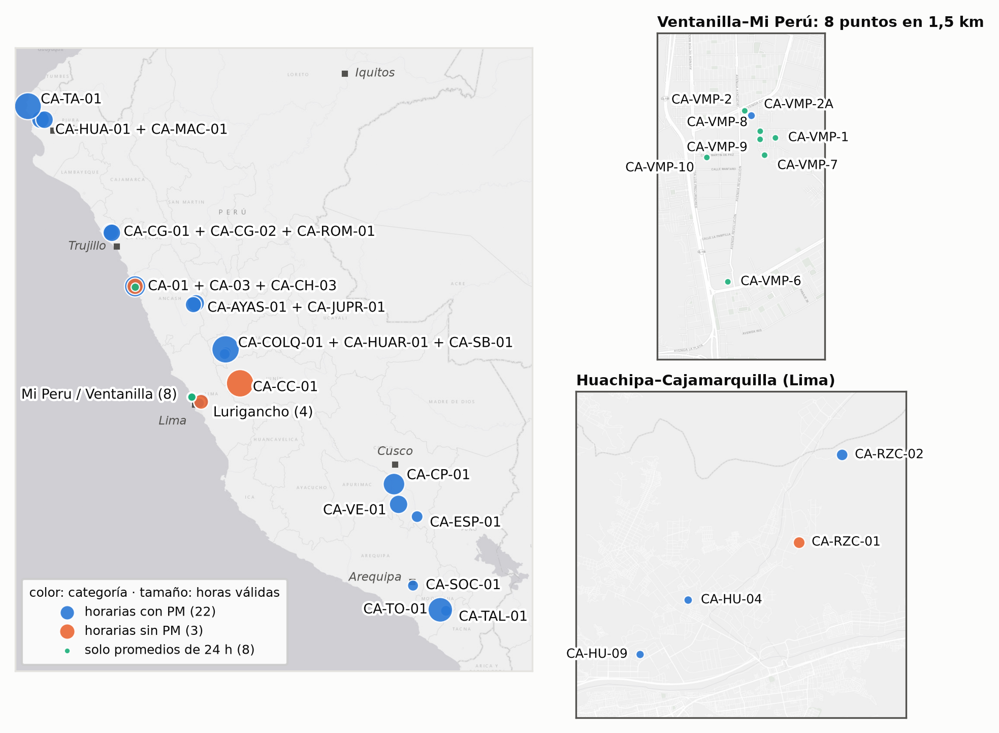
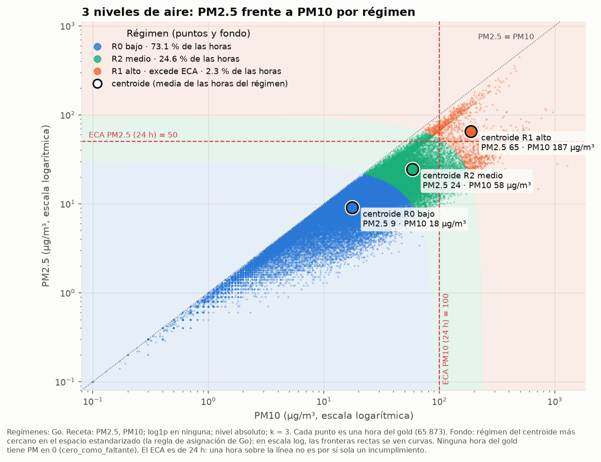
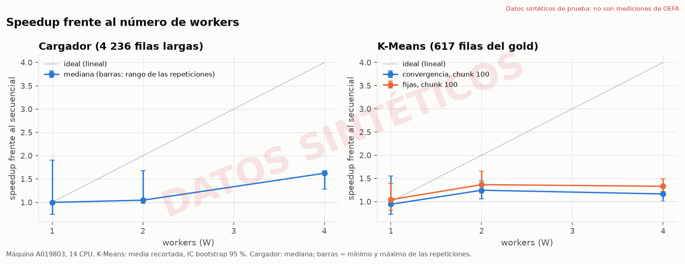
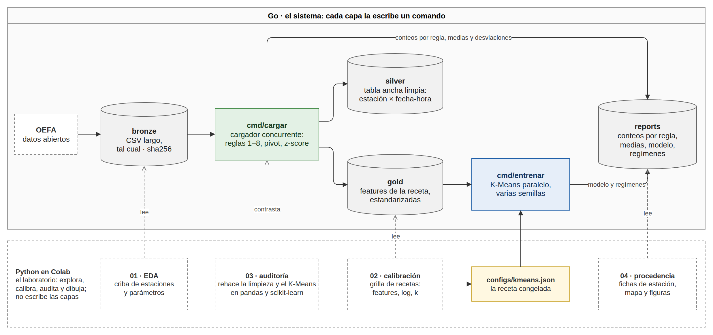
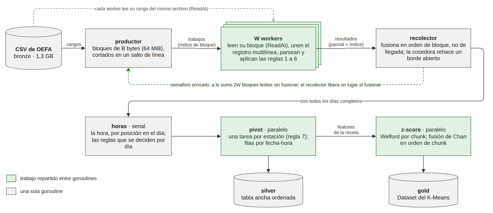
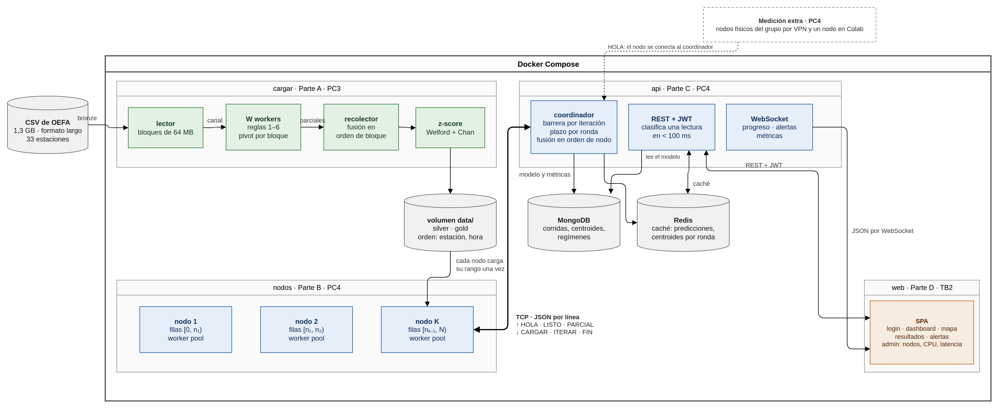
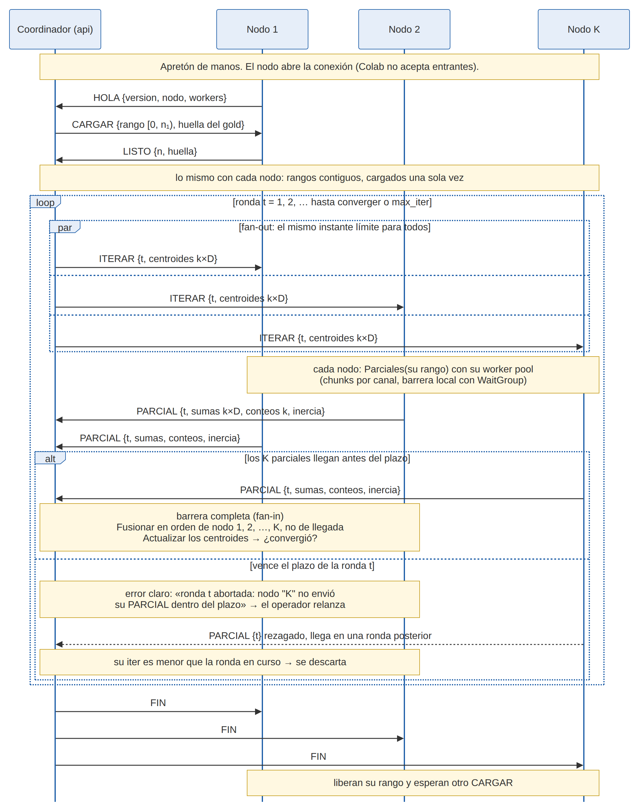

<a id="inicio"></a>

<div align="center">

<h1>aire-distribuido</h1>

<p>
  <strong>Regímenes de calidad del aire con K-Means paralelo en Go sobre 2,9 millones de lecturas de OEFA</strong>,<br>
  con un cargador concurrente que reparte un CSV de 1,3 GB entre goroutines<br>
  y un K-Means distribuido por TCP, diseñado y con su protocolo probado.
</p>

<p>
  Trabajo Final del curso <em>Programación Concurrente y Distribuida</em> (UPC 1ACC0065, ciclo 2026-20) ·
  caso 10, calidad del aire
</p>

<p>
  
  
  
  
  <a href="https://github.com/R0SEWT/aire-distribuido/tree/pc3.1"></a>
</p>

<p>
  <a href="#que-es">Qué es</a> ·
  <a href="#resultados">Resultados</a> ·
  <a href="#como-esta-hecho">Cómo está hecho</a> ·
  <a href="#avance">Avance</a> ·
  <a href="#empezar">Empezar</a> ·
  <a href="#mapa">Mapa del repo</a> ·
  <a href="#datos">Datos</a> ·
  <a href="#convenciones">Convenciones</a> ·
  <a href="#equipo">Equipo</a>
</p>

</div>

<details>
  <summary>Contenido</summary>
  <ol>
    <li><a href="#que-es">Qué es</a></li>
    <li><a href="#resultados">Resultados</a></li>
    <li><a href="#como-esta-hecho">Cómo está hecho</a></li>
    <li><a href="#avance">Avance</a></li>
    <li><a href="#empezar">Empezar</a></li>
    <li><a href="#mapa">Mapa del repo</a></li>
    <li><a href="#datos">Datos</a></li>
    <li><a href="#convenciones">Convenciones</a></li>
    <li><a href="#equipo">Equipo</a></li>
  </ol>
</details>

<a id="que-es"></a>

## Qué es

<p align="center">
  
  <br><sub>Las 33 estaciones de OEFA del dataset. El tamaño es la cantidad de horas válidas; los recuadros, las dos zonas de Lima con varias estaciones juntas.</sub>
</p>

El Organismo de Evaluación y Fiscalización Ambiental (OEFA) publica las lecturas horarias de calidad
del aire que toma junto a las actividades que fiscaliza: un CSV de 1,3 GB con 2 883 877 filas de 33
estaciones, de 2018 a 2022. La pregunta del proyecto es **en qué estaciones y a qué horas el aire
entra en un nivel alto de PM2,5 y PM10, y con cuánta anticipación eso avisa de un episodio que
supera el Estándar de Calidad Ambiental (ECA)**. La PC3 responde el dónde y el cuándo; la
anticipación se mide en el TB2.

El sistema tiene las cuatro partes del enunciado, todas en Go con la biblioteca estándar:

| Parte | Qué hace | Entregable |
|---|---|---|
| A. Cargador | Lee el CSV de OEFA por bloques con goroutines, aplica las reglas de limpieza, pivota y estandariza | PC3 |
| B. K-Means | Cada worker (o, en la PC4, cada nodo) calcula sumas parciales; el coordinador recalcula los centroides | PC3 en paralelo; PC4 distribuido por TCP |
| C. API coordinadora | REST y WebSocket; clasifica una lectura en menos de 100 ms, con MongoDB y Redis | PC4 |
| D. Frontend | Mapa de estaciones con su régimen y las alertas en vivo | TB2 |

> [!WARNING]
> **Una zona sin estación no es una zona con aire limpio.** OEFA mide donde fiscaliza (minas,
> fundiciones, refinerías, agroindustria, corredores viales, ladrilleras), no donde vive la gente:
> 10 de las 25 regiones tienen alguna estación. El mapa y el informe lo dicen tal cual.

<p align="right">(<a href="#inicio">volver arriba</a>)</p>

<a id="resultados"></a>

## Resultados

La receta, elegida con 1 080 corridas de calibración, agrupa las 65 873 horas-estación con PM2,5 y
PM10 completos en **tres niveles de aire**:

| Nivel | Horas | PM2,5 medio | PM10 medio | Frente al ECA de 24 h |
|---|---:|---:|---:|---|
| Bajo | 73,1 % | 9,0 µg/m³ | 17,6 µg/m³ | no lo excede |
| Medio | 24,6 % | 24,4 µg/m³ | 58,2 µg/m³ | no lo excede |
| **Alto** | **2,3 %** | **65,1 µg/m³** | **186,7 µg/m³** | **lo excede** |

<p align="center">
  
</p>

- **El nivel alto cae de mañana**, con el pico a las 08:00, y se concentra en pocas estaciones,
  encabezadas por CA-CP-01 en Cusco, a 3 600 m. Su fracción fina es la menor de los tres niveles
  (0,35), lo que apunta a polvo antes que a combustión.
- **Ningún K-Means aísla los episodios.** El nivel alto recoge el 44 % de las horas en que el
  promedio de 24 horas supera el ECA: la alerta necesita el nivel y el ECA juntos.
- **Los límites van a la vista.** El 30 % del nivel alto sale de campañas de pocas semanas en Lima,
  y el 61 % del gold es de 2022.

Rendimiento con 12 workers frente a 1, en la laptop de desarrollo (14 CPU lógicas):

| Etapa | 1 worker | 12 workers | Speedup (IC 95 %) | Mismo resultado |
|---|---:|---:|---:|---|
| Cargador, CSV completo de 1,3 GB | 6,68 s | 1,35 s | 4,94× [4,66; 5,21] | silver y gold idénticos para todo W |
| K-Means hasta converger, chunks de 1 000 filas | 91,5 ms | 24,8 ms | 3,86× [3,28; 4,60] | bit a bit para todo W |

> [!NOTE]
> **Cómo leer el speedup.** Es el tiempo con un worker dividido por el tiempo con doce, **en la
> misma máquina**. No llega a 12× porque repartir cuesta: en el cargador, la fusión en orden y las
> fases seriales; en el K-Means, que cada iteración dura 2 ms y la barrera pesa. Con chunks de
> 10 000 filas solo hay 7 chunks para 12 workers y el speedup baja a 2,25×.

- **La hora se reconstruye por posición** en el 93 % de las lecturas, que no la traen; la regla
  coincide con la hora explícita en el 100 % de las que sí la traen.
- **Un 0 de OEFA es un faltante, no aire limpio.** El 26,4 % de las filas son días enteros en 0
  de un equipo que no midió.
- **Una auditoría independiente** rehace la limpieza y el K-Means en pandas y scikit-learn: 40 de
  40 chequeos sin diferencias.

<p align="center">
  
</p>

Todas las cifras salen de los JSON de [`reports/`](reports/). El detalle, con sus figuras y tablas,
está en el informe de la PC3, en [`docs/informe/`](docs/informe/).

<p align="right">(<a href="#inicio">volver arriba</a>)</p>

<a id="como-esta-hecho"></a>

## Cómo está hecho

<p align="center">
  
</p>

El dato recorre las capas en un solo sentido. `cmd/cargar` lee el bronze y escribe el silver, el
gold y los conteos de cada regla; `cmd/entrenar` corre el K-Means sobre el gold con la receta que
congeló la calibración. Python, en Colab, explora, calibra, audita y dibuja, pero no escribe ninguna
capa.

| Pieza | Patrón | Sincronización |
|---|---|---|
| Cargador | Productor → W workers → recolector, por canales | Semáforo de 2W bloques en vuelo; fusión en orden de bloque, no de llegada |
| Pivot y z-score | Una tarea por estación; Welford por chunk | `sync.WaitGroup`; fusión de Chan en orden de chunk |
| K-Means | Worker pool persistente; los chunks van por un canal | Una barrera `sync.WaitGroup` por iteración; cada worker escribe solo su parcial, sin `Mutex` |
| Semillas | Varias corridas completas a la vez | Ninguna: solo comparten los datos, de solo lectura |
| K-Means distribuido (PC4) | Coordinador y K nodos, JSON por línea sobre TCP | Barrera por ronda a través de la red, con plazo; fusión en orden de nodo |

<details>
  <summary>Más diagramas: el cargador por dentro, la arquitectura y una ronda distribuida</summary>
  <p align="center">
    
    <br><br>
    
    <br><br>
    
  </p>
  Las fuentes son los <code>.drawio</code> de <a href="docs/diagramas/">docs/diagramas/</a>.
</details>

> [!NOTE]
> **El mismo código en una máquina y en el clúster.** `kmeans/parciales.go` divide el K-Means en
> `Parciales`, `Fusionar` y `Actualizar`. En la PC3 llama a `Parciales` un worker sobre su chunk; en
> la PC4, un nodo sobre su partición. La barrera de una ronda por la red ya está escrita y probada en
> `protocolo/`, incluidos el plazo que vence y el parcial rezagado que se descarta.

> [!IMPORTANT]
> **Ninguna cifra a mano.** El informe se escribe en Quarto y sale a Word; sus tablas y cifras se
> generan desde `reports/*.json` con `docs/informe/tablas.py`, y los fragmentos de código se copian
> del código fuente al renderizar.

<p align="right">(<a href="#inicio">volver arriba</a>)</p>

<a id="avance"></a>

## Avance

| Entregable | Qué lleva | Semana | Estado |
|---|---|---:|---|
| PC3 · Entregable 1 | Cargador concurrente, K-Means paralelo, diseño distribuido e informe | 11 | Entregada: tag [`pc3.1`](https://github.com/R0SEWT/aire-distribuido/tree/pc3.1) |
| PC4 · Entregable 2 | Clúster de nodos por TCP, API coordinadora, Docker Compose y el protocolo verificado con Spin | 13 | Pendiente |
| TB2 · Entregable final | Frontend con el mapa y las alertas, anticipación de los episodios, video | 15 | Pendiente |

Las tareas viven en el [tablero Kanban](https://github.com/users/R0SEWT/projects/8) y en beads.

<p align="right">(<a href="#inicio">volver arriba</a>)</p>

<a id="empezar"></a>

## Empezar

**Requisitos:** Go 1.26. Docker es opcional. Para renderizar el informe hacen falta además
[Quarto](https://quarto.org) y Python con pandas, o [uv](https://docs.astral.sh/uv/).

**1. Pruebas.** Toda prueba de concurrencia corre con el detector de carreras:

```bash
go test -race ./...
```

**2. Con la muestra, sin descargar nada.** `data/sample/` trae 4 491 registros reales copiados del
CSV de OEFA. Las salidas van a una carpeta temporal para no pisar los `reports/` versionados:

```bash
T=$(mktemp -d)
go run ./cmd/cargar -entrada data/sample/oefa_real_muestra.csv \
  -silver "$T/silver.csv" -gold "$T/gold.csv" -reports "$T"
go run ./cmd/entrenar -gold "$T/gold.csv" -estandarizacion "$T/estandarizacion.json" \
  -salida "$T/kmeans.json" -asignaciones "$T/asignaciones.csv" -regimenes "$T/regimenes.json" \
  -centroides ""
```

**3. Con el CSV completo.** Se baja del portal (1,3 GB) a `data/bronze/`; aquí sí se reescriben
`data/` y `reports/`:

```bash
mkdir -p data/bronze
curl -L -o data/bronze/oefa.csv "https://www.datosabiertos.gob.pe/sites/default/files/1a_Vigilancia%20y%20Seguimiento%20ambiental%20en%20la%20calidad%20del%20aire.csv"
go run ./cmd/cargar -entrada data/bronze/oefa.csv
go run ./cmd/entrenar -codo 2:10
```

Debería terminar con 65 873 horas-estación en el gold y tres regímenes, con una inercia de
50 950,4.

**4. Los benchmarks.** Escriben `reports/benchmark_cargador.json` y `reports/benchmark_kmeans.json`:

```bash
go run ./cmd/cargar -entrada data/bronze/oefa.csv -bench 10 -workers 1,2,4,8,12
go run ./cmd/benchmark -workers 1,2,4,8,12
```

**5. En Docker.** La imagen final es distroless y corre sin root, así que las carpetas montadas
tienen que admitir escritura:

```bash
docker build -t aire-distribuido .
docker run --rm -v "$PWD/data:/app/data" -v "$PWD/reports:/app/reports" \
  aire-distribuido cargar -entrada data/bronze/oefa.csv
```

**6. El informe.** Deja un `.docx` por integrante en `docs/informe/salida/`:

```bash
bash docs/informe/render.sh
```

<p align="right">(<a href="#inicio">volver arriba</a>)</p>

<a id="mapa"></a>

## Mapa del repo

| Ruta | Qué hay |
|------|---------|
| `datos/`, `cmd/cargar/` | Parte A: el cargador concurrente. Bloques por bytes, workers, recolector en orden, pivot por estación y z-score por chunk. |
| `kmeans/`, `cmd/entrenar/`, `cmd/benchmark/` | Parte B: el K-Means secuencial y el paralelo, las semillas, los regímenes frente al ECA, el codo y el benchmark. |
| `protocolo/` | Los mensajes entre el coordinador y los nodos, su codificación y la barrera de una ronda, con pruebas. |
| `configs/` | `limpieza.json` (columnas, unidades, centinelas y rangos) y `kmeans.json` (la receta congelada). |
| `reports/` | Lo que escriben los comandos: conteos, estandarización, modelo, regímenes, benchmarks y auditoría. |
| `notebooks/` | El laboratorio en Colab: EDA, calibración, auditoría y figuras, procedencia y mapa. |
| `docs/informe/` | El informe en Quarto, con su plantilla de Word, el filtro y el empaquetado de la entrega. |
| `docs/diagramas/` | Los diagramas en draw.io y sus PNG. |
| `docs/diseno.md`, `docs/specs/` | El diseño del sistema y las specs de cada parte. |
| `data/` | Solo el README y la muestra; el resto no se versiona. |

<p align="right">(<a href="#inicio">volver arriba</a>)</p>

<a id="datos"></a>

## Datos

[*Vigilancia y seguimiento ambiental en la calidad del aire*](https://www.datosabiertos.gob.pe/dataset/vigilancia-y-seguimiento-ambiental-en-la-calidad-del-aire-organismo-de-evaluaci%C3%B3n-y),
de OEFA, en la Plataforma Nacional de Datos Abiertos del Perú, con licencia
[ODC-By](https://opendatacommons.org/licenses/by/): el uso exige citar a OEFA como fuente. El
modelo usa solo OEFA. La red de SENAMHI en Lima queda para un contraste en el TB2. Detalle de
ambas fuentes en [`data/README.md`](data/README.md).

> Organismo de Evaluación y Fiscalización Ambiental. (2026). *Vigilancia y seguimiento ambiental en
> la calidad del aire* [Conjunto de datos]. Plataforma Nacional de Datos Abiertos.

> [!IMPORTANT]
> Los datos no se versionan: el CSV pesa 1,3 GB. El repositorio lleva solo `data/sample/`, para las
> pruebas y la integración continua.

<p align="right">(<a href="#inicio">volver arriba</a>)</p>

<a id="convenciones"></a>

## Convenciones

- **TDD y `-race`**: el test va antes que la goroutine. Un test que pasa sin `-race` no demuestra
  nada sobre una sección crítica.
- **Determinismo**: las reducciones suman en un orden fijo (de bloque, de chunk o de nodo), nunca en
  el de llegada, y nunca se itera un mapa para escribir.
- **Git Flow**: `develop` es la rama por defecto. Una rama `feature/*` por pieza, PR revisada, y
  cada entrega sale de `release/<entregable>` hacia `main`, con tag (`pc3.1`, …).
- **Ninguna cifra a mano** en el informe: todo sale de `reports/`.
- **Tareas en beads** y en el tablero Kanban, no en TODOs sueltos.
- **IA como herramienta**: para auditar código, contrastar contra la teoría y revisar el informe;
  cada hallazgo se verifica contra el código y las pruebas.

Las reglas completas están en [`CLAUDE.md`](CLAUDE.md).

<p align="right">(<a href="#inicio">volver arriba</a>)</p>

<a id="equipo"></a>

## Equipo

<div align="center">
<table>
  <tr>
    <td align="center" width="170">
      <a href="https://github.com/R0SEWT">
        <br>
        <b>Rody Vilchez</b><br><sub>@R0SEWT · coordinador</sub>
      </a>
    </td>
    <td align="center" width="170">
      <a href="https://github.com/dnnygz">
        <br>
        <b>Dayana Gómez</b><br><sub>@dnnygz</sub>
      </a>
    </td>
    <td align="center" width="170">
      <a href="https://github.com/ElJulioGG">
        <br>
        <b>Julio Meza</b><br><sub>@ElJulioGG</sub>
      </a>
    </td>
  </tr>
</table>
</div>

<p align="center"><sub>Equipo 4: Aire Distribuido · Programación Concurrente y Distribuida · UPC · Ciclo 2026-20</sub></p>

<p align="right">(<a href="#inicio">volver arriba</a>)</p>
