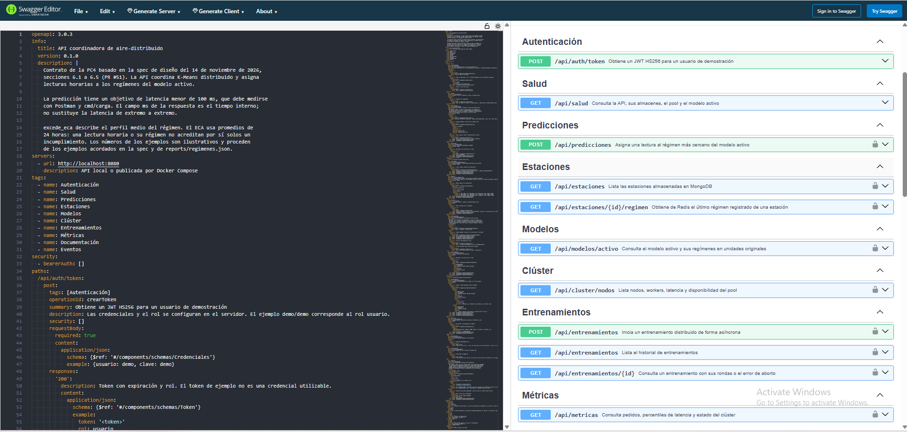

# Contrato de la API coordinadora

[`openapi.yaml`](openapi.yaml) describe las 13 rutas y 14 operaciones de la PC4, según las secciones
6.1–6.5 de la [spec del equipo (PR #51)](https://github.com/R0SEWT/aire-distribuido/pull/51).
J1 define el contrato para implementar la API y preparar Postman en paralelo. Este archivo no
implementa `cmd/api` ni demuestra que la API cumpla su objetivo de latencia.

## Validación reproducible

Desde la raíz del repositorio, con [uv](https://docs.astral.sh/uv/):

```bash
uv run scripts/validar-openapi.py
```

El validador comprueba OpenAPI 3.0.3, referencias, claves YAML duplicadas, cobertura de rutas,
autenticación, roles y cada ejemplo de petición, respuesta y evento. También comprueba que se
rechacen concentraciones negativas, fecha inválida, estación vacía y pedidos con cero nodos o
réplicas. No levanta la API ni envía peticiones de entrenamiento.

Para reproducir la aceptación visual de J1, importar el archivo en
[Swagger Editor](https://editor.swagger.io/) con **File → Import file**. La
[captura de la validación](../informe/capturas/pc4/swagger-editor.png) muestra el contrato
cargado, el título y la versión OpenAPI en el YAML y las operaciones renderizadas, sin un
panel de errores visible. El encuadre contiene solo Swagger Editor, sin la barra de tareas.
La evidencia se incorpora a la PR de J1 junto con la validación por consola.



## Acceso y ejemplos

Las rutas de token, salud, YAML y Swagger UI son públicas. Las de clúster, entrenamientos y
métricas requieren `admin`; predicciones, estaciones, modelo y eventos admiten `usuario` o `admin`.
`x-roles` documenta los roles porque HTTP bearer en OpenAPI no usa scopes OAuth.

Los ejemplos de §6.5 se conservan: token de demostración, salud, lectura y predicción,
modelo con sus tres regímenes, nodo, entrenamiento aceptado y terminado, errores 409/422 y
métricas. El marcador `<token>` representa el JWT que emitirá la API. Las concentraciones
llegan en µg/m³ sin estandarizar. `ms` es tiempo interno; Postman y `cmd/carga` medirán la latencia
de extremo a extremo en las tareas siguientes.

El ECA corresponde a un promedio de 24 horas. `excede_eca` describe la media del régimen, y
una lectura horaria clasificada no demuestra un incumplimiento. Los índices de régimen no
representan un orden de gravedad.

## Precisiones para integrar con la API

La spec no da el JSON público de cada estación, ni fija el nombre del estado de aborto ni todos
los errores. Este contrato propone `id` para exponer `_id`, metadata de estación opcional,
`abortado` como estado y errores 404/503 cuando falta el recurso o el servicio requerido.
Son decisiones de contrato para revisar con quien implemente la API; no afirman que ya exista
ese comportamiento. Los ejemplos nuevos usan datos mínimos y no inventan coordenadas.

El entrenamiento responde 202; otro simultáneo recibe 409 y la falta de nodos recibe 422.
Las réplicas mayores que uno sirven para medir y no activan un modelo. Un nodo caído aborta la
corrida y queda nombrado en el error. El punto de control de Redis no implica reanudación.

`/ws` documenta el handshake HTTP 101 y el JWT en la consulta `token`. La extensión
`x-websocket-events` describe los payloads de `entrenamiento.ronda` y `entrenamiento.fin`,
incluyendo el fin por error. La envoltura que identifica el tipo de evento en cada trama no
está definida en §6.4: debe acordarse al implementar el WebSocket. Swagger UI no sustituye un
cliente WebSocket.

El formato se basa en la [especificación oficial OpenAPI 3.0.3](https://spec.openapis.org/oas/v3.0.3.html).
La versión elegida permite usar Swagger Editor y las herramientas de Postman sin depender de
características más recientes de JSON Schema.
