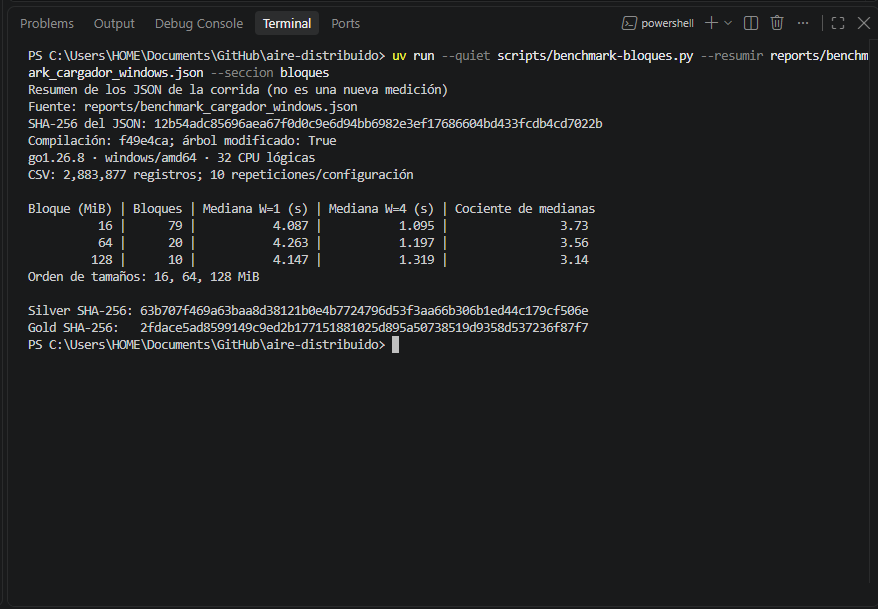
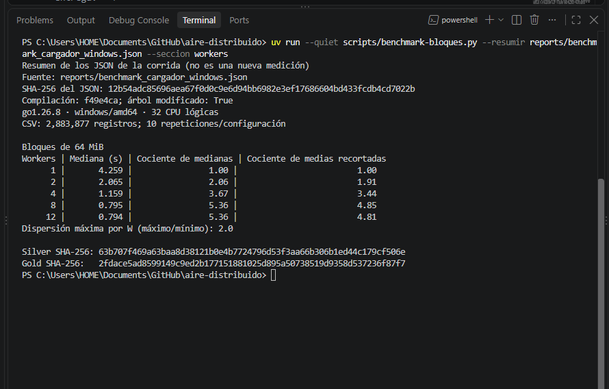

# Tamaño de bloque del cargador concurrente

El [benchmark publicado de Linux](../reports/benchmark_cargador.json) varió los workers con bloques de 64 MiB. El complemento de Windows varía también el tamaño de bloque y comprueba las huellas de ambas salidas.

## Piloto con la muestra real

El piloto con `data/sample/oefa_real_muestra.csv` sirvió para probar el script y la conservación de las salidas antes de medir el CSV completo. También se reprodujeron en Linux las mismas huellas: silver `cedaf76bd37dcf1f0b3950272ee2fc4057b1e9d54a06cb4c37fbe2cfd9e63edb` y gold `8aecd1d26fb3d40d1bdda7c50d988c532d1cefe6fa0efec403e1a8c9012a8d89`. Los tiempos del piloto no se usan para elegir el tamaño del archivo completo.

## Resultados con el CSV completo

La fuente es [`reports/benchmark_cargador_windows.json`](../reports/benchmark_cargador_windows.json), con una copia idéntica en `docs/informe/generado/`. Los cuatro registros conservan los tiempos originales y sus metadatos: binario compilado del commit `f49e4ca`, con el árbol modificado por un overlay temporal que omitía la llamada Linux a `Getrusage`. El cargador no usa esa función. Así se midió. La compatibilidad de Windows de la PR #50 ya está integrada: las reproducciones actuales se compilan sin ese overlay; los metadatos de la medición histórica se conservan.

Los dos JSON conservan los bytes de la evidencia de Windows, incluidos sus saltos CRLF. Las reglas específicas `-text` de `.gitattributes` impiden que Git los normalice y cambie el SHA-256 que muestran las capturas al clonar en otro sistema. Las configuraciones de Go siguen usando LF.

Las tablas se generan desde esos registros con `tablas.py`:

- [Prueba de tamaños de bloque](informe/generado/tablas/benchmark_cargador_windows_bloques.md).
- [Prueba de cantidad de workers](informe/generado/tablas/benchmark_cargador_windows_workers.md).

Hay una serie por tamaño, ejecutada en orden ascendente en un equipo Windows. Las primeras repeticiones de cada serie fueron más rápidas; se conservan todas y el resumen usa el cociente de medianas. La dispersión por W, la comparación con Linux y las condiciones completas se generan en el informe desde los JSON. Estos equipos también difieren en hardware y versión de Go.

Se mantienen 64 MiB como valor por defecto. Antes de adoptar otro tamaño, falta comparar con ocho y doce workers y en Linux, variando el orden y registrando las condiciones de energía y el calentamiento.

## Reproducir las mediciones

Se necesita Python 3.11 o posterior y el binario de `cmd/cargar` compilado localmente. En Linux, desde la raíz del repo:

```bash
go build -o /tmp/aire-cargar ./cmd/cargar
python3 scripts/benchmark-bloques.py /tmp/aire-cargar data/bronze/oefa.csv /tmp/aire-bloques --tamanos 64,16,128
```

En Windows, con Go y `uv` instalados, desde la raíz del repo:

```powershell
$cargadorBenchmark = Join-Path $env:TEMP 'aire-cargar.exe'
$salidaBenchmark = Join-Path $env:TEMP ('aire-bloques-' + (Get-Date -Format 'yyyyMMdd-HHmmss'))
go build -tags timetzdata -o $cargadorBenchmark ./cmd/cargar
if ($LASTEXITCODE -ne 0) { throw 'No se pudo compilar el cargador' }
uv run --quiet scripts/benchmark-bloques.py $cargadorBenchmark data/bronze/oefa.csv $salidaBenchmark --tamanos 64,16,128
```

La etiqueta `timetzdata` incorpora las zonas horarias en el ejecutable, incluida
`America/Lima`; así no depende de encontrar `zoneinfo.zip` de Go al ejecutarlo
en otro Windows.

Para comprobar el control del piloto sin medir el CSV completo, añade `--piloto` al
último comando; no sustituye la medición histórica del informe. Cada ejecución debe
usar un directorio de salida nuevo.

`--piloto` usa la muestra y tamaños en KiB. El script verifica el SHA-256 del CSV completo y las salidas, rechaza scripts `.bat`/`.cmd`, aplica un plazo por tamaño (`--timeout`, 600 segundos por defecto), guarda los JSON y `terminal.txt`, y registra el orden usado en `resumen.md`. El directorio de salida debe ser nuevo.

Para la prueba de workers se usa el mismo binario, CSV y equipo:

```bash
/tmp/aire-cargar -entrada data/bronze/oefa.csv -bloque 64MB -workers 1,2,4,8,12 -bench 10 -silver /tmp/silver.csv -gold /tmp/gold.csv -reports /tmp/aire-workers
```

## Agrupar y verificar la procedencia

El agrupador recibe las tres salidas de tamaños, en su orden de ejecución, y después la de workers. Conserva los tiempos y metadatos; normaliza `entrada` y elimina únicamente `host` y `metadatos.maquina`:

```bash
python3 scripts/benchmark-bloques.py --agrupar /tmp/aire-bloques/64MiB/benchmark_cargador.json /tmp/aire-bloques/16MiB/benchmark_cargador.json /tmp/aire-bloques/128MiB/benchmark_cargador.json /tmp/aire-workers/benchmark_cargador.json --destino /tmp/benchmark_cargador_windows.json
```

El archivo histórico versionado mantiene el orden original. Para comprobar su copia y regenerar las cifras:

```bash
cmp reports/benchmark_cargador_windows.json docs/informe/generado/benchmark_cargador_windows.json
cd docs/informe
python3 tablas.py --entrada ../../reports --estricto
```

## Resumen reproducible de los JSON

Las dos evidencias son capturas reales de la terminal con el comando del script versionado y el SHA-256 de la fuente a la vista. Muestran resúmenes de los registros conservados; no corresponden a nuevas mediciones del cargador.

```powershell
uv run --quiet scripts/benchmark-bloques.py --resumir reports/benchmark_cargador_windows.json --seccion bloques
uv run --quiet scripts/benchmark-bloques.py --resumir reports/benchmark_cargador_windows.json --seccion workers
```

Si se limpia la pantalla con `Clear-Host`, ejecutarlo por separado, esperar el prompt y después introducir el comando del resumen. Así la captura conserva la línea de ejecución.




