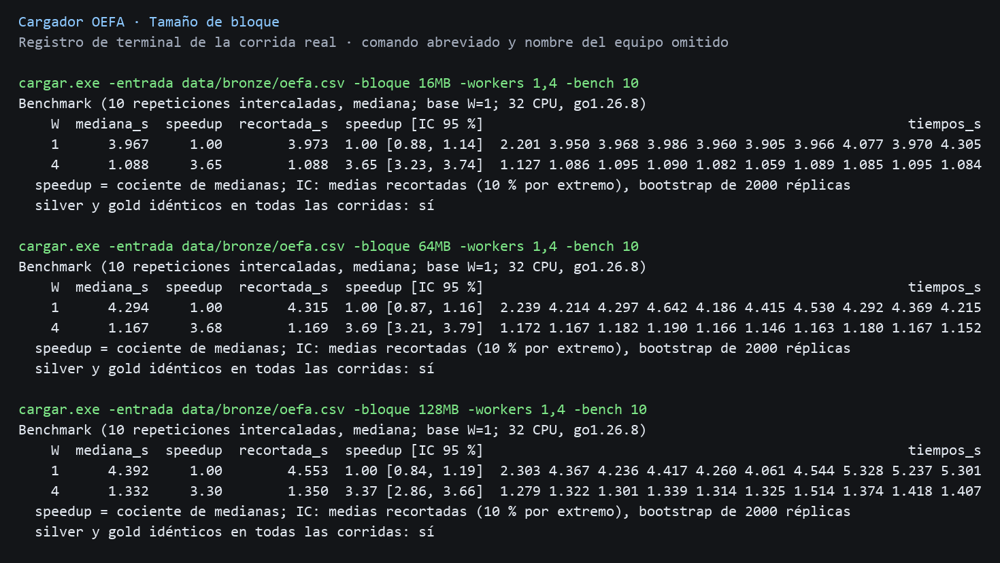
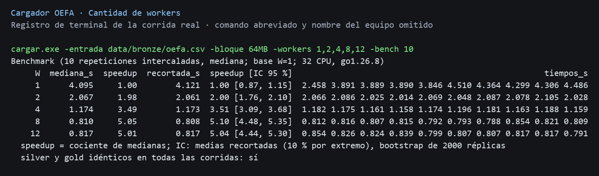

# Tamaño de bloque del cargador concurrente

El [benchmark publicado](../reports/benchmark_cargador.json) varió los workers con bloques de 64 MiB. Este experimento varía también el tamaño de bloque y verifica si las dos salidas conservan su contenido.

## Piloto con la muestra real

Se usó `data/sample/oefa_real_muestra.csv` (4 491 registros), el commit `8ef264f`, Go 1.26.8 en Windows amd64 y el chunk de estandarización de 1 000 filas. Se midieron diez repeticiones por combinación. Dentro de cada tamaño se intercalaron las corridas de uno y cuatro workers. El tiempo medido incluye lectura, limpieza, pivot y estandarización, y excluye la escritura de los archivos.

Para compilar el piloto en Windows se usó un overlay temporal que omite la llamada Linux a `Getrusage`. El cargador y su benchmark no llaman a esa función. Las pruebas completas también se ejecutaron en Windows con ese overlay. Los comandos de reproducción de esta nota son para Linux.

| Tamaño | Bloques | Mediana con 1 worker | Mediana con 4 workers | Cociente de medianas |
|---|---:|---:|---:|---:|
| 16 KiB | 114 | 5,422 ms | 3,260 ms | 1,66× |
| 64 KiB | 29 | 3,920 ms | 2,216 ms | 1,77× |
| 128 KiB | 15 | 3,684 ms | 2,572 ms | 1,43× |

Las 60 corridas conservaron las salidas. El benchmark comprobó las huellas por repetición y la comparación entre tamaños dio los mismos SHA-256:

- Silver: `cedaf76bd37dcf1f0b3950272ee2fc4057b1e9d54a06cb4c37fbe2cfd9e63edb`
- Gold: `8aecd1d26fb3d40d1bdda7c50d988c532d1cefe6fa0efec403e1a8c9012a8d89`

Con cuatro workers, 64 KiB obtuvo la menor mediana en esta primera serie. Al repetir el piloto con el script, 64 y 128 KiB quedaron casi empatados (2,580 y 2,567 ms), con las mismas huellas. Las series se hicieron por tamaño en orden ascendente y con un archivo de menos de 2 MiB. La elección del tamaño para el archivo completo requiere la corrida siguiente.

## Resultados con el CSV completo

Se midió el 6 de noviembre de 2026 con los 2 883 877 registros del informe (1 317 949 839 bytes), el commit `8ef264f` y el mismo binario de Go 1.26.8 para Windows amd64 del piloto, con 32 CPU lógicas y un chunk de 1 000 filas. El binario usó el overlay temporal descrito arriba. Se hicieron diez repeticiones por combinación, intercalando uno y cuatro workers dentro de cada tamaño. Los tamaños se probaron en orden ascendente.

| Tamaño | Bloques | Mediana con 1 worker | Mediana con 4 workers | Mejora al pasar a 4 workers |
|---|---:|---:|---:|---:|
| 16 MiB | 79 | 3,967 s | 1,088 s | 3,65× |
| 64 MiB | 20 | 4,294 s | 1,167 s | 3,68× |
| 128 MiB | 10 | 4,392 s | 1,332 s | 3,30× |

Con cuatro workers, 16 MiB redujo la mediana un **6,8 %** respecto de 64 MiB. Los tiempos observados con cuatro workers fueron 1,059–1,127 s para 16 MiB, 1,146–1,190 s para 64 MiB y 1,279–1,514 s para 128 MiB. **16 MiB fue el tamaño más rápido en este equipo y en esta serie.** Se mantienen 64 MiB como valor por defecto. Antes de adoptar 16 MiB, falta comparar ambos tamaños con ocho y doce workers y en Linux, variando el orden de las pruebas.

Las 60 mediciones conservaron `silver` y `gold` byte a byte. Ambas huellas también coinciden con las del benchmark publicado:

- Silver: `63b707f469a63baa8d38121b0e4b7724796d53f3aa66b306b1ed44c179cf506e`
- Gold: `2fdace5ad8599149c9ed2b177151881025d895a50738519d9358d537236f87f7`



## Escalabilidad con bloques de 64 MiB

La segunda prueba mantuvo 64 MiB por bloque y varió el número de workers. Se usaron el mismo CSV, equipo Windows y binario que en la prueba de tamaños, con diez repeticiones intercaladas por configuración. La comparación usa la mediana de cada serie y la aceleración respecto de un worker en el mismo equipo. La referencia de Linux proviene del [benchmark publicado](../reports/benchmark_cargador.json).

| Workers | Mediana en Windows | Aceleración en Windows | Mediana en Linux | Aceleración en Linux |
|---:|---:|---:|---:|---:|
| 1 | 4,095 s | 1,00× | 6,683 s | 1,00× |
| 2 | 2,067 s | 1,98× | 3,678 s | 1,82× |
| 4 | 1,174 s | 3,49× | 2,355 s | 2,84× |
| 8 | 0,810 s | 5,05× | 1,585 s | 4,22× |
| 12 | 0,817 s | 5,01× | 1,349 s | 4,95× |

En el equipo Windows, ocho workers dieron la menor mediana. Con doce, la diferencia fue de solo 7 ms y los tiempos observados se solapan, así que esta serie muestra una meseta entre ocho y doce. La comparación describe dos equipos con hardware y versiones de Go distintos, además del sistema operativo.

Las 50 mediciones conservaron las mismas huellas de `silver` y `gold` que la prueba de tamaños y la referencia publicada.



Los cuatro registros completos de estas pruebas están agrupados en [`benchmark_cargador_windows.json`](informe/generado/benchmark_cargador_windows.json). Se normalizó la ruta del CSV y se omitió el nombre del equipo. El informe genera sus tablas desde esos registros con `tablas.py`.

## Cómo reproducir la corrida completa

Desde la raíz del repositorio en Linux, coloca el archivo de OEFA en `data/bronze/oefa.csv`. El script requiere Python 3.11 o posterior. Comprueba la huella del CSV antes de medir y compara las salidas de todos los tamaños. Guarda las medianas, las huellas, los JSON y el registro de terminal.

```bash
binarios=$(mktemp -d)
go build -o "$binarios/cargar" ./cmd/cargar
python3 scripts/benchmark-bloques.py "$binarios/cargar" data/bronze/oefa.csv "$binarios/resultados"
```

El script genera `resumen.md` dentro del directorio de salida que se indica como tercer argumento. En el ejemplo, ese directorio es `$binarios/resultados`. Para replicar el piloto, pasa `data/sample/oefa_real_muestra.csv`, elige otro directorio de salida y añade `--piloto`. Si la corrida completa muestra diferencias pequeñas, repite la serie cambiando el orden de los tamaños antes de recomendar una configuración.

Para repetir la prueba de escalabilidad con el mismo binario, ejecutar:

```bash
corrida="$binarios/workers-64MiB"
mkdir -p "$corrida"
"$binarios/cargar" -entrada data/bronze/oefa.csv -bloque 64MB \
  -workers 1,2,4,8,12 -bench 10 -silver "$corrida/silver.csv" \
  -gold "$corrida/gold.csv" -reports "$corrida"
```
