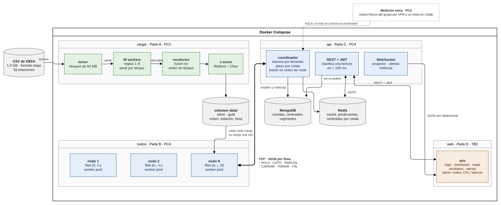
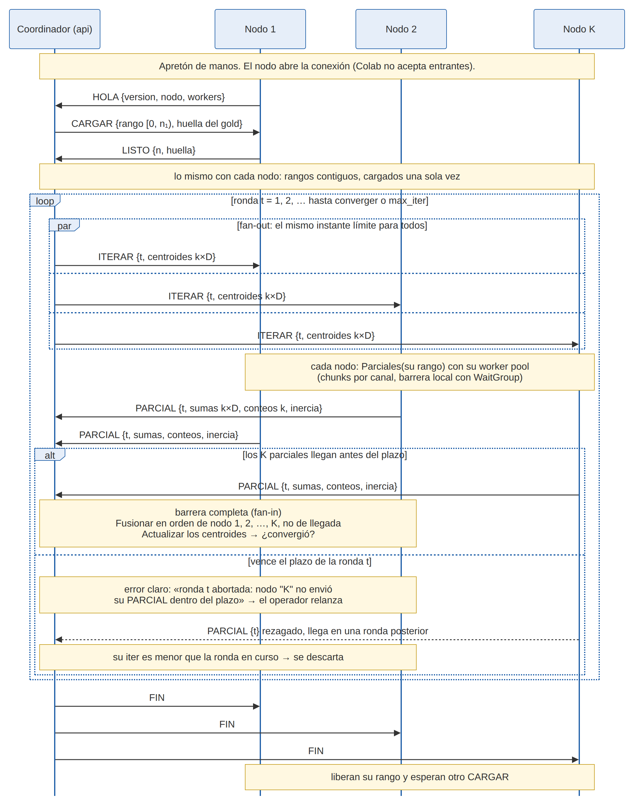

# Diseño del K-Means paralelo y distribuido

Fuente de los puntos «Diseño del modelo ML distribuido» y «Paralelización del cálculo» del informe de
la PC3. Desarrolla las secciones 5 a 7 de la
[spec de la PC3](superpowers/specs/2026-10-31-pc3-design.md) y continúa el diseño del K-Means del TP
(`../concurrente/tp/docs/kmeans.md`), del que se porta el paquete `kmeans/`.

Dos entregables, dos palabras. La **PC3 es concurrente**: goroutines en una sola máquina, para cargar
el CSV de OEFA (parte A) y entrenar el K-Means (parte B). La **PC4 es distribuida**: el mismo K-Means
repartido entre nodos que hablan con un coordinador por TCP. Este documento diseña las dos cosas; de la
segunda, en la PC3 solo se implementa y se prueba el protocolo (paquete [`protocolo/`](../protocolo/)).



## 1. El algoritmo: Lloyd con k-means++

Cada fila de la tabla ancha es una lectura horaria de una estación: un vector $x_i \in \mathbb{R}^D$
con las features de la receta congelada en `configs/kmeans.json` (contaminantes con `log1p`, algo de
meteorología, todo en z-score). La estación y la hora **no** son features: se usan después, para decir
dónde y cuándo aparece cada régimen. K-Means busca $k$ centroides $\mu_1, \dots, \mu_k$ que minimicen
la inercia

$$J = \sum_{i=1}^{N} \lVert x_i - \mu_{a(i)} \rVert^2, \qquad a(i) = \arg\min_j \lVert x_i - \mu_j \rVert^2 .$$

Cada centroide es un **régimen** de calidad del aire; su perfil des-estandarizado se compara contra el
ECA (DS 003-2017-MINAM).

### 1.1 Una iteración

```
Algoritmo 1 — Lloyd(X, μ⁽⁰⁾, tol_abs, tol_rel, max_iter)

para t = 1 … max_iter:
    S_j ← 0 ∈ ℝᴰ,  n_j ← 0,  J ← 0                 para j = 1 … k
    para i = 1 … N:                                  ← PARALELO: cada fila es independiente
        a(i) ← argmin_j ‖x_i − μ_j‖²                   (empate: gana el menor j)
        S_a(i) += x_i ;  n_a(i) += 1 ;  J += ‖x_i − μ_a(i)‖²
    ── barrera: la actualización necesita TODAS las S_j y n_j ──
    para j = 1 … k:                                  ← secuencial: k·D divisiones
        si n_j > 0:  μ_j ← S_j / n_j                   (si no, conserva su centroide)
    si max_j ‖μ_j⁽ᵗ⁾ − μ_j⁽ᵗ⁻¹⁾‖∞ ≤ tol_abs + tol_rel · max_j ‖μ_j⁽ᵗ⁻¹⁾‖∞:  parar
pasada final: a(i) y J con los centroides finales     ← paralelo
```

La propiedad que hace posible todo lo demás: **las sumas se descomponen**. Si las filas se parten en
bloques $B_1, \dots, B_C$, entonces $S_j = \sum_c S_j^{(c)}$, $n_j = \sum_c n_j^{(c)}$ y
$J = \sum_c J^{(c)}$. Lo que un bloque tiene que entregar para que se actualicen los centroides son
$k \cdot D + k + 1$ números, **sin importar cuántas filas tenga**. Esa es la unidad de trabajo de la
versión concurrente (un chunk) y de la distribuida (el rango de un nodo).

### 1.2 Inicialización: k-means++

```
Algoritmo 2 — KMeans++(X, k, semilla)        (Arthur y Vassilvitskii, 2007)

rng ← generador con semilla fija
μ_1 ← x_r,  con r uniforme en 1 … N
d²(i) ← ‖x_i − μ_1‖²                          para todo i
para m = 2 … k:
    si Σ d² = 0:  parar                         (no quedan puntos distintos: k efectivo = m − 1)
    elegir r con probabilidad d²(r) / Σ d²      ← secuencial: depende de μ_1 … μ_(m−1)
    μ_m ← x_r
    d²(i) ← min(d²(i), ‖x_i − μ_m‖²)            para todo i
```

Corre **una sola vez**: los centroides iniciales se materializan en disco con su sha256 y todas las
versiones (secuencial, concurrente, distribuida) parten de ese archivo. La misma semilla no garantiza
los mismos centroides si cambia el generador o el orden en que se consume; el archivo sí.

### 1.3 Contrato numérico (heredado del TP)

Vale igual para la versión secuencial, la concurrente y la distribuida:

- **Distancia**: euclídea al cuadrado (comparar no necesita la raíz).
- **Desempate**: si dos centroides empatan, gana el de menor índice.
- **Parada**: el criterio del Algoritmo 1 con `tol_abs = tol_rel = 1e-9`, o `max_iter = 100`; el
  resultado registra cuál de los dos paró la corrida.
- **Cluster vacío**: conserva su centroide. Re-sembrarlo con el punto más lejano haría que el resultado
  dependiera del orden de recorrido.
- **Entradas inválidas**: se rechazan `NaN` e `Inf`, `k ≤ 0`, `k > N`, `workers ≤ 0`, `max_iter ≤ 0`.
- **Inercia**: la de cada iteración se acumula gratis durante la asignación, con los centroides que
  produjeron esa asignación; la que se publica se recalcula con los centroides finales, para que el
  número corresponda al modelo publicado.
- **k y la receta** salen de la calibración en Colab y se leen de `configs/kmeans.json`: Go no elige k.

**Costo**: $O(N \cdot k \cdot D)$ por iteración, y $N \cdot D \cdot 8$ bytes de memoria. Con unos cientos
de miles de filas anchas y $D \le 7$ son decenas de megabytes: la tabla entera cabe en cualquier nodo,
incluso en un teléfono.

## 2. Parte A: el cargador concurrente (resumen)

El detalle está en la §5 de la spec y las reglas de limpieza en `docs/limpieza.md`. Lo que importa para
el modelo:

```
lector ──bloques de 64 MB──▶ canal ──▶ W workers (parsear, reglas 1–6, pivot parcial por bloque)
alineados a salto de línea                   │ (índice de bloque, mapa parcial, conteos por regla)
                                             ▼
                              recolector: fusiona en ORDEN DE BLOQUE ──▶ tabla ancha
                                             ▼
                 estandarización: Welford por chunk + fusión de Chan en orden de chunk ──▶ Dataset
```

- **Bloques por bytes**: el archivo de 1.3 GB se parte en bloques de 64 MB alineados al siguiente salto
  de línea, unos 21. Cada worker lee su rango con `ReadAt` sobre el mismo `*os.File`, que admite
  lecturas paralelas: no hay un lector secuencial compartido.
- **Map por bloque**: cada worker acumula en **su propio mapa** `(estación, fecha-hora) → vector
  parcial`. Sin estado compartido, sin `Mutex`.
- **Reduce en orden de bloque**: la misma clave aparece en varios bloques (el CSV no está ordenado por
  estación). Fusionar por índice de bloque hace que el resultado sea idéntico para cualquier W y que el
  «primero» de un duplicado esté bien definido.
- **Salida ordenada por (estación, fecha-hora)**, nunca iterando el mapa: la iteración de mapas en Go es
  aleatoria. Ese orden es además el **sistema de coordenadas del clúster**: un rango `[desde, hasta)`
  de la PC4 significa algo solo si todos los nodos tienen la misma tabla en el mismo orden (§4.3).
- **Estandarización**: media y desviación con el algoritmo de Welford por chunk, fusionadas con la
  fórmula de Chan en orden de chunk. Para dos trozos $a$ y $b$ con $(n, \bar x, M_2)$:
  $\delta = \bar x_b - \bar x_a$, $n = n_a + n_b$, $\bar x = \bar x_a + \delta\, n_b / n$,
  $M_2 = M_{2,a} + M_{2,b} + \delta^2 n_a n_b / n$. No se usa $\sum x^2 - (\sum x)^2/n$, que cancela
  dígitos en la presión (≈ 1000 hPa con desviación de pocos hPa).

## 3. Parte B en una máquina: paralelización del cálculo (PC3)

### 3.1 Qué es vergonzosamente paralelo y qué no

| Paso | ¿Paralelo? | Por qué |
|---|---|---|
| Asignar cada fila a su centroide | **Sí, vergonzosamente** | Cada fila depende solo de sí misma y de los centroides, que son de solo lectura durante la asignación. |
| Acumular sumas, conteos e inercia | Sí, con parciales | La suma se descompone por bloques (§1.1). Lo que no es libre es el **orden** en que se suman los parciales (§3.4). |
| Actualizar los centroides | No, y no hace falta | Necesita todos los parciales: es el punto de la barrera. Cuesta $k \cdot D$ divisiones. |
| Criterio de parada | No | Es global: mira todos los centroides. |
| Una iteración y la siguiente | No | La iteración $t+1$ necesita los centroides de la $t$: es una dependencia de datos real. |
| k-means++ | No en lo esencial | Cada elección depende de las anteriores: son $k$ pasos secuenciales. Dentro de cada paso, actualizar $d^2$ se podría repartir por filas, pero corre una vez y se materializa. La alternativa paralela es k-means‖ (Bahmani et al., 2012), diferida. |
| Pasada final con los centroides finales | Sí | Es una asignación más. |

La fracción secuencial por iteración es la actualización más la reducción de los parciales, frente a
$N \cdot k \cdot D$ operaciones paralelas. En el TP (2,8 millones de filas, $k = 8$, $D = 6$) la fracción
serial estimada por Karp–Flatt fue 0,017 con 4 workers: el techo lo pusieron los núcleos físicos de la
máquina, no el algoritmo (`../concurrente/tp/docs/analisis-pc2.md`).

### 3.2 Worker pool persistente por chunks

```
       ┌──────────── canal de chunks (con buffer) ───────────┐
main → │  [0,c)  [c,2c)  [2c,3c)  …                          │ → W workers (goroutines fijas)
       └─────────────────────────────────────────────────────┘
          cada worker: toma un chunk → asigna sus filas → escribe SU parcial (sumas k×D, conteos k, inercia)
                                         ↓
                             barrera (sync.WaitGroup)
                                         ↓
          main: Fusionar en orden de chunk → Actualizar → ¿convergió? → siguiente iteración
```

- **Persistente**: las W goroutines se crean una vez y viven toda la corrida; no se relanzan por
  iteración. El tiempo medido incluye su ciclo de vida.
- **Chunks, no particiones fijas**: con muchos más chunks que workers ($C = \lceil N / \text{chunk} \rceil
  \gg W$), el canal reparte la carga solo. Un núcleo lento toma menos chunks y no frena a los rápidos:
  en el Pixel del TP, con núcleos heterogéneos, el pool absorbió la diferencia sin cambiar una línea.
  En la red no pasa lo mismo (§4.5).
- **Parciales por chunk, no por worker**: cada chunk tiene su propio acumulador, y lo escribe el único
  worker que lo recibió.

### 3.3 La barrera

Antes de repartir, `main` hace `barrera.Add(C)`; cada worker llama `barrera.Done()` al terminar un chunk;
`main` espera en `barrera.Wait()`. Es la **única** sincronización del bucle caliente, además del canal que
reparte los chunks. La actualización de los centroides va después de la barrera porque necesita los $C$
parciales, y la siguiente iteración empieza después de la actualización porque necesita los centroides
nuevos.

### 3.4 Por qué la reducción va en orden de chunk

Sumar en punto flotante **no es asociativo**:
$(1 + 10^{100}) - 10^{100} = 0$, pero $1 + (10^{100} - 10^{100}) = 1$. Si cada worker acumulara lo que le
tocó, el resultado dependería de qué chunks le tocaron, es decir, del planificador: dos corridas iguales
darían números distintos y ningún test podría compararlas bit a bit.

Con un parcial por chunk y la suma **en orden de índice de chunk**, el árbol de suma es siempre el mismo
para un tamaño de chunk dado: el resultado es **idéntico bit a bit para cualquier W** y cualquier
planificación. Es el test estrella del TP (`TestConcurrenteDaElMismoResultadoParaCualquierP`), y se
conserva en el port. Cuesta $C \cdot k \cdot (D+1)$ números: con 300 chunks, $k = 5$ y $D = 7$ son
12 000 floats, unos 96 KB. Nada frente a los datos.

Contra la versión secuencial el árbol de suma es otro, así que la equivalencia se comprueba **con
tolerancia** (`TestConcurrenteEquivaleAlSecuencialConTolerancia`).

En el TP la inercia final salió **idéntica bit a bit en cuatro máquinas**, x86-64 y ARM64
(`../concurrente/tp/docs/pixel.md`). Conviene no darlo por garantizado: la especificación de Go permite
fusionar `x*y + z` en una sola instrucción FMA, y en ARM64 el compilador lo hace. Para blindar el
determinismo entre arquitecturas, el bucle de distancia del port puede escribir `dist += float64(delta *
delta)`: la conversión explícita obliga a redondear el producto e impide la fusión **[recomendación para
`kmeans/`]**.

### 3.5 Por qué no hay condiciones de carrera

El enunciado pide «garantizar que no haya condiciones de carrera en la actualización de los parámetros
del modelo». Se garantiza por **diseño**, no por candados: cada dato tiene un solo escritor en cada fase.

| Dato | Quién lo escribe | Cuándo | Quién lo lee |
|---|---|---|---|
| Centroides $\mu$ (los parámetros del modelo) | solo `main` | entre barreras, en `Actualizar` | todos los workers, durante la asignación |
| Parcial del chunk $c$ | el único worker que recibió $c$ | durante la asignación | `main`, después de la barrera |
| Asignación $a(i)$ | el worker del chunk que contiene $i$ | durante la asignación | `main`, al final |
| Sumas y conteos totales | solo `main` | después de la barrera | `main` |

Las relaciones de orden las da el modelo de memoria de Go: un envío por un canal ocurre antes de que la
recepción correspondiente termine (el worker ve los centroides que `main` escribió antes de repartir), y
un `Done` ocurre antes del `Wait` que desbloquea (`main` ve los parciales completos). No hay `Mutex` en el
bucle caliente, y `go test -race` lo verifica en cada prueba.

La alternativa obvia, acumuladores compartidos con `sync.Mutex`, también es correcta, pero serializa el
bucle caliente y vuelve a hacer que el orden de las sumas dependa del planificador. Go no tiene suma
atómica de `float64` (habría que simularla con un bucle de comparar-e-intercambiar sobre los bits), y
tendría el mismo problema de orden. El TP comprometió esa variante solo como contraste del costo de la
contención.

### 3.6 Técnicas y patrones de Go usados

| Patrón | Dónde | Cómo |
|---|---|---|
| **Pipeline** | Parte A | lector → workers → recolector → estandarización, etapas unidas por canales. |
| **Fan-out** | Partes A y B; PC4 | Bloques o chunks repartidos a W goroutines; en la PC4, un `ITERAR` a cada nodo desde una goroutine por nodo (`protocolo.Ronda`). |
| **Fan-in** | Partes A y B; PC4 | El recolector junta los mapas parciales; `main` junta los parciales de chunk; `Ronda` junta los `PARCIAL` de los nodos. |
| **Worker pool** | Partes A y B | W goroutines persistentes que consumen de un canal de trabajos. |
| **Canal de reparto con buffer** | Partes A y B | `chan int` de índices de bloque o de chunk; el balanceo de carga es dinámico. |
| **Barrera** | Parte B; PC4 | `sync.WaitGroup` por iteración en una máquina; `WaitGroup` sobre las K goroutines de una ronda en la red. |
| **Map-reduce** | Partes A y B | El pivot (map por bloque, reduce en orden de bloque) y la propia iteración de Lloyd (map: asignar un chunk; reduce: sumar parciales), como en PKMeans (Zhao, Ma y He, 2009). |
| **Confinamiento** | Partes A y B; PC4 | Cada goroutine es dueña de su parcial (o de su posición en el slice de resultados de `Ronda`): se comunica entregándolo, no compartiéndolo. |
| **Exclusión mutua** | Solo `protocolo.Codificador` | Un `Mutex` para que dos goroutines que escriben en la misma conexión no intercalen líneas. Nunca en el bucle caliente. |
| **Plazos de E/S** | PC4 | `SetReadDeadline`/`SetWriteDeadline` para que la barrera de red termine o aborte, nunca se cuelgue. |

### 3.7 Las interfaces que la PC4 va a distribuir

```go
// Parciales asigna las filas [desde, hasta) de d a los centroides y devuelve sumas k*D, conteos k e
// inercia. Es lo que un nodo calcula sobre su partición en cada iteración.
func Parciales(d *Datos, centroides []float64, desde, hasta int) Parcial
// Fusionar suma parciales en el orden dado. Reducción exacta: el orden fija el resultado bit a bit.
func Fusionar(ps []Parcial, k, dim int) Parcial
// Actualizar recalcula los centroides a partir de un parcial fusionado y dice cuánto se movieron.
func Actualizar(cent []float64, p Parcial) (movimiento float64)
```

El `Concurrente` del TP se reescribe sobre estas tres funciones, de modo que la versión de una máquina
y la distribuida ejecutan **el mismo código** y solo cambia quién llama a `Parciales`. La reducción
distribuida queda como un árbol de dos niveles, los dos en orden fijo:

```
              coordinador:  Fusionar(PARCIAL nodo 1, …, PARCIAL nodo K)        ← orden de nodo
                                 ▲                         ▲
   nodo 1:  Fusionar(chunk 1, …, chunk C₁)      nodo K:  Fusionar(chunk 1, …, chunk C_K)  ← orden de chunk
               ▲ Parciales sobre cada chunk de [0, n₁)        ▲ … de [n_(K−1), N)
```

### 3.8 Qué se mide en la PC3

Tiempo por iteración y total con W ∈ {1, 2, 4, 8, 11} y chunk ∈ {1 000, 10 000} filas (con unos cientos de
miles de filas anchas, chunks de 100 000 darían menos chunks que workers), speedup contra el secuencial
del mismo contrato, e intervalo de confianza bootstrap del cociente, con el protocolo del TP (repeticiones,
calentamiento, orden barajado, media recortada). Las corridas grandes van en gorgo.

## 4. Diseño distribuido (se implementa en la PC4)

Lo que cambia respecto de una máquina: **los chunks pasan a ser nodos, el `WaitGroup` pasa a ser una
barrera a través de la red y el canal pasa a ser una conexión TCP**. Lo que no cambia es el algoritmo, el
contrato numérico y la regla de sumar en un orden fijo.



### 4.1 Topología: estrella

Un **coordinador** (la API, como pide el enunciado: «hacer de coordinador del cluster, enviando tareas a
los nodos de cómputo y unificando resultados») y **K nodos de cómputo**, cada uno conectado solo al
coordinador. Por qué estrella:

1. **La barrera necesita todos los parciales en un solo lugar** para actualizar los centroides. El
   coordinador es ese lugar; en estrella, cada ronda son dos mensajes por nodo (ida y vuelta).
2. **Una reducción en anillo o en árbol no gana nada aquí.** Es lo que usan Dhillon y Modha (2000) con
   `MPI_Allreduce`, y tiene sentido cuando lo que se reduce es grande. Aquí son unos kilobytes por ronda
   (§4.5): el costo es la latencia, y un anillo de K nodos encadena 2(K − 1) saltos por ronda contra 2 de
   la estrella.
3. **Es la única topología a la que pueden entrar todos los nodos.** Colab y un teléfono no aceptan
   conexiones entrantes; dos de ellos no pueden hablar entre sí sin un intermediario. Si todos abren la
   conexión hacia el coordinador, todos entran (§4.2).

El precio: el coordinador es un **punto único de falla** y todo el tráfico pasa por su enlace. Con K ≤ 5
y kilobytes por ronda, lo segundo no importa; lo primero se acepta (si cae la API, se relanza la corrida,
§4.7).

### 4.2 Los nodos se conectan al coordinador, nunca al revés

El nodo abre la conexión y se presenta con `HOLA {version, nodo, workers}`. Recién entonces el coordinador
le asigna trabajo. Tres razones:

- **Colab no acepta conexiones entrantes y sus sesiones mueren.** Entra a la red con `tailscaled` en
  modo userspace (sin dispositivo TUN) y una clave de autenticación efímera. En ese modo, un `net.Dial`
  de Go no llega a las direcciones 100.x de la tailnet: el nodo sale por el proxy SOCKS5 de `tailscaled`
  (un cliente SOCKS5 de solo `CONNECT` son unas decenas de líneas con la biblioteca estándar) o corre
  detrás de `tailscale nc`, hablando el protocolo por su entrada y salida estándar. Como `protocolo/`
  trabaja sobre `io.Reader` e `io.Writer`, las dos sirven **[abierta para la PC4: verificar en Colab]**.
- **El Pixel está detrás del NAT del operador**: mismo caso.
- **Un nodo que desaparece es el caso normal, no una excepción.** Si la sesión de Colab muere a mitad de
  una corrida, el coordinador lo ve como un plazo vencido (§4.7). El nodo que vuelve manda otro `HOLA` y
  entra en la corrida siguiente; no se suma a una corrida empezada, porque los rangos ya están repartidos.

### 4.3 Sharding por rangos contiguos, cargados una vez

El coordinador reparte la tabla ancha en rangos contiguos de filas y le manda a cada nodo
`CARGAR {rango [desde, hasta), huella}`. Cada nodo tiene el gold en su disco (en Docker Compose, un
volumen compartido; en Colab, copiado desde Drive), carga **solo su rango, una sola vez**, lo mantiene en
memoria y responde `LISTO {n, huella}`.

- **Por qué contiguos**: un rango se describe con dos números y el nodo lee un tramo continuo del archivo.
  Como el gold está ordenado por (estación, fecha-hora), un rango son unas cuantas estaciones enteras.
  Eso **no sesga** el resultado: la fusión suma todas las filas sin importar dónde estén. Y no desbalancea
  el cómputo: el costo por fila es el mismo ($O(k \cdot D)$) en cualquier fila, así que la carga depende
  solo de cuántas filas tiene cada nodo. Repartir por hash o en round-robin no ganaría nada y perdería la
  lectura continua.
- **La huella** es el sha256 del gold. Un rango solo significa algo si todos los nodos tienen la misma
  tabla en el mismo orden: un nodo con un gold de ayer sumaría otras filas y nadie lo notaría. El
  coordinador manda la huella en `CARGAR` y comprueba en `LISTO` que el nodo cargó ese archivo y
  exactamente `hasta − desde` filas (`protocolo.AsignarRango`).
- **Tamaño de los rangos**: iguales en la línea base. Proporcionales al rendimiento medido de cada nodo
  (filas por segundo en una ronda de calibración) es una extensión: iguala el tiempo de cómputo, pero no la
  latencia (§4.5).

### 4.4 Una iteración

Es lo que implementa y prueba `protocolo.Ronda`:

1. El coordinador fija **un mismo instante límite** para todos: `limite = ahora + plazo`.
2. **Fan-out**: una goroutine por nodo manda `ITERAR {iter, centroides}` con plazo de escritura `limite`.
3. Cada nodo corre `Parciales` sobre su rango **con su propio worker pool** (§3.2: chunks, barrera local,
   fusión local en orden de chunk) y responde `PARCIAL {iter, sumas, conteos, inercia}`.
4. **Fan-in**: cada goroutine lee hasta el `PARCIAL` de esa ronda, descartando en el camino los `PONG`
   sueltos y los `PARCIAL` rezagados de rondas anteriores. Comprueba la forma ($k$ conteos, $k \cdot D$
   sumas) y la **conservación**: los conteos tienen que sumar las filas del rango del nodo.
5. **Barrera**: un `WaitGroup` sobre las K goroutines. `Ronda` vuelve cuando cada nodo respondió o falló,
   y como muy tarde en el instante límite; si todos respondieron, devuelve los parciales **en orden de
   nodo, no de llegada**.
6. El coordinador corre `Fusionar` en orden de nodo, `Actualizar` y el criterio de parada: el mismo
   código y el mismo contrato que en una máquina.

**Determinismo.** El parcial de cada nodo es determinista (orden de chunk), el cable no cambia ningún bit
(`encoding/json` escribe cada `float64` con la representación más corta que se relee igual; hay un test
que lo comprueba con subnormales, `-0` y `MaxFloat64`) y la fusión va en orden de nodo. Así, dos corridas
con **los mismos K y los mismos rangos** dan el mismo resultado bit a bit aunque los nodos respondan en
otro orden: `TestFusionEnOrdenDeNodoNoDeLlegada` lo prueba con tres nodos que llegan al revés y cuyos
parciales valen 1, $10^{100}$ y $-10^{100}$. Entre distinto número de nodos, o contra una sola máquina, el
árbol de suma cambia y la igualdad es **con tolerancia**, como manda la §2 de la spec.

### 4.5 La barrera a través de la red: el costo dominante

Una iteración distribuida dura lo que tarda **el más lento** de los K nodos, más la fusión:

$$T_\text{iter} \approx \max_i \big( \text{RTT}_i + T_{\text{cálculo},i} \big) + T_\text{fusión},
\qquad T_{\text{cálculo},i} \approx N_i \cdot k \cdot D \cdot c_i .$$

**Bytes por ronda.** Cada nodo recibe $k \cdot D$ centroides y devuelve $k \cdot D$ sumas, $k$ conteos y la
inercia: en binario, $2 \cdot K \cdot k \cdot D \cdot 8$ bytes más los conteos. Con $k = 5$, $D = 7$ y
$K = 4$ son unos 2,4 KB; en JSON, unos 6 KB (medido sobre mensajes de ese tamaño: cada número ocupa unos
20 caracteres). A 10 Mbit/s eso son menos de 5 ms; en la red local, décimas de milisegundo. **El ancho de
banda no es el problema.**

**Cómputo por ronda.** En el TP, 10 iteraciones sobre 2,8 millones de filas con $k = 8$ y $D = 6$ tardaron
1 106 ms en secuencial: unos 0,8 ns por fila, centroide y dimensión. Escalado a 300 000 filas anchas
**[supuesto: el conteo real está pendiente de los datos]** con $k = 5$ y $D = 6$, una iteración son unos
7 ms en secuencial y poco más de 1 ms con 8 workers. Repartida en dos nodos, menos de 1 ms por nodo.

**Latencia por ronda.** Entre contenedores de la misma máquina, décimas de milisegundo. Por Tailscale
entre dos máquinas de Lima con conexión directa, unos milisegundos; hasta una VM de Colab en un centro de
datos de otro continente, o a través de un relé DERP, del orden de 100 ms **[órdenes de magnitud, se
miden en la PC4 con `protocolo.Latido`]**.

**Conclusión honesta**: con este tamaño de datos, la latencia de una sola ronda con un nodo lejano es
**dos órdenes de magnitud mayor que el cómputo** que esa ronda reparte. Distribuir por datos a través de
una red amplia hace cada iteración *más lenta* que en una sola máquina, y la PC4 tiene que mostrarlo así,
no esconderlo. El punto de equilibrio es $N_i \cdot k \cdot D \cdot c \approx \text{RTT}$: con 100 ms de
RTT y $k \cdot D = 30$, cada nodo necesitaría unos 4 millones de filas en secuencial (unos 24 millones con
8 workers) para que el cómputo pese tanto como la espera. Distribuir por datos paga con datos mucho más
grandes, o con nodos en la misma red local.

**Un nodo lento frena a todos.** Dentro de una máquina el canal reparte chunks a demanda y un núcleo lento
simplemente toma menos (§3.2). Entre nodos, los rangos son fijos: si el Pixel tarda cuatro veces más en
su rango, toda la iteración tarda lo que tarda el Pixel. Agregar un nodo lento puede hacer **más lenta**
la corrida que no agregarlo. Repartir a demanda entre nodos exigiría que cada nodo tenga todos los datos o
los cargue por partes en cada ronda: es otra arquitectura, y aquí no se implementa.

### 4.6 Protocolo coordinador ↔ nodos

JSON delimitado por saltos de línea sobre TCP: un objeto por línea, con un campo `tipo` y los campos que
aplican a ese tipo. Implementado en [`protocolo/`](../protocolo/).

| Tipo | Sentido | Campos | Cuándo | Qué comprueba quien lo recibe |
|---|---|---|---|---|
| `HOLA` | nodo → coord. | `version`, `nodo`, `workers` | al conectarse | versión igual a `protocolo.Version`; si no, responde `ERROR` y lo rechaza |
| `CARGAR` | coord. → nodo | `rango {desde, hasta}`, `huella` | una vez por corrida | el nodo verifica que su gold tenga esa huella y ese rango |
| `LISTO` | nodo → coord. | `n`, `huella` | con el rango en memoria | `n = hasta − desde` y la misma huella |
| `ITERAR` | coord. → nodo | `iter`, `centroides` (k·D) | cada ronda | `iter` positivo, centroides finitos |
| `PARCIAL` | nodo → coord. | `iter`, `sumas` (k·D), `conteos` (k), `inercia` | respuesta a `ITERAR` | ronda en curso; forma; conteos que suman el rango |
| `FIN` | coord. → nodo | — | fin de la corrida | el nodo libera el rango y espera otro `CARGAR` |
| `PING` / `PONG` | coord. ↔ nodo | — | fuera de las rondas | latencia (`Latido`) y que el nodo sigue vivo |
| `ERROR` | ambos | `mensaje` | cuando algo falla | aborta lo que se estaba haciendo |

Una corrida en el cable (salida real de `ExampleCodificador`):

```
{"tipo":"HOLA","version":1,"nodo":"colab-1","workers":2}
{"tipo":"CARGAR","rango":{"desde":0,"hasta":1000},"huella":"sha256:ab12"}
{"tipo":"LISTO","huella":"sha256:ab12","n":1000}
{"tipo":"ITERAR","iter":3,"centroides":[0.1,-1.5,2,0.25]}
{"tipo":"PARCIAL","iter":3,"sumas":[4.5,-9,30,2.5],"conteos":[600,400],"inercia":812.0625}
{"tipo":"FIN"}
```

Estados del nodo:

```
             HOLA                  CARGAR / LISTO
 conectado ───────▶  libre  ───────────────────────▶  cargado  ◀──┐
                       ▲                                 │  │      │
                       └──────────────── FIN ────────────┘  └──────┘
                                                  ITERAR / PARCIAL, una vez por ronda

 En cualquier estado: PING → PONG.  ERROR o cierre de la conexión: fin de la sesión.
```

Reglas:

- **`iter` es el número de ronda y crece estrictamente durante toda la vida de la conexión**, también si
  la corrida se relanza sobre las mismas conexiones. Un `PARCIAL` con `iter` menor que la ronda en curso es
  un **rezagado**: se descarta y se cuenta (`Enlace.Rezagados`, una métrica del panel de administración).
  Uno con `iter` mayor es una violación del protocolo: nadie puede responder una ronda que no se envió.
- **Cada mensaje se valida al enviarlo y al recibirlo** (`Mensaje.Validar`). Las líneas tienen como máximo
  1 MiB y se rechazan los campos desconocidos: los dos extremos se compilan del mismo repositorio, y un
  campo que el otro no entiende es un desajuste de versiones que conviene ver.
- **Escritura atómica por línea**: el `Codificador` serializa las escrituras con un `Mutex`, porque en un
  nodo la goroutine que contesta `PONG` y la que manda el `PARCIAL` escriben en la misma conexión.
- **Un plazo vencido no desincroniza el flujo**: si vence a mitad de una línea, el `Decodificador` guarda lo
  leído y la lectura siguiente continúa desde ahí. Por eso el coordinador puede seguir usando la conexión
  de un nodo lento y descartar después su rezagado, en vez de reconectar.

**Por qué JSON y no binario**: el volumen es chico (§4.5), las líneas se pueden leer con `nc` o `tcpdump`
durante una demo, y la ida y vuelta de los `float64` es exacta, así que el texto no rompe el determinismo.
`NaN` e `Inf` no existen en JSON: se rechazan antes de escribir. Si las mediciones de la PC4 mostraran
que codificar pesa, `encoding/gob` (binario, de la biblioteca estándar) es el reemplazo directo.
**Por qué un protocolo propio y no `net/rpc`**: la parte B del enunciado pide hacerlo «con sockets y
patrones», y aquí la sincronización tiene que verse: quién espera a quién, con qué plazo y qué se hace con
una respuesta que llega tarde.

### 4.7 Fallas: plazo por ronda y error claro

**Decisión (cerrada el 31/10)**: cada ronda tiene un plazo; si algún nodo no responde a tiempo, la ronda se
aborta con un error que nombra al nodo, y el operador relanza. Es lo mínimo que un coordinador síncrono
necesita: sin plazo, un nodo caído bloquea la barrera para siempre y el sistema pierde la vivacidad.

`Ronda` lo implementa con un instante límite absoluto compartido por las K goroutines, aplicado con
`SetReadDeadline` y `SetWriteDeadline` a cada conexión: vuelve, como muy tarde, en el límite. El error
envuelve una causa que la API puede distinguir con `errors.Is`: `ErrPlazoVencido` (nodo lento o caído),
`ErrInformado` (el nodo mandó `ERROR`) o `ErrProtocolo` (un bug o un desajuste de versiones). El mensaje,
tal como sale en el test:

```
ronda 1 abortada: nodo "mudo": no envió su PARCIAL dentro del plazo (100ms): leer: plazo vencido (read pipe: i/o timeout)
```

| Falla | Qué ve el coordinador | Qué pasa |
|---|---|---|
| Nodo caído, sesión de Colab muerta | fin de la conexión o plazo vencido | la ronda se aborta; el error nombra al nodo |
| Nodo lento | plazo vencido; su `PARCIAL` llega después | la ronda se aborta; el rezagado se descarta por su `iter` |
| Red partida | plazo vencido | igual que un nodo caído |
| Nodo con otro gold o con otra versión | `LISTO` con otra huella, `HOLA` con otra versión | rechazo en el apretón de manos, antes de iterar |
| Nodo con un bug (forma, conteos) | `ErrProtocolo` | la ronda se aborta |
| Coordinador caído | (los nodos ven el fin de la conexión) | se pierde la corrida; se relanza |

**Cómo elegir el plazo [propuesta para la PC4]**: varias veces el tiempo de una ronda normal del nodo más
lento, medido en una ronda de calibración junto con su RTT (`Latido`), con un piso de algunos segundos. Un
plazo corto aborta corridas sanas; uno largo tarda en detectar un nodo caído.

**Extensión descrita, no implementada: reasignar el rango.** Si vence el plazo del nodo $i$ en la ronda
$t$: (1) se elige un nodo sano $j$; (2) se le manda `CARGAR` con el rango de $i$ (o $j$ ya lo tenía como
réplica); (3) se repite la iteración con un número de ronda nuevo $t' > t$; (4) el `PARCIAL` tardío de $i$
se descarta por su `iter`, que es justo para lo que existe ese campo. No entra porque exige datos
replicados o carga bajo demanda, una política para elegir $j$ y probar fallas *durante* la reasignación;
la rúbrica pide la barrera y su sincronización, no tolerancia a fallas.

**Extensión barata [propuesta para la PC4]: punto de control en Redis.** El estado de Lloyd entre dos
iteraciones son solo los centroides (y el número de iteración). Si el coordinador guarda en Redis los
centroides de cada ronda completada (el enunciado lo sugiere: «respuestas parciales»), una corrida
abortada se relanza desde la última ronda completa en vez de desde k-means++, y el resultado es **el
mismo** que el de una corrida sin interrupción con los mismos nodos y rangos, porque la iteración $t+1$
depende solo de $\mu^{(t)}$.

### 4.8 Nodos heterogéneos y qué enseña cada uno

La entrega oficial corre en **Docker Compose en una sola máquina**; el clúster real es una medición
adicional de la PC4, y nada del entregable depende de él.

| Nodo | Qué es | Qué muestra |
|---|---|---|
| Contenedores en Docker Compose | la entrega oficial, una máquina | el costo del protocolo sin red: codificar, copiar, despertar goroutines |
| gorgo | 11 núcleos, por Tailscale | un nodo fuerte; con la caja 4060, la comparación «1 nodo contra 2 nodos reales» de la spec |
| Caja 4060 | PC de escritorio (su CPU), por Tailscale | el segundo nodo fuerte |
| Pixel 9a | Termux, núcleos heterogéneos, deriva térmica | que la barrera espera al más lento, y que el ruido de un nodo (29 % de variación en el TP) se vuelve el ruido de toda la iteración |
| Sesión de Colab | pocas vCPU, lejos, se muere | que la latencia domina (§4.5) y que una falla es el caso normal (§4.7) |

**Un nodo lejano y lento es útil a propósito**: hace visible el costo de la barrera en el paralelismo por
datos frente al paralelismo por semillas, que no lo paga (§4.9).

### 4.9 Dos paralelismos sobre el mismo clúster

| | Por datos | Por semillas |
|---|---|---|
| Qué hace cada nodo | Lloyd sobre su rango, una ronda por iteración | un K-Means entero sobre todos los datos, con su propia semilla |
| Sincronización | una barrera por iteración: decenas de rondas | ninguna hasta el final: una sola ronda |
| Datos en cada nodo | su rango, $N/K$ filas | la tabla entera, $N$ filas (decenas de MB: cabe) |
| Mensajes por corrida | $2 \cdot K$ por iteración | $2 \cdot K$ en total |
| Qué devuelve | un modelo: Lloyd sobre todos los datos | K modelos; el coordinador se queda con el de menor inercia (empate: la semilla menor) |
| Efecto de un nodo lento | frena cada iteración de todos | solo retrasa su semilla; con plazo, se descarta |
| Qué busca | menos tiempo por iteración | un mejor mínimo local en el mismo tiempo |

Responden preguntas distintas. El paralelismo por datos acelera **un** ajuste; el paralelismo por semillas
mejora su **calidad**: Lloyd converge a mínimos locales, y reiniciar con varias semillas es la práctica
estándar. Medidos sobre el mismo clúster, la diferencia de tiempo entre los dos es el **costo de coordinar**,
que es la pregunta de la U2. El primero es lo que pide el enunciado; el segundo es el contraste.

### 4.10 Por qué aquí la sincronización es el problema: comparación con el Random Forest

Un Random Forest se entrena por *bagging*: cada árbol aprende sobre su propia muestra bootstrap, sin hablar
con los demás, y al final se juntan los árboles. Distribuido, es **un solo reduce al final**: cada nodo
entrena sus árboles y los devuelve. La sincronización cuesta una ronda por corrida.

El K-Means por datos no se puede hacer así: cada iteración necesita los centroides **globales** de la
anterior, así que son tantas barreras como iteraciones. Con más nodos, el cómputo por ronda de cada uno
baja, pero la latencia de la ronda no; por eso aquí el costo dominante es sincronizar, y es lo que se mide.
El paralelismo por semillas (§4.9) es precisamente el modo «tipo bagging» del K-Means: independiente y con
un reduce al final.

### 4.11 Qué verificaría Spin en la PC4

El protocolo de la barrera se modela en Promela cuando se implemente (PC4). El modelo: un coordinador y K
nodos (K = 2 o 3, con dos o tres rondas para acotar el espacio de estados), canales para `ITERAR` y
`PARCIAL` con su número de ronda, y dos no determinismos: un nodo puede **caerse** (dejar de responder) o
**atrasarse** (responder cuando el coordinador ya siguió), y el coordinador puede tomar la rama del
**plazo** mientras le falte algún parcial. Las propiedades: (1) **ausencia de deadlock**, sin estados
finales inválidos; (2) **toda ronda termina o aborta**, en LTL
`[] (ronda_iniciada -> <> (ronda_completa || ronda_abortada))`, con equidad débil; (3) **un rezagado nunca
se fusiona**: un `assert(p.iter == ronda)` en el punto de fusión; (4) la fusión usa exactamente un parcial
por nodo. Spin verifica el **algoritmo** sobre todos los entrelazados; los tests de `protocolo/` verifican la
**implementación** sobre algunos. El curso pide los dos.

## 5. Qué es concurrente (PC3) y qué es distribuido (PC4)

| | PC3: concurrente | PC4: distribuido |
|---|---|---|
| Unidad de trabajo | chunk de filas (B), bloque de bytes (A) | rango contiguo de filas por nodo |
| Quién ejecuta | W goroutines en una máquina | K procesos en contenedores o máquinas, cada uno con su pool |
| Comunicación | canales y memoria compartida de solo lectura | TCP, JSON por línea |
| Sincronización | `sync.WaitGroup` por iteración | barrera de red: `Ronda` espera K `PARCIAL` |
| Orden de la reducción | índice de chunk | índice de nodo (y de chunk dentro de cada nodo) |
| Determinismo | bit a bit para cualquier W | bit a bit con los mismos K y rangos; con tolerancia entre K distintos |
| Fallas | no hay: es un proceso | plazo por ronda, error claro, rezagados descartados |
| Costo dominante | cómputo, $O(N \cdot k \cdot D / W)$ | latencia de la barrera, un RTT por ronda |
| Cómo se verifica | `go test -race` | `go test -race` sobre `net.Pipe` (ya, en `protocolo/`), Spin y la medición en el clúster |
| Despliegue | `Dockerfile` con `cargar` y `entrenar` | Docker Compose: api, nodos, MongoDB, Redis, web |

## 6. Arquitectura del sistema y sus contenedores

El diagrama del inicio (`diagramas/arquitectura.mmd`, renderizado con `diagramas/renderizar.sh`) muestra
las cuatro partes del enunciado y qué va en cada contenedor:

| Contenedor | Parte | Entregable | Qué hace |
|---|---|---|---|
| `cargar` | A | PC3 | trabajo de una vez: CSV de OEFA (bronze) → silver y gold en el volumen `data/`, con los conteos de limpieza |
| `nodo` × K | B | PC4 | se conecta a la API, carga su rango del gold, responde las rondas (`docker compose up --scale nodo=K`) |
| `api` | C | PC4 | coordinador del clúster; REST con JWT para clasificar una lectura en menos de 100 ms; WebSocket con el progreso, las alertas y las métricas |
| `mongo` | — | PC4 | persistente: corridas (receta, huella, K, rangos, tiempos por ronda, inercias, motivo de paro), modelos (centroides y la media y desviación para estandarizar lecturas nuevas), regímenes frente al ECA |
| `redis` | — | PC4 | caché: predicciones precalculadas por estación, centroides de la última ronda completa (§4.7), métricas del clúster para el panel |
| `web` | D | TB2 | SPA: login, dashboard, mapa de estaciones con su régimen, resultados del entrenamiento, panel de administración |

Lo de MongoDB y Redis es la propuesta para la PC4, no una decisión cerrada. El `Dockerfile` de la PC3
compila `cargar` y `entrenar`; Docker Compose completo llega con la PC4.

## 7. Lo que ya existe: el paquete `protocolo`

- **Mensajes**: `Mensaje` (un sobre con `Tipo` y los campos de cada tipo), los nueve tipos y `Validar`.
- **Codificación**: `Codificador` y `Decodificador` sobre `io.Writer` e `io.Reader` con `bufio`, con plazos
  (`EscribirAntesDe`, `LeerConPlazo`, `LeerAntesDe`) cuando la conexión los admite.
- **Lado del coordinador**: `Enlace` (la conexión con un nodo y lo que declaró), `RecibirHola`,
  `AsignarRango`, `Ronda` (la barrera de una iteración) y `Latido`.
- **Pruebas** (`go test -race ./protocolo/`): ida y vuelta de cada mensaje; los `float64` cruzan el cable
  bit a bit; mensajes y líneas inválidos se rechazan; un plazo vencido a mitad de línea no desincroniza el
  flujo; escritores concurrentes no mezclan líneas; un coordinador y dos nodos falsos sobre `net.Pipe`
  completan una iteración cuya fusión es la de una sola máquina; con tres nodos que llegan al revés la
  fusión sigue el orden de nodo; un nodo mudo dispara el plazo y un error que lo nombra; un `PARCIAL`
  rezagado se descarta; versión, huella, forma y conservación se verifican.

Lo que **no** existe todavía, y es la PC4: el listener TCP, el binario del nodo, el bucle de Lloyd sobre
`Ronda`, el reparto de rangos, la reasignación y el modelo en Promela.

## Referencias

Por verificar y pasar a APA 7 antes de citarlas en el informe.

- Arthur, D., y Vassilvitskii, S. (2007). k-means++: The advantages of careful seeding. En *Proceedings
  of the 18th Annual ACM-SIAM Symposium on Discrete Algorithms* (pp. 1027–1035).
- Bahmani, B., Moseley, B., Vattani, A., Kumar, R., y Vassilvitskii, S. (2012). Scalable k-means++.
  *Proceedings of the VLDB Endowment, 5*(7), 622–633.
- Chan, T. F., Golub, G. H., y LeVeque, R. J. (1983). Algorithms for computing the sample variance:
  Analysis and recommendations. *The American Statistician, 37*(3), 242–247.
- Dhillon, I. S., y Modha, D. S. (2000). A data-clustering algorithm on distributed memory
  multiprocessors. En *Large-Scale Parallel Data Mining* (LNCS 1759, pp. 245–260). Springer.
- Lloyd, S. P. (1982). Least squares quantization in PCM. *IEEE Transactions on Information Theory,
  28*(2), 129–137.
- Welford, B. P. (1962). Note on a method for calculating corrected sums of squares and products.
  *Technometrics, 4*(3), 419–420.
- Zhao, W., Ma, H., y He, Q. (2009). Parallel K-Means clustering based on MapReduce. En *Cloud Computing
  (CloudCom 2009)* (LNCS 5931, pp. 674–679). Springer.
- The Go Authors. *The Go Memory Model* y *The Go Programming Language Specification* (sección
  «Floating-point operators»). https://go.dev/ref/mem, https://go.dev/ref/spec
