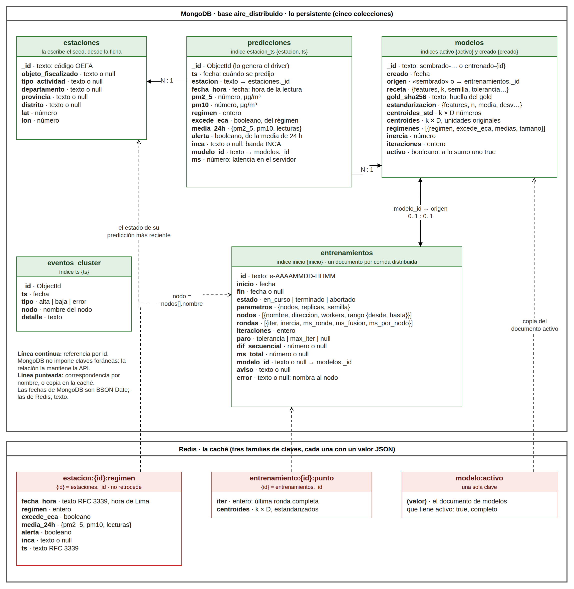
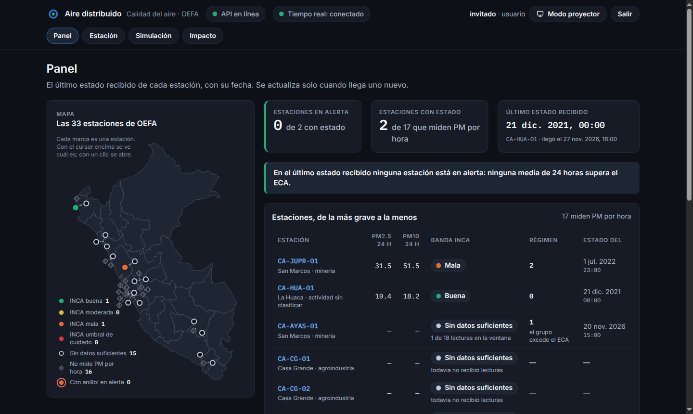
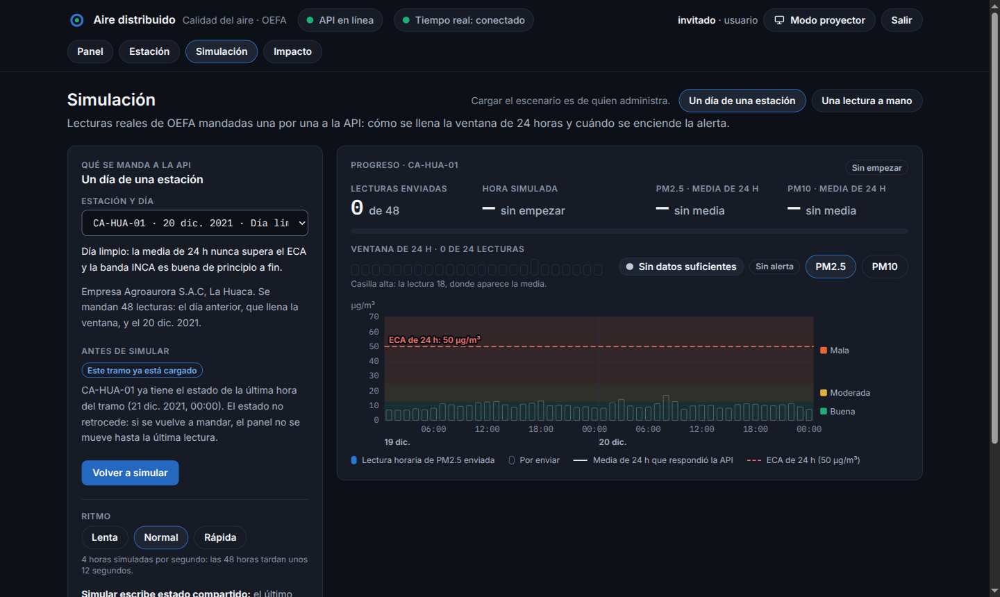
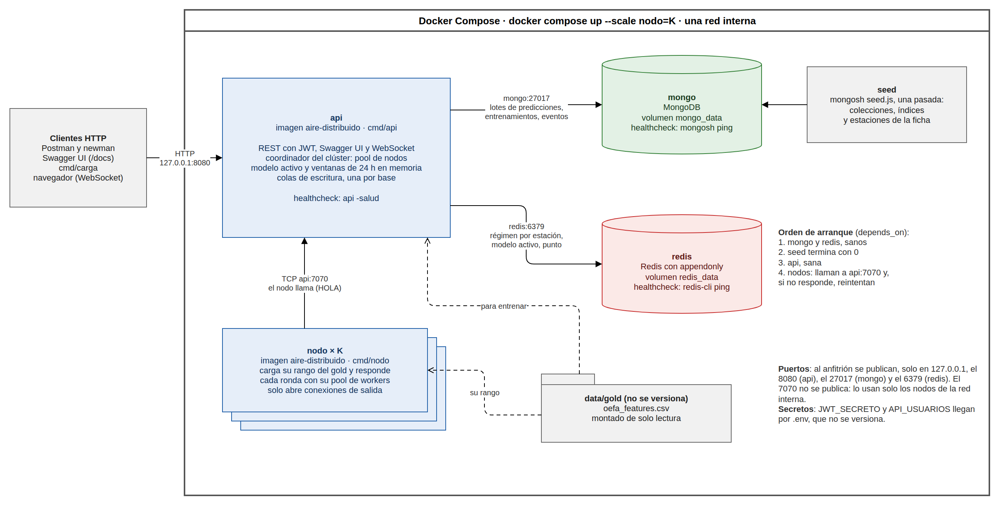
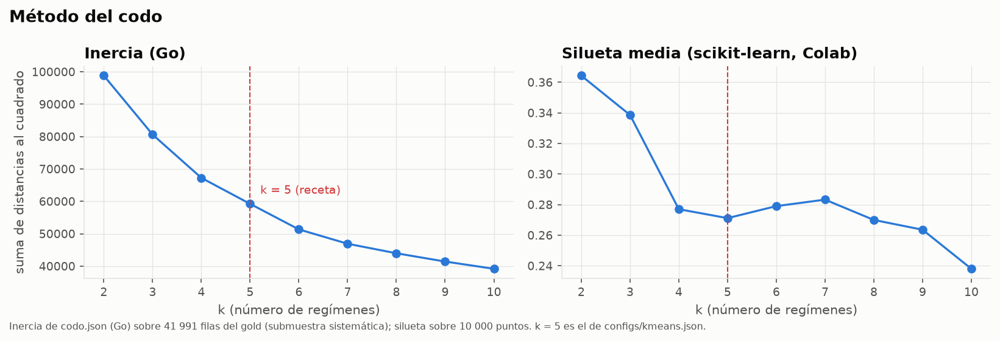
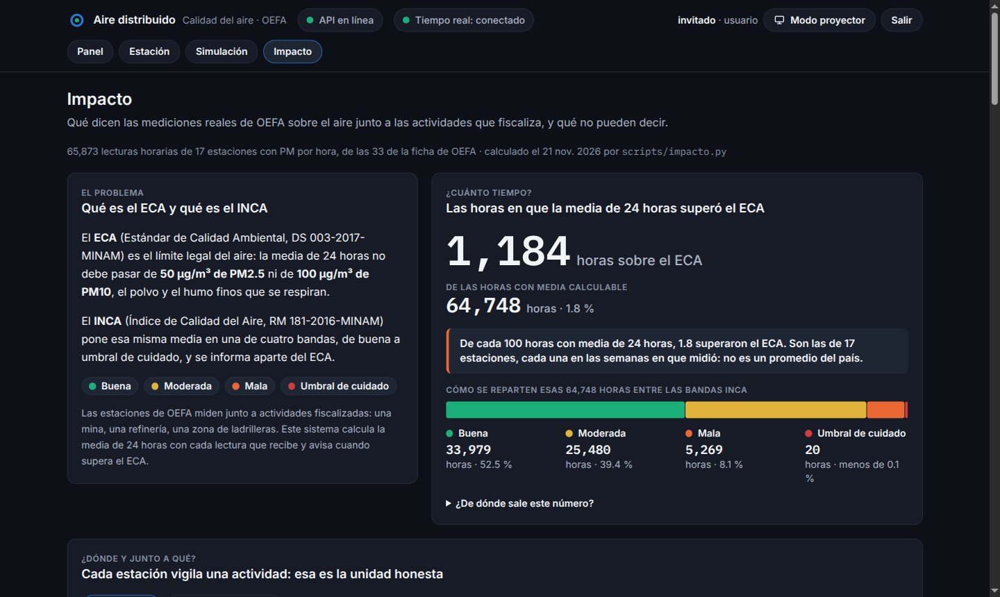

## {background-color="#10233B" .center}

[Rody]{.quien}

[OEFA · vigilancia de la calidad del aire · ]{.eyebrow}

[]{.cifra}

::: {.sub}
lecturas horarias de  estaciones, en un CSV de 1,3 GB
:::

::: {.fragment .pregunta style="font-size: 1.15em; margin-top: 1em;"}
¿Qué aire se respira junto a una mina, una fundición o una zona de ladrilleras?
:::

::: notes
[0:20 · Rody, en la portada] Buenas. Somos el Equipo 4: Dayana, Julio y yo, Rody. Caso 10, calidad
del aire. Los puntos de la portada son las estaciones de OEFA en su posición real.
[0:25 · Rody] OEFA, el organismo que fiscaliza a las actividades que contaminan, mide el aire junto
a ellas: casi 2,9 millones de lecturas horarias de 33 estaciones, de 2018 a 2022, en un CSV de
1,3 GB. Más de un millón de registros, como pide el enunciado.
[clic] Y la pregunta de fondo: ¿qué aire se respira al lado de una mina, una fundición o una zona
de ladrilleras?
:::

## {.center}

[Rody]{.quien}

[La pregunta de impacto social]{.eyebrow}

::: {.pregunta}
¿En qué estaciones y a qué horas el aire supera el ECA de PM2,5 y PM10, y **con cuánta
anticipación** se puede avisar?
:::

::: {.chips .fragment}
[PC3: dónde y cuándo]{.chip .on} [PC4: el clúster y la API]{.chip .on}
[TB2: el mapa, las alertas y la anticipación]{.chip .on}
:::

::: {.fragment .sub style="font-size: 0.9em; margin-top: 0.8em;"}
Para quién: las personas con enfermedades respiratorias que viven junto a una actividad
fiscalizada. Es la pregunta que el enunciado pone de ejemplo para el caso 10.
:::

::: notes
[0:30 · Rody] El material particulado entra hasta lo profundo de los pulmones. La pregunta: en qué
estaciones y a qué horas el aire supera el ECA, el estándar peruano, y con cuánta anticipación se
puede avisar.
[clic] La PC3 respondió el dónde y el cuándo; la PC4 construyó el clúster y la API; hoy, el TB2
cierra con el mapa, las alertas en tiempo real y la anticipación medida.
[clic] Y la alerta es para quien más la necesita: las personas con enfermedades respiratorias.
:::

## {background-color="#10233B" .center}

[Dayana]{.quien}

[1 · El dato]{.eyebrow}

::: {.pregunta}
Antes de paralelizar, hay que entender qué significa cada fila
:::

::: notes
[0:05 · Dayana] Antes de paralelizar nada, tuvimos que entender el archivo.
:::

## Lo que el CSV de OEFA esconde

[Dayana]{.quien}

::: {.tres}
::: {}
[]{.cifra}

[de las lecturas no trae hora]{.t}

La reconstruimos por su posición en el día. Donde sí viene, coincide en el
 de los casos.
:::

::: {.fragment}
[]{.cifra}

[de las filas son días enteros en 0]{.t}

Para OEFA, un 0 es «no medido», no aire limpio: tratarlo como dato diluiría los episodios.
:::

::: {.fragment}
[]{.cifra}

[son gases que llegan dos veces]{.t}

El mismo valor viene en ppb y en µg/m³. Queda una sola unidad por parámetro.
:::
:::

::: notes
[0:30 · Dayana] Tres cosas que el archivo no dice. El 93 % de las lecturas no trae la hora: la
reconstruimos por la posición de la fila en el día, y donde la hora sí viene, coincide en el 100 %.
[clic] OEFA marca con 0 lo que no midió: el 26,4 % de las filas son días enteros en 0. Si fueran
aire limpio, los episodios se perderían.
[clic] Y muchos gases llegan dos veces, en dos unidades: queda una sola.
:::

## De  filas a  horas para el modelo

[Dayana]{.quien}

::: {.d3 data-grafico="embudo"}
:::

::: {.fragment .paso data-paso="1"}
&nbsp;
:::

::: {.fragment .paso data-paso="2"}
&nbsp;
:::

[Cada barra sale de los conteos que escribe el cargador (`reports/limpieza.json`).]{.nota}

::: notes
[0:30 · Dayana] Así queda después de las reglas.
[clic] De los 2,9 millones de filas, la mitad son lecturas válidas; lo que más se descarta son los
días enteros en 0.
[clic] Las válidas se pivotan a una fila por estación y hora, y el modelo usa las que tienen PM2,5 y
PM10 a la vez: 65 873 horas de 17 estaciones. Esa es la capa gold, la que reciben los nodos.
:::

## {background-color="#10233B" .center}

[Rody]{.quien}

[2 · El sistema]{.eyebrow}

::: {.pregunta}
Todo en Go y en contenedores: cargador, nodos, API coordinadora, MongoDB, Redis y la SPA
:::

::: notes
[0:05 · Rody] Ahora el sistema completo.
:::

## Las cuatro partes, en Docker Compose

[Rody]{.quien}

{.figura style="max-height: 470px;"}

::: {.chips}
[web (Caddy) · 80 / 443]{.chip} [api · HTTP 8080]{.chip .on} [api · TCP 7070 para los nodos]{.chip .on}
[mongo · 27017]{.chip} [redis · 6379]{.chip} [`--scale nodo=K`]{.chip}
:::

::: notes
[0:40 · Rody] Las cuatro partes del enunciado. A, el cargador concurrente, en verde: lee el CSV y
deja el silver y el gold. B, los nodos del K-Means, abajo. C, la API coordinadora, arriba, con
MongoDB y Redis. Y D, la SPA, a la derecha.
Los puertos: la API escucha dos sockets, el 8080 para HTTP y el 7070 para los nodos, que es TCP
puro. El 7070 no se publica fuera de la red de Compose: solo lo usan los nodos. MongoDB en el
27017, Redis en el 6379, y el Caddy del servicio web es el único que da la cara al navegador.
Todo se levanta con docker compose up, y la cantidad de nodos es un parámetro: --scale nodo=K.
:::

## El camino de un pedido

[Rody]{.quien}

[Predecir: no pasa por el clúster]{.flujo-t}

::: {.flujo}
::: {.web}
**SPA en el navegador**
React · el JWT va en `Authorization`
:::

::: {.flecha}
→
:::

::: {.web}
**Caddy (web)**
mismo origen, HTTPS y la política de contenido
:::

::: {.flecha}
→
:::

::: {.api}
**API · `net/http` :8080**
ruta, JWT y rol (`401` / `403`)
:::

::: {.flecha}
→
:::

::: {.mem}
**En memoria**
modelo (`atomic.Pointer`) y media de 24 h
:::

::: {.flecha}
→
:::

::: {.base}
**Después de responder**
cola → MongoDB y Redis · WebSocket
:::
:::

[Entrenar (admin): sí pasa por el clúster]{.flujo-t}

::: {.flujo}
::: {.web}
**SPA (admin)**
`POST /api/entrenamientos`
:::

::: {.flecha}
→
:::

::: {.api}
**API**
uno a la vez (si no, `409`) y toma K nodos del pool
:::

::: {.flecha}
→
:::

::: {.nodo}
**Nodos · TCP :7070**
`CARGAR` una vez, `ITERAR` → `PARCIAL` por ronda
:::

::: {.flecha}
→
:::

::: {.api}
**API**
fusiona en orden de nodo; activa el modelo si es el secuencial
:::

::: {.flecha}
→
:::

::: {.base}
**Cada ronda**
WebSocket · MongoDB · Redis
:::
:::

::: notes
[0:40 · Rody] Para que quede claro qué pasa con un pedido, dos caminos.
Arriba, una predicción: la SPA manda una lectura con su token; el Caddy la pasa a la API; la API
valida el token y el rol, clasifica la lectura con el modelo que tiene en memoria, actualiza la
media de 24 horas de esa estación, también en memoria, y responde. La predicción NO pasa por el
clúster: el modelo ya entrenado vive en la API. Recién después de responder, la lectura va por una
cola a MongoDB y Redis, y el nuevo estado sale por el WebSocket a todos los navegadores.
Abajo, un entrenamiento, que solo puede lanzar un admin: la API toma K nodos del pool, les manda su
rango una vez y después una ronda por iteración. Fusiona en orden de nodo y, si el modelo coincide
con el secuencial, lo activa.
:::

## {background-color="#10233B" .center}

[Julio]{.quien}

[3 · La concurrencia]{.eyebrow}

::: {.pregunta}
En una máquina: goroutines, canales y `sync`, solo con la biblioteca estándar
:::

::: notes
[0:05 · Julio] Empecemos por la concurrencia dentro de una máquina.
:::

## Parte A: el CSV se reparte en bloques entre W goroutines

[Julio]{.quien}

:::: {.columns}
::: {.column width="62%"}
{.figura style="max-height: 380px;"}

::: {.lista style="font-size: 0.56em; margin-top: 0.4em;"}
- Canal `trabajos` (índices de bloque) → W workers → canal `resultados`
- Semáforo: un canal con búfer de 2W, `enVuelo`: la memoria no crece con el archivo
- `sync.WaitGroup` para cerrar `resultados` cuando terminan los workers
:::
:::

::: {.column width="38%"}
[×]{.cifra .chica}

::: {.sub}
con  workers: de  s a
 s sobre el CSV de 1,3 GB
:::

::: {.lista style="font-size: 0.62em; margin-top: 0.6em;"}
- La fusión va **en orden de bloque, no de llegada**: silver y gold idénticos para todo W
- Eficiencia de : la fusión en orden y las fases
  seriales () no se reparten
:::
:::
::::

[`datos/pipeline.go` ·  repeticiones por W, intervalo bootstrap al 95 %: .]{.nota}

::: notes
[0:45 · Julio] El cargador es un pipeline productor–consumidor. Un productor parte el CSV en bloques
de 64 MiB, cortados en un salto de línea, y manda sus índices por el canal trabajos. W workers leen
cada uno su bloque, aplican las reglas y mandan su parcial por el canal resultados. Cada worker
tiene su propio estado: no comparten nada, no hay Mutex.
El recolector fusiona en orden de bloque, no de llegada: por eso el silver y el gold son idénticos
con 1 worker o con 12, lo comprobamos con su sha256. Un canal con búfer de 2W hace de semáforo: como
mucho 2W bloques leídos sin fusionar.
Con 12 workers, 4,94 veces más rápido. No es 12: la fusión en orden y las fases seriales no se
reparten.
:::

## Parte B: el K-Means en un worker pool

[Rody]{.quien}

::: {.d3 data-grafico="pool" data-w="4"}
:::

[Ilustrativo: los tiempos no son mediciones. El código es `kmeans/concurrente.go`.]{.nota}

::: notes
[0:50 · Rody] El K-Means. Los chunks de mil filas esperan en el canal trabajos. Los workers se crean
una sola vez y viven toda la corrida.
Cada worker toma un chunk, asigna sus puntos al centroide más cercano y escribe su parcial (sumas,
conteos e inercia) solo en su casilla. Nadie escribe en la casilla de otro y los centroides son de
solo lectura durante la iteración: por eso el bucle no necesita Mutex.
La barrera es un sync.WaitGroup: espera los parciales de todos los chunks, y recién entonces
Fusionar los suma en orden de chunk, nunca en el de llegada. La suma en coma flotante no es
asociativa: en el orden de llegada, dos corridas iguales darían números distintos.
(Clic en W = 1 para comparar.)
:::

## El mismo resultado bit a bit para todo W

[Rody]{.quien}

:::: {.columns}
::: {.column width="64%"}
::: {.d3 data-grafico="speedup" data-series="kmeans_1000,kmeans_10000"}
:::

::: {.fragment .paso data-paso="1"}
&nbsp;
:::
:::

::: {.column width="36%"}
[]{.cifra .chica}

::: {.sub}
inercia, idéntica bit a bit con  workers
:::

::: {.lista style="margin-top: 0.7em;"}
- × con 12 workers, hasta converger en
   iteraciones
- Una iteración dura  ms: coordinar pesa
:::

::: {.fragment .lista}
- Con chunks de 10 000 filas hay solo  chunks
  para 12 workers: ×
:::
:::
::::

::: notes
[0:25 · Rody] Y se cumple en la medición: la inercia sale idéntica, bit a bit, con 1 a 12 workers. El
speedup llega a 3,86: una iteración dura 2 milisegundos y la barrera pesa.
[clic] Con chunks de 10 000 filas solo hay 7 chunks para 12 workers, y cae a 2,25.
:::

## {background-color="#10233B" .center}

[Julio]{.quien}

[4 · La distribución]{.eyebrow}

::: {.pregunta}
Entre máquinas: sockets TCP, un protocolo de mensajes y una barrera con plazo
:::

::: notes
[0:05 · Julio] Ahora, entre máquinas.
:::

## Los sockets: la API escucha, el nodo llama

[Julio]{.quien}

:::: {.columns}
::: {.column width="58%"}
::: {.codigo}
[cmd/api/main.go · la API abre dos sockets de escucha: 7070 y 8080]{.archivo}

```go
lnNodos, err := net.Listen("tcp", op.nodosAddr) // ":7070"
ln, err := net.Listen("tcp", op.addr)           // ":8080"
```

[cluster/reunir.go · Accept en un bucle; cada conexión, en su goroutine, espera el HOLA (5 s)]{.archivo}

```go
for {
    conn, err := r.ln.Accept()
    if err != nil { return }
    e := protocolo.NuevoEnlace(conn)
    go r.saludar(e, conn.RemoteAddr().String())
}
```

[cmd/nodo/main.go · el nodo marca a api:7070; el coordinador nunca llama]{.archivo}

```go
marcador := &net.Dialer{Timeout: 3 * time.Second}
return marcador.DialContext(ctx, "tcp", *coordinador)
```
:::
:::

::: {.column width="42%"}
::: {.lista style="font-size: 0.6em;"}
- **Topología en estrella**: la API coordina; los nodos no se hablan entre sí. La fusión es una
  suma de parciales, y solo el coordinador la necesita
- **El nodo llama** (`Dial`): Colab no acepta conexiones entrantes, y en las PC del laboratorio el
  nodo corre sin permisos de administrador. Si pierde la conexión, vuelve a llamar solo
- **Un mensaje = una línea de JSON** sobre la conexión TCP (`encoding/json` + `\n`), con
  `SetReadDeadline` y `SetWriteDeadline` para los plazos
- En el laboratorio, con  PC como nodos, la barrera de una ronda
  mide ** ms** de mediana
:::
:::
::::

::: notes
[0:50 · Julio] Aquí están los sockets. La API abre dos con net.Listen: el 7070, TCP puro, para los
nodos, y el 8080 para HTTP. Una goroutine hace Accept en un bucle y cada conexión nueva se atiende
en su propia goroutine, que espera el HOLA del nodo con un plazo de 5 segundos.
El nodo es el que marca, con net.Dialer y DialContext hacia api:7070. Lo hicimos así porque Colab
no acepta conexiones entrantes y en las PC del laboratorio el nodo corre sin permisos de
administrador: solo abre conexiones de salida. Y si el nodo pierde la conexión, vuelve a llamar solo.
La topología es una estrella: los nodos no se hablan entre sí, porque la fusión es una suma de
parciales y solo el coordinador la necesita. Cada mensaje es una línea de JSON sobre la conexión,
con plazos de lectura y escritura del propio socket. En el laboratorio, con 4 PC, una ronda
completa por la red tarda medio milisegundo.
:::

## Una ronda: dos niveles, y la fusión en orden de nodo

[Julio]{.quien}

:::: {.columns}
::: {.column width="55%"}
::: {.codigo .chico}
[protocolo/coordinador.go · una goroutine por nodo y un WaitGroup]{.archivo}

```go
var barrera sync.WaitGroup
barrera.Add(len(enlaces))
for i, e := range enlaces {
    go func() {
        defer barrera.Done()
        // ITERAR por su socket; lee el PARCIAL con plazo.
        // Solo escribe su índice: sin Mutex.
        parciales[i], errs[i] = e.ronda(iter, k,
            centroides, limite, plazo)
    }()
}
barrera.Wait()
```

[cluster/lloyd.go · después de la barrera, la misma suma que en una máquina]{.archivo}

```go
p := kmeans.Fusionar(ps, k, dim) // en orden de nodo, no de llegada
```
:::
:::

::: {.column width="45%"}
| Mensaje | Sentido |
|:--|:--|
| `HOLA` | nodo → API |
| `CARGAR` / `LISTO` | su rango del gold, una vez |
| `ITERAR` | API → nodo, con los centroides |
| `PARCIAL` | sumas, conteos e inercia |
| `FIN`, `PING`/`PONG`, `ERROR` | cierre, latido y falla |

::: {.lista style="font-size: 0.56em; margin-top: 0.5em;"}
- **Entre procesos**, sockets TCP. **Dentro de cada proceso**, goroutines, canales y `WaitGroup`:
  cada nodo calcula su parcial con su propio worker pool, el de la parte B
- Con 1 nodo, el modelo es el de una máquina **bit a bit**; con hasta
  , difiere a lo sumo en 
:::
:::
::::

::: notes
[0:50 · Julio] Así es una ronda en el coordinador. Por cada nodo se lanza una goroutine: escribe el
ITERAR en el socket de su nodo y se bloquea leyendo el PARCIAL, con un plazo. Cada goroutine escribe
solo en su índice del arreglo, así que no hace falta Mutex. Un WaitGroup espera a todas: esa es la
barrera. Si un nodo no responde a tiempo, la ronda se aborta con un error que lo nombra.
Después de la barrera, el coordinador llama a Fusionar en orden de nodo: la misma función que suma
los chunks en una sola máquina.
Ojo con los dos niveles: entre procesos usamos sockets TCP, y dentro de cada proceso, goroutines,
canales y WaitGroup. Cada nodo calcula su parcial con su propio worker pool, el mismo de la parte B.
Resultado: con un nodo, el modelo distribuido es el de una máquina bit a bit; con hasta 4 nodos
difiere en 10 a la menos 15, que es redondeo.
:::

## {background-color="#10233B" .center}

[Julio]{.quien}

[5 · El servicio]{.eyebrow}

::: {.pregunta}
La API coordinadora: `net/http`, JWT, WebSocket, MongoDB y Redis
:::

::: notes
[0:05 · Julio] La API.
:::

## La API en Go: el handler de una predicción

[Julio]{.quien}

:::: {.columns}
::: {.column width="58%"}
::: {.codigo .chico}
[api/servidor.go · rutas de `net/http`, cada una con los roles que admite]{.archivo}

```go
s.ruta("POST /api/predicciones", cualquiera, s.predecir)
s.ruta("POST /api/entrenamientos", []string{RolAdmin},
    s.iniciarEntrenamiento)
s.ruta("GET /ws", nil, s.seguirEventos) // token en el apretón
```

[api/rutas.go · predecir: nada del camino espera a una base ni al clúster]{.archivo}

```go
m := s.modelo.Load() // atomic.Pointer: sin lock
reg, err := m.Predecir(modelo.Lectura{
    Estacion: l.estacion, PM25: l.pm25, PM10: l.pm10})
media := s.ventanas.Agregar(l.estacion, l.fechaHora,
    l.pm25, l.pm10) // la media de 24 h, en memoria
s.escritor.encolar(almacen.Prediccion{ /* … */ })
s.responder(w, r, http.StatusOK, /* … */)
```

[api/escritor.go · si la cola está llena, se descarta y se cuenta: el pedido no espera]{.archivo}

```go
select {
case c.ch <- p:
    return true
default:
    c.descartadas.Add(1)
    return false
}
```
:::
:::

::: {.column width="42%"}
::: {.lista style="font-size: 0.6em;"}
- `ruta` envuelve cada handler con la verificación del JWT (HS256, `crypto/hmac`) y la medición
  de latencia por ruta
-  rutas:  libres,
   de usuario y  de admin. Contrato
  OpenAPI y Swagger UI en `/docs`
- El modelo se reemplaza con un `Store` atómico al terminar un entrenamiento: las predicciones en
  curso terminan con el anterior
- El WebSocket está escrito sobre `net/http` (RFC 6455, `Hijack`): un hub con canales de alta,
  baja y difusión
:::
:::
::::

::: notes
[0:50 · Julio] Este es el código de la API. Cada ruta se registra en el mux de net/http con los roles
que admite; la función ruta la envuelve con la verificación del JWT y con la medición de latencia.
Una predicción hace cuatro cosas: lee el modelo de un atomic.Pointer, sin lock; clasifica la lectura
con el centroide más cercano; actualiza la media de 24 horas de la estación, en memoria; y encola la
predicción para guardarla. Responde sin esperar a MongoDB ni a Redis, y sin pasar por el clúster.
La cola es un canal con búfer: si se llena, se descarta y se cuenta, pero el pedido no espera.
El WebSocket también es nuestro, sobre net/http: un hub con canales de alta, baja y difusión.
:::

## La API responde en menos de 100 ms, con 64 clientes a la vez

[Julio]{.quien}

::: {.d3 data-grafico="latencia"}
:::

[ pedidos a `POST /api/predicciones` con JWT ( por nivel), medidos del lado del cliente con `cmd/carga`:  sobre el límite y  errores. Con MongoDB y Redis guardando:  escrituras en cada uno.]{.nota}

::: notes
[0:30 · Julio] Y la medición. 80 000 pedidos de predicción, con 1, 4, 16 y 64 clientes a la vez. La
escala es logarítmica: con 64 clientes, el 99 % de los pedidos responde en 3,1 milisegundos, más de
30 veces por debajo del límite de 100. Ninguno pasó el límite, ninguno falló, y mientras tanto
MongoDB y Redis guardaron cada predicción.
:::

## MongoDB persiste, Redis responde rápido

[Dayana]{.quien}

:::: {.columns}
::: {.column width="62%"}
{.figura style="max-height: 520px; margin-top: 0.4em;"}
:::

::: {.column width="38%"}
::: {.dos .apilado}
::: {}
[MongoDB ·  colecciones]{.t}

`estaciones`, `predicciones`, `modelos`, `entrenamientos` y `eventos_cluster`: lo que tiene que
durar, con  índices.
:::

::: {}
[Redis ·  claves]{.t}

`estacion:{id}:regimen` (el último de cada estación), `modelo:activo` (arranque en caliente) y
`entrenamiento:{id}:punto` (el punto de control de cada ronda).
:::

::: {}
[Cómo escribe la API]{.t}

Una cola con búfer y una goroutine por base, por lotes de hasta :
una base lenta no frena a la otra ni al pedido.
:::
:::
:::
::::

::: notes
[0:40 · Dayana] Dos niveles de almacenamiento, como pide el enunciado. MongoDB guarda lo que tiene
que durar: el catálogo de estaciones, cada predicción, los modelos, el historial de entrenamientos
con sus rondas y las altas y bajas de los nodos.
Redis guarda lo que se lee rápido: el último régimen de cada estación, que es lo que pinta el mapa;
una copia del modelo activo, para que la API arranque con el último entrenado; y el punto de control
de cada ronda.
La API escribe con una goroutine y una cola por base: si una se pone lenta, no frena a la otra ni al
pedido.
:::

## {background-color="#10233B" .center}

[Dayana]{.quien}

[6 · La interfaz]{.eyebrow}

::: {.pregunta}
Una SPA que muestra el estado de cada estación, las alertas y el clúster en tiempo real
:::

::: notes
[0:05 · Dayana] La interfaz.
:::

## La SPA: React, Vite, TypeScript y D3

[Dayana]{.quien}

::: {.apps}
::: {}
{.app}

[Panel: el último estado de cada estación en el mapa, con la banda INCA y la alerta]{.pie}
:::

::: {}
{.app}

[Simulación: lecturas reales enviadas una por una; la ventana de 24 h se llena y la alerta se enciende]{.pie}

::: {.lista style="font-size: 0.5em; margin-top: 0.5em;"}
- Ingreso, panel, estación, simulación e impacto; para el admin, entrenamiento y clúster (nodos,
  CPU, latencia y eventos)
- Tiempo real por WebSocket: `estacion.regimen` y las rondas del entrenamiento
- Configura desde la UI: estación, día y ritmo de la simulación; nodos, réplicas y semilla de un entrenamiento
:::
:::
:::

::: notes
[0:45 · Dayana] La interfaz es una SPA en React con TypeScript, y los gráficos y el mapa en D3, sin
teselas de terceros: funciona sin internet.
A la izquierda, el panel: el último estado recibido de cada estación, con su banda INCA y si está en
alerta. A la derecha, la simulación: se eligen una estación y un día, y la UI manda las lecturas
reales una por una a la API; se ve llenarse la ventana de 24 horas y encenderse la alerta.
El admin ve además el entrenamiento, donde elige cuántos nodos usar y sigue cada ronda en vivo, y el
clúster: nodos conectados, CPU, latencia por ruta y eventos. Todo lo que cambia llega por el
WebSocket, sin recargar.
:::

## Seguridad: la UI esconde, la API decide

[Dayana]{.quien}

::: {.dos}
::: {}
[En la API (Go)]{.t}

::: {.lista}
- JWT HS256 con clave de al menos  bytes, por variable de entorno; dura una hora
- Rol en cada ruta: un usuario recibe `403` en una de admin aunque fuerce la URL
- Claves comparadas en tiempo constante (`crypto/subtle`)
- Cuerpo limitado a  KiB (`http.MaxBytesReader`)
- El WebSocket valida origen y token antes del `101`; el token viaja en `Sec-WebSocket-Protocol`, no en la URL
- CORS solo para los orígenes de `CORS_ORIGENES`
:::
:::

::: {}
[En el despliegue (Caddy y Compose)]{.t}

::: {.lista}
- UI y API en el mismo origen: sin CORS en producción
- `Content-Security-Policy`: scripts, estilos y fuentes solo del propio origen; `frame-ancestors 'none'`
- HTTPS con HSTS; `nosniff` y `Referrer-Policy`
- El token en `sessionStorage`: se borra al cerrar la pestaña
- Puertos solo en `127.0.0.1`; el 7070 de los nodos no se publica
- Secretos en `.env`, que no se versiona; el log no guarda el token
:::
:::
:::

::: notes
[0:40 · Dayana] La seguridad, que es el punto de «políticas de seguridad de la API» del entregable.
La regla: la UI esconde lo que el rol no puede usar, pero la que decide es la API. Cada ruta exige un
JWT firmado con HS256 y un rol; un usuario que fuerza la URL de admin recibe 403. Las claves se
comparan en tiempo constante, el cuerpo de un pedido no pasa de 64 KiB, y el WebSocket valida el
origen y el token antes de aceptar la conexión.
En el despliegue, el Caddy sirve la UI y la API en el mismo origen, con una política de contenido
estricta y HTTPS. El token vive en sessionStorage, los puertos internos no se publican y los
secretos van en un .env que no está en el repositorio.
:::

## {background-color="#10233B" .center}

[Julio]{.quien}

[7 · Lo que responde]{.eyebrow}

::: {.pregunta}
¿Funciona, es rápido, y qué dice sobre el aire?
:::

::: notes
[0:05 · Julio] ¿Cómo sabemos que funciona?
:::

## Evaluación experimental

[Julio]{.quien}

::: {.eval}
| Qué se probó | Cómo | Resultado |
|:--|:--|:--|
| Sin condiciones de carrera | `go test -race ./...` en cada push y PR (CI) |  funciones de prueba de Go |
| La interfaz | Vitest, en el CI |  archivos de prueba |
| Distribuido = secuencial | `cmd/distribuido` con 1 a  nodos | 1 nodo: bit a bit; hasta : ≤  |
| Clúster en el laboratorio | `cmd/smoke`,  PC,  rondas | barrera p50 de  ms |
| API en menos de 100 ms | `cmd/carga`,  pedidos, 1 a  clientes | p99 ≤  ms;  sobre el límite |
| La API de punta a punta | Postman y newman,  lecturas de prueba |  casos, de  estaciones |
| Limpieza y K-Means | Auditoría independiente en pandas y scikit-learn |  de  chequeos sin diferencias |
| La pregunta de impacto | `scripts/impacto.py` sobre el gold y el silver | la lámina siguiente |
:::

::: notes
[0:45 · Julio] La evaluación, en una tabla. Todas las pruebas de Go corren con el detector de
carreras, en cada push y en cada PR: 549 funciones de prueba. La interfaz tiene sus pruebas en
Vitest.
El distribuido da el mismo modelo que el secuencial: bit a bit con un nodo, y con hasta cuatro, a
10 a la menos 15. En el laboratorio, con 4 PC, una ronda tarda medio milisegundo. La API, menos de
100 ms con 64 clientes. La colección de Postman con datos de prueba recorre la API de punta a
punta. Y una auditoría independiente rehízo la limpieza y el K-Means en scikit-learn: 40 de 40.
:::

## Lo que responde: el aire junto a cada actividad

[Dayana]{.quien}

:::: {.columns}
::: {.column width="30%"}
[]{.cifra .chica .alto}

::: {.sub style="font-size: 0.7em;"}
horas con la media de 24 h sobre el ECA, de  calculables
(), en  episodios de
 estaciones
:::

::: {.aviso style="margin-top: 0.7em; font-size: 0.5em;"}
** ()**:
 estaciones junto a una zona ladrillera y una refinería de zinc,
 de sus  horas
sobre el ECA. Su distrito tenía  habitantes en
 (INEI).
:::
:::

::: {.column width="70%"}
::: {.d3 data-grafico="impacto"}
:::
:::
::::

[`reports/impacto.json`:  estaciones con PM por hora; la población es del distrito y es contexto, no gente expuesta: no se suma entre distritos.]{.nota}

::: notes
[0:45 · Dayana] Y ahora, lo que responde sobre el aire. De las 64 748 horas en que se puede calcular
la media de 24 horas, 1 184 superaron el ECA: el 1,8 %, en 30 episodios de 8 estaciones.
Pero el promedio esconde lo importante: depende de la actividad que vigila la estación. Junto a la
refinería de zinc de Cajamarquilla y a las ladrilleras de Huachipa, en Lurigancho, Lima, la mayoría de las horas medidas superaron el
ECA: 585 de 879. En las minas y la agroindustria, menos del 1 %.
Una advertencia honesta: esas estaciones de Lima midieron pocas semanas, y la población del
distrito es contexto, no gente expuesta: vivir en el distrito no es haber respirado ese aire.
:::

## ¿Con cuánta anticipación?

[Dayana]{.quien}

::: {.tres}
::: {}
[ h]{.cifra}

[desde la primera lectura horaria sobre el umbral]{.t}

Mediana de los  episodios (cuartiles 
a  h). Todos tuvieron una señal antes.
:::

::: {.fragment}
[ h]{.cifra}

[desde la primera hora en el nivel alto del K-Means]{.t}

Cuartiles  a  h. El nivel alto acierta el
 de las veces y cubre el .
:::

::: {.fragment}
[ h]{.cifra}

[seguida, justo antes del cruce]{.t}

La cota baja: las señales se encienden y se apagan. Por eso la alerta del sistema es la norma
misma, la media de 24 h.
:::
:::

[Descriptivo, sobre las mismas lecturas con que se entrenó: no hay partición temporal, no es un pronóstico. La anticipación tiene un tope de  h por construcción.]{.nota}

::: notes
[0:40 · Dayana] La segunda mitad de la pregunta: con cuánta anticipación. En los 30 episodios, la
primera lectura horaria sobre el umbral apareció, en la mediana, 20 horas antes de que la media de
24 horas cruzara el ECA.
[clic] Si la señal es el nivel alto del K-Means, 18 horas. Pero el nivel alto acierta solo el 35 %
de las veces que suena.
[clic] Y la cota baja: justo antes del cruce, la señal estuvo encendida una hora seguida, en la
mediana. Las señales van y vienen. Por eso la alerta del sistema es la norma misma, la media de 24
horas, y las señales horarias se muestran como contexto.
Lo decimos claro: es descriptivo, sobre los mismos datos del entrenamiento. No es un pronóstico.
:::

## Lo que este sistema no puede decir

[Rody]{.quien}

:::: {.columns}
::: {.column width="55%"}
{.figura style="max-height: 540px;"}
:::

::: {.column width="45%"}
::: {.aviso}
**Una zona sin estación no es una zona con aire limpio.** 
estaciones en  de las  regiones, donde
OEFA fiscaliza, no donde vive la gente.
:::

::: {.lista style="font-size: 0.6em; margin-top: 0.7em;"}
- Solo  miden PM2,5 y PM10 por hora; las otras
   no entran en ninguna cifra
- Muchas son campañas de semanas, y los datos van de 2018 a 2022: la UI dice «último estado
  recibido», nunca «ahora»
- El K-Means describe niveles; la alerta es la media de 24 h
- La anticipación es descriptiva, sin partición temporal
:::
:::
::::

::: notes
[0:35 · Rody] Y los límites, que son parte del resultado. 33 estaciones en 10 de las 25 regiones,
puestas donde OEFA fiscaliza, no donde vive la gente: una zona sin estación no es una zona con aire
limpio. Solo 17 miden material particulado por hora; las otras 16 no entran en ninguna cifra.
Muchas midieron pocas semanas, y los datos son de 2018 a 2022: por eso la interfaz nunca dice
«ahora», dice «último estado recibido». El K-Means describe niveles, la alerta es la norma, y la
anticipación es descriptiva.
:::

## Demo en vivo · aire.rosewt.dev

[Rody conduce]{.quien}

::: {.demo-tabla}
| | Qué se muestra | Narra | |
|:-|:-----------------------------------|:-|-:|
| 1 | **Panel**: el mapa, la banda INCA y las alertas de cada estación | Dayana | 0:30 |
| 2 | **Simulación**: un día de una estación; la ventana de 24 h se llena y la alerta llega al panel por WebSocket | Dayana | 0:45 |
| 3 | **Clúster** (admin): los nodos con su IP:puerto, CPU, latencia por ruta y eventos | Julio | 0:30 |
| 4 | **Entrenamiento**: K nodos, cada ronda en vivo; al final, la diferencia con el secuencial y el modelo activado | Rody | 0:50 |
| 5 | **Terminal**: `docker compose ps` y el log de un nodo: `conectado desde IP:puerto a …:7070`, `CARGAR`, rondas | Julio | 0:30 |
| 6 | **Impacto**: horas sobre el ECA por actividad y la anticipación | Dayana | 0:20 |
| 7 | **Swagger** en `/docs` y un `403` en una ruta de admin con un token de usuario | Julio | 0:20 |
:::

::: {.planb}
**Plan B si falla la red:** el mismo sistema en la laptop, levantado antes de la clase
(`docker compose up -d --scale nodo=3`, en `localhost:8081`). **Si falla también Docker:** las
capturas de la app en este deck, el video del TB2 y
`go test -race -run SobreTCP -v ./protocolo/`, que corre un coordinador y un nodo sobre TCP real
en `127.0.0.1`.
:::

::: notes
[4:00 · Rody conduce la laptop; cada uno narra su parte] El guion completo, con los comandos y la
lista de lo que se revisa antes de la clase, está en docs/presentacion/reparto.md.
Antes de entrar: la API en línea, los nodos en el pool, una sesión de admin abierta y un token que
dure toda la clase (JWT_DURACION=4h).
:::

## {background-color="#10233B"}

[Rody]{.quien}

:::: {.columns}
::: {.column width="70%"}
[Lo que nos llevamos]{.eyebrow}

::: {.lista style="font-size: 0.78em;"}
- Repartir es fácil. Lo difícil es que el resultado no dependa de cómo se repartió: fusionar
  siempre en el mismo orden, en una máquina y entre nodos.
- Un sistema rápido es el que no espera: el modelo en memoria y las bases fuera del camino del
  pedido.
- Antes de paralelizar, entender el dato; y decir lo que el dato no puede decir.
:::

[El sistema]{.eyebrow style="margin-top: 0.9em; display: block;"}

::: {.lista style="font-size: 0.66em;"}
- En vivo: **aire.rosewt.dev** · Código, informe y video: el repositorio del QR
:::
:::

::: {.column width="30%" .centro}
{.qr}

[github.com/R0SEWT/aire-distribuido]{.nota}

[¿Preguntas?]{.pregunta style="display: block; margin-top: 0.6em;"}
:::
::::

::: notes
[0:30 · Rody] Tres cosas que nos llevamos. Repartir el trabajo es fácil; lo difícil es que el
resultado no dependa de cómo se repartió, y eso se logra fusionando siempre en el mismo orden: en
una máquina, entre chunks, y en el clúster, entre nodos. Un sistema rápido es el que no espera: el
modelo en memoria y las bases de datos fuera del camino del pedido. Y antes de paralelizar hay que
entender el dato, y decir lo que el dato no puede decir.
Gracias; ¿preguntas?
:::

# Respaldo {.respaldo background-color="#10233B"}

## Docker Compose: servicios, puertos y orden de arranque {.respaldo}

[Respaldo · docker-compose.yml y docs/diagramas/despliegue.png]{.eyebrow}

:::: {.columns}
::: {.column width="55%"}
{.figura style="max-height: 470px;"}
:::

::: {.column width="45%"}
| Servicio | Imagen | Puerto |
|:--|:--|:--|
| `web` | Caddy con la UI (Node la compila) | 80 → `127.0.0.1:8081` |
| `api` | `aire-distribuido` (distroless) | 8080 → `127.0.0.1`; 7070 solo en la red interna |
| `nodo` × K | la misma, `nodo -coordinador api:7070` | ninguno: solo sale |
| `mongo` | `` | 27017 |
| `redis` | `` | 6379 |
| `seed` | mongosh con `seed.js` | — |

[Orden: mongo y redis sanos → seed → api sana (`api -salud`: distroless no tiene curl) → web y nodos, que reintentan hasta que el 7070 responde.]{.nota}
:::
::::

## Los plazos del clúster y qué pasa si un nodo cae {.respaldo}

[Respaldo · cmd/api y cluster/]{.eyebrow}

| Plazo | Valor | Qué protege |
|:--|--:|:--|
| HOLA de una conexión nueva |  s | una conexión que no se presenta no ocupa una goroutine para siempre |
| CARGAR → LISTO |  s | la primera barrera: todos tienen su rango en memoria |
| Ronda ITERAR → PARCIAL |  s | la barrera de cada iteración |
| Latido PING → PONG, cada  s |  s | detectar a un nodo libre que se fue |

::: {.lista style="font-size: 0.6em; margin-top: 0.6em;"}
- Si un nodo cae o no responde a tiempo, la ronda se aborta con un error que lo nombra, la corrida
  se corta con todos y **no hay modelo**: uno con menos nodos sería otro modelo. Los nodos vuelven a
  llamar solos y quedan libres para relanzar
- Un `PARCIAL` que llega tarde de una ronda abortada se reconoce por su número y se descarta
- El punto de control de cada ronda queda en Redis, pero no se reanuda: se relanza el entrenamiento
- Un entrenamiento a la vez: un semáforo (canal con búfer de 1); el segundo pedido recibe `409`
:::

## Patrones de Go que usa el sistema {.respaldo}

[Respaldo]{.eyebrow}

| Patrón | Dónde | Con qué |
|:--|:--|:--|
| Pipeline productor–consumidor | cargador (`datos/pipeline.go`) | canales `trabajos`, `resultados`; `WaitGroup` |
| Semáforo | cargador | canal con búfer de 2W (`enVuelo`) |
| Worker pool con barrera | K-Means (`kmeans/concurrente.go`), cada nodo (`kmeans/nodo.go`) | canal de chunks; `WaitGroup` |
| Fan-out / fan-in con plazo | ronda del clúster (`protocolo/coordinador.go`) | una goroutine por conexión TCP; `WaitGroup` |
| Accept loop | pool de nodos (`cluster/reunir.go`) | `net.Listener`, una goroutine por conexión |
| Bucle de eventos con `select` | pool de nodos (`cluster/pool.go`) | canal de llegadas, `time.Ticker` del latido |
| Hub de difusión | WebSocket (`api/hub.go`) | canales de alta, baja y difusión |
| Escritura asíncrona por lotes | persistencia (`api/escritor.go`) | una cola con búfer y una goroutine por base |
| Publicación sin lock | modelo activo (`api/servidor.go`) | `atomic.Pointer` |
| Exclusión mutua donde hay estado compartido | ventana de 24 h, pool, hub | `sync.Mutex` y `sync.RWMutex` |

## Las reglas de limpieza, con lo que descartó cada una {.respaldo}

[Respaldo · reports/limpieza.json]{.eyebrow}

| Regla | Qué hace | Filas |
|:--|:-----------------------------------------|----------------:|
| 1 | Solo lecturas horarias: fuera los promedios diarios o móviles |  |
| 2′ | Hora por posición en el día, cuando no viene |  reconstruidas |
| 3′ | Un día entero en 0 es «no medido» |  |
| 3′ | Una hora en 0 de un contaminante, en un día con datos |  |
| — | Fila sin valor (plantilla de exportación de 2022) |  |
| 4 | Fuera del rango físico (casi todo, presión en 0) |  |
| 6 | Una sola unidad por parámetro: duplicados descartados |  |
| 7 | Pivot: una fila por estación y hora |  |
| 8 | Completitud: PM2,5 y PM10 a la vez |  |

[La regla de las 18 horas: con menos de 18 horas no nulas, OEFA publica 0 como promedio del día. El 0 es «sin dato» también dentro de un día.]{.nota}

## Por qué k =  {.respaldo}

[Respaldo · notebook 02]{.eyebrow}

:::: {.columns}
::: {.column width="58%"}
{.figura}
:::

::: {.column width="42%"}
::: {.lista style="font-size: 0.66em;"}
-  corridas sobre 
  variantes de la receta (features, log, nivel, k)
- k = : 
  ()
- Estable entre semillas: ARI de 
-  semillas de k-means++; gana la de menor inercia
- Los tres niveles: bajo ( de las horas), medio
  () y alto (, el único sobre el ECA)
:::
:::
::::

## El speedup, con su fracción serial {.respaldo}

[Respaldo · reports/benchmark_*.json]{.eyebrow}

| | Cargador | K-Means (chunk 1 000) |
|:--------------------------|----------:|----------:|
| Speedup con 12 workers | × | × |
| Intervalo bootstrap al 95 % |  |  |
| Eficiencia (speedup / W) |  |  |
| Fracción serial efectiva (Karp-Flatt) |  |  |
| Techo de Amdahl con esa fracción | × | × |

[Karp-Flatt estima la fracción serial que explicaría el speedup medido. En el K-Means crece con W: el límite es coordinar (la barrera por iteración), no una sección secuencial fija.]{.nota}

## Cuándo conviene repartir {.respaldo}

[Respaldo · reports/smoke_lab_4.json y reports/kmeans_distribuido_local_N.json]{.eyebrow}

::: {.lista style="font-size: 0.68em;"}
- Una ronda por la red, con  PC del laboratorio:  ms
  de mediana; la ida y vuelta a cada nodo, entre  y
   ms
- Una iteración sobre todo el gold en una sola máquina con  workers:
   ms
- Con  filas, la red cuesta tanto como el cómputo: con esta tabla,
  repartir no acelera. El clúster se justifica cuando cada nodo tiene mucho más que calcular: con
   réplicas del gold (
  filas) llega a los mismos centroides
- La fusión y la actualización, lo que el coordinador hace en serie, tardan
   ms: el costo de la ronda es la red, no la suma
:::

## Las rutas de la API {.respaldo}

[Respaldo · api/servidor.go y docs/api/openapi.yaml]{.eyebrow}

| Ruta | Quién |
|:--|:--|
| `POST /api/auth/token`, `POST /api/auth/invitado`, `GET /api/salud`, `GET /openapi.yaml`, `GET /docs` | libre |
| `POST /api/predicciones`, `GET /api/estaciones`, `GET /api/estaciones/{id}/regimen`, `GET /api/regimenes`, `GET /api/modelos/activo` | usuario o admin |
| `GET /ws` (WebSocket: el token va en el apretón de manos) | usuario o admin |
| `GET /api/metricas`, `GET /api/cluster/nodos`, `GET /api/cluster/eventos` | admin |
| `POST /api/entrenamientos`, `GET /api/entrenamientos`, `GET /api/entrenamientos/{id}` | admin |

[El servidor HTTP tiene plazos de lectura, de escritura y de inactividad (`ReadHeaderTimeout` de 5 s), y se apaga en orden con SIGTERM: corta el entrenamiento, termina los pedidos en curso y vacía las colas de escritura.]{.nota}

## Impacto: la pantalla de la app {.respaldo}

[Respaldo · aire.rosewt.dev/impacto]{.eyebrow}

{.app style="max-height: 470px;"}

[Las bandas INCA (RM 181-2016-MINAM) de las  horas calculables: buena , moderada , mala  y umbral de cuidado .]{.nota}
