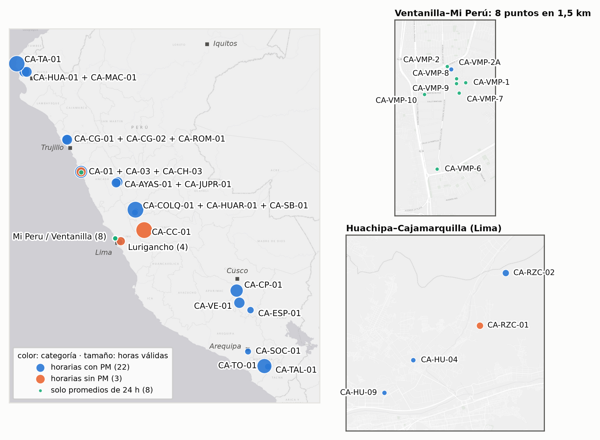
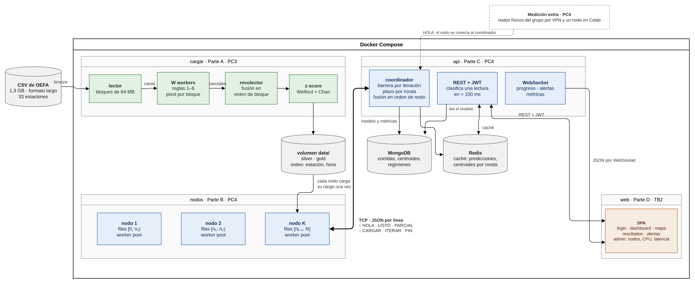
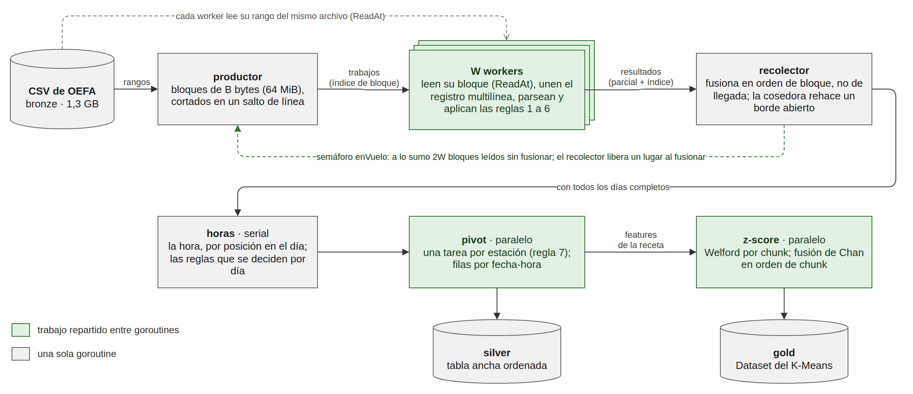
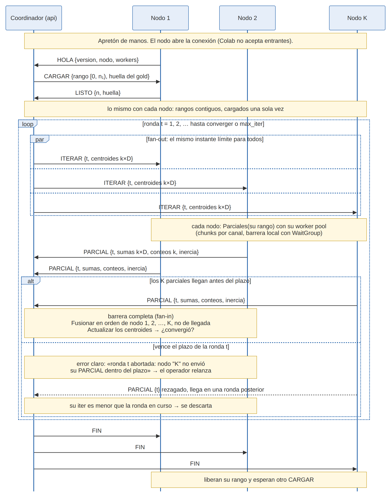
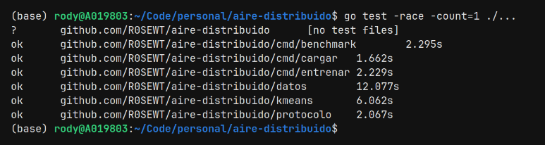
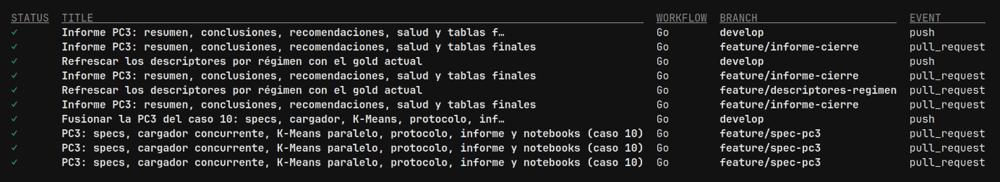
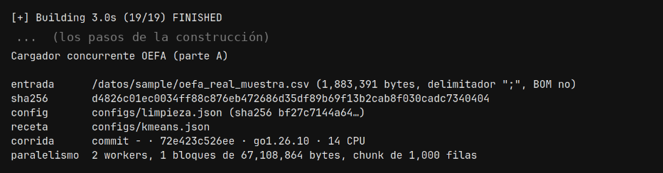
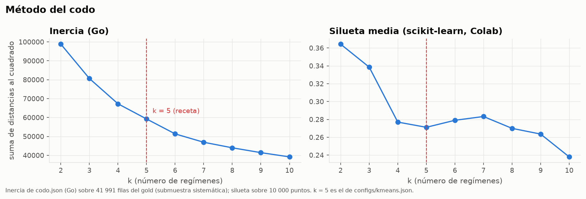

## {background-color="#10233B" .center}

[Rody]{.quien}

[OEFA · vigilancia de la calidad del aire · ]{.eyebrow}

[]{.cifra}

::: {.sub}
lecturas horarias de  estaciones, en un CSV de 1,3 GB
:::

::: {.fragment .pregunta style="font-size: 1.15em; margin-top: 1em;"}
¿Qué aire se respira junto a una mina, una fundición o una refinería?
:::

::: notes
[0:15 · Rody, en la portada] Buenas. Somos el Equipo 4: Dayana, Julio y yo, Rody. Nuestro caso es
el 10 del enunciado, la calidad del aire. Los puntos de la portada son las estaciones de OEFA en su
posición real: las llenas son las que llegan al modelo.
[0:30 · Rody] OEFA, el organismo que fiscaliza a las actividades que contaminan, mide el aire
junto a ellas y lo publica en datos abiertos: casi 2,9 millones de lecturas horarias de 33
estaciones, de 2018 a 2022, en un CSV de 1,3 GB. Es más de un millón de registros, como pide el
enunciado.
[clic] Y la pregunta de fondo es simple: ¿qué aire se respira al lado de una mina, de una
fundición o de una refinería?
:::

## {.center}

[Rody]{.quien}

[La pregunta]{.eyebrow}

::: {.pregunta}
¿En qué estaciones y a qué horas el aire entra en un **nivel alto** de PM2,5 y PM10?
:::

::: {.fragment .sub style="font-size: 1.05em; margin-top: 0.6em;"}
¿Y con cuánta anticipación eso avisa de un episodio que supera el Estándar de Calidad Ambiental
(ECA)?
:::

::: {.chips .fragment}
[PC3: el dónde y el cuándo]{.chip .on} [TB2: con cuánta anticipación]{.chip}
[Para quién: las personas con enfermedades respiratorias]{.chip}
:::

::: notes
[0:30 · Rody] El material particulado, PM2,5 y PM10, entra hasta lo profundo de los pulmones. Por
eso la pregunta: en qué estaciones y a qué horas el aire entra en un nivel alto.
[clic] Y, después, con cuánta anticipación eso avisa de un episodio que supera el ECA, el estándar
peruano, que es un promedio de 24 horas.
[clic] Esta PC3 responde el dónde y el cuándo; la anticipación se mide en el TB2. Y la alerta es
para quien más la necesita: las personas con enfermedades respiratorias.
:::

## Dónde mide OEFA

[Rody]{.quien}

:::: {.columns}
::: {.column width="62%"}
{.figura style="max-height: 560px;"}
:::

::: {.column width="38%"}
[ estaciones]{.cifra .chica}

::: {.sub}
en  de las  regiones
:::

::: {.lista style="margin-top: 0.8em;"}
Cada estación acompaña a una actividad fiscalizada: minas, fundiciones, refinerías, agroindustria,
corredores viales, ladrilleras.
:::

::: {.aviso .fragment style="margin-top: 0.8em;"}
**Una zona sin estación no es una zona con aire limpio.** OEFA mide donde fiscaliza, no donde vive
la gente.
:::
:::
::::

::: notes
[0:25 · Rody] Este es el mapa: 33 estaciones en 10 de las 25 regiones. Cada una está ahí porque hay
algo que fiscalizar cerca: una mina, una fundición, una ladrillera. Los recuadros son dos zonas de
Lima con varias estaciones juntas.
[clic] Y algo que vamos a repetir hasta el final: donde no hay estación no sabemos nada. Una zona
sin estación no es una zona con aire limpio.
:::

## {background-color="#10233B" .center}

[Dayana]{.quien}

[1 · El dato]{.eyebrow}

::: {.pregunta}
Antes de paralelizar, hay que entender qué significa cada fila
:::

::: notes
[0:05 · Dayana] Antes de paralelizar nada, tuvimos que entender el archivo.
:::

## Lo que el CSV de OEFA esconde

[Dayana]{.quien}

::: {.tres}
::: {}
[]{.cifra}

[de las lecturas no trae hora]{.t}

La reconstruimos por su posición en el día. Donde sí viene, coincide en el
 de los casos.
:::

::: {.fragment}
[]{.cifra}

[de las filas son días enteros en 0]{.t}

Para OEFA, un 0 es «no medido», no aire limpio: tratarlo como dato diluiría los episodios.
:::

::: {.fragment}
[]{.cifra}

[son gases que llegan dos veces]{.t}

El mismo valor viene en ppb y en µg/m³. Queda una sola unidad por parámetro.
:::
:::

::: notes
[0:35 · Dayana] Tres cosas que el archivo no dice a simple vista.
Primero: el 93 % de las lecturas no trae la hora. La reconstruimos por la posición de la fila dentro
del día, y donde la hora sí viene, nuestra regla coincide en el 100 % de los casos.
[clic] Segundo: OEFA marca con 0 lo que no midió. El 26,4 % de las filas son días enteros en 0. Si
los tomáramos como aire limpio, el promedio bajaría y los episodios se perderían.
[clic] Tercero: muchos gases llegan dos veces, en dos unidades. Nos quedamos con una sola.
(Si preguntan por el 0: la regla de las 18 horas de OEFA lo confirma; está en el respaldo.)
:::

## De  filas a  horas para el modelo

[Dayana]{.quien}

::: {.d3 data-grafico="embudo"}
:::

::: {.fragment .paso data-paso="1"}
&nbsp;
:::

::: {.fragment .paso data-paso="2"}
&nbsp;
:::

[Cada barra sale de los conteos que escribe el cargador (`reports/limpieza.json`).]{.nota}

::: notes
[0:35 · Dayana] Así queda el archivo después de las reglas.
[clic] De los 2,9 millones de filas, la mitad son lecturas válidas. La otra mitad se descarta, y
el motivo más grande es justamente ese: días enteros en 0.
[clic] Las lecturas válidas se pivotan a una fila por estación y hora: 236 mil horas-estación. Y
el modelo solo usa las que tienen PM2,5 y PM10 a la vez: 65 873 horas de 17 estaciones. Esa es la
capa gold.
:::

## {background-color="#10233B" .center}

[Rody]{.quien}

[2 · La concurrencia]{.eyebrow}

::: {.pregunta}
Todo en Go, solo con la biblioteca estándar: goroutines, canales y `sync`
:::

::: notes
[0:05 · Rody] Ahora, cómo lo hicimos en paralelo.
:::

## Cuatro partes; la PC3 construye las dos primeras

[Rody]{.quien}

{.figura}

::: {.chips}
[A · cargador: PC3]{.chip .on} [B · K-Means: PC3 en paralelo, PC4 distribuido]{.chip .on}
[C · API coordinadora: PC4]{.chip} [D · frontend: TB2]{.chip}
:::

::: notes
[0:30 · Rody] El sistema tiene las cuatro partes del enunciado, todas en contenedores con Docker
Compose. En verde, el cargador, que lee el CSV. En azul, el K-Means, que en esta PC3 corre en
paralelo en una máquina y en la PC4 se reparte entre nodos por TCP, con la API coordinadora. Y a la
derecha el frontend, que es del TB2. Hoy les mostramos las partes A y B.
:::

## Parte A: el CSV se reparte en bloques entre W goroutines

[Julio]{.quien}

{.figura style="max-height: 470px;"}

::: {.sub}
La fusión va **en orden de bloque, no de llegada**: el resultado no depende de W.
:::

::: notes
[0:40 · Julio] El cargador. Un productor parte el CSV en bloques de 64 MiB, cortados en un salto de
línea, y manda sus índices por un canal. W workers leen cada uno su bloque, parsean y aplican las
reglas fila por fila, cada uno con su propio estado: no hay Mutex.
Los resultados llegan en cualquier orden, pero el recolector los fusiona en orden de bloque. Por
eso el resultado es el mismo con 1 worker o con 12.
Y un semáforo deja como máximo 2W bloques leídos sin fusionar: así la memoria no crece con el
archivo.
Después vienen las horas, en serie, y el pivot y el z-score, otra vez en paralelo.
:::

## Con  workers, el CSV se carga  veces más rápido

[Julio]{.quien}

:::: {.columns}
::: {.column width="64%"}
::: {.d3 data-grafico="speedup" data-series="cargador"}
:::
:::

::: {.column width="36%"}
[ s →  s]{.cifra .chica}

::: {.sub}
1,3 GB, con 1 worker y con 
:::

::: {.lista style="margin-top: 0.7em;"}
- Silver y gold **idénticos** para todo W
- Eficiencia de : la fusión en orden y las fases
  seriales ( del tiempo) no se reparten
:::
:::
::::

[Laptop de desarrollo, 14 CPU lógicas ·  repeticiones por W · intervalo bootstrap al 95 %.]{.nota}

::: notes
[0:35 · Julio] Medimos con 1, 2, 4, 8 y 12 workers, diez repeticiones cada uno. Con 12 workers, la
carga del CSV completo pasa de 6,7 segundos a 1,35: 4,94 veces más rápido, con su intervalo de
confianza en la banda.
No es 12 veces, y lo sabemos explicar: la fusión en orden y las fases seriales no se reparten. Lo
importante es que el silver y el gold salen idénticos para cualquier W: lo comprobamos con su
sha256.
(Si preguntan: Karp-Flatt da una fracción serial efectiva de 13 %; está en el respaldo.)
:::

## Parte B: el K-Means en un worker pool

[Rody]{.quien}

::: {.d3 data-grafico="pool" data-w="4"}
:::

[Ilustrativo: los tiempos no son mediciones. El código es `kmeans/concurrente.go`; el pseudocódigo, en el respaldo.]{.nota}

::: notes
[1:00 · Rody] El K-Means. Arriba, los chunks de filas esperan en el canal trabajos. Los workers se
crean una sola vez y viven toda la corrida.
Cada worker toma un chunk, asigna sus puntos al centroide más cercano y escribe su parcial (sumas,
conteos e inercia) solo en su casilla, P[b]. Nadie escribe en la casilla de otro, y los centroides
son de solo lectura: por eso no hay Mutex.
Fíjense en el orden de llegada: cambia en cada iteración. La barrera espera los doce parciales, y
recién entonces Fusionar los suma en orden de chunk, 0, 1, 2…, nunca en el de llegada. La suma en
coma flotante no es asociativa: si sumáramos en el orden de llegada, dos corridas iguales darían
números distintos.
Después, Actualizar mueve los centroides y empieza la siguiente iteración.
(Clic en W = 1 para comparar: el mismo trabajo, en serie.)
:::

## El mismo resultado bit a bit para todo W

[Rody]{.quien}

:::: {.columns}
::: {.column width="64%"}
::: {.d3 data-grafico="speedup" data-series="kmeans_1000,kmeans_10000"}
:::

::: {.fragment .paso data-paso="1"}
&nbsp;
:::
:::

::: {.column width="36%"}
[]{.cifra .chica}

::: {.sub}
inercia, idéntica bit a bit con  workers
:::

::: {.lista style="margin-top: 0.7em;"}
- × con 12 workers, hasta converger en
   iteraciones
- Una iteración dura  ms: coordinar pesa
:::

::: {.fragment .lista}
- Con chunks de 10 000 filas hay solo  chunks
  para 12 workers: ×
:::
:::
::::

::: notes
[0:30 · Rody] Lo que mostramos en la animación se cumple en la medición: la inercia sale idéntica,
bit a bit, con 1, 2, 4, 8 y 12 workers. Y el speedup llega a 3,86 con 12.
No llega más lejos porque el problema es chico: una iteración dura 2 milisegundos, y la barrera de
cada iteración pesa.
[clic] Y el tamaño del chunk importa: con chunks de 10 000 filas solo hay 7 chunks para 12 workers,
y el speedup cae a 2,25.
:::

## El mismo código en una máquina y en el clúster

[Rody]{.quien}

:::: {.columns}
::: {.column width="54%"}
| | Quién llama a `Parciales` | Quién fusiona |
|:--|:--------------|:--------------|
| PC3 | un worker, sobre su chunk | `Fusionar`, en orden de chunk |
| PC4 | un nodo, sobre su partición | el coordinador, en orden de nodo |

::: {.lista style="margin-top: 0.6em;"}
- `Fusionar` y `Actualizar` no cambian: la versión distribuida reutiliza el código
- La ronda por la red ya está escrita y probada: el plazo que vence y el parcial rezagado que se
  descarta
:::
:::

::: {.column width="46%"}
{.figura style="max-height: 500px;"}
:::
::::

::: notes
[0:30 · Rody] Y esto prepara la PC4. El K-Means está partido en tres funciones: Parciales, Fusionar y
Actualizar. Hoy a Parciales la llama un worker sobre su chunk; en la PC4, un nodo sobre su
partición, y el coordinador fusiona en orden de nodo. Es el mismo código.
A la derecha, una ronda por la red: el coordinador manda ITERAR, espera el PARCIAL de cada nodo con
un plazo, y recién entonces actualiza. Esa barrera ya está implementada y probada.
(Si preguntan por los puertos: las pruebas corren sobre net.Pipe, una conexión en memoria; el
listener TCP es la PC4.)
:::

## {background-color="#10233B" .center}

[Dayana]{.quien}

[3 · Lo que encontramos]{.eyebrow}

::: {.pregunta}
¿Qué niveles de aire aparecen, y cuándo y dónde llega el alto?
:::

::: notes
[0:05 · Dayana] Y ahora, qué encontramos.
:::

## El aire cae en tres niveles; solo el alto supera el ECA

[Dayana]{.quien}

::: {.d3 data-grafico="niveles"}
:::

[Media de las horas de cada nivel. El ECA es un promedio de 24 horas: una hora alta no es, por sí sola, un incumplimiento.]{.nota}

::: notes
[0:25 · Dayana] El K-Means separa las horas en tres niveles. El bajo, casi tres de cada cuatro
horas. El medio, una de cada cuatro. Y el alto: solo el 2,3 % de las horas, pero con un PM2,5 medio
de 65 y un PM10 de 187 microgramos, por encima de las dos líneas del ECA.
:::

## El nivel alto llega de mañana y en pocas estaciones

[Dayana]{.quien}

:::: {.columns}
::: {.column width="56%"}
::: {.d3 data-grafico="horas"}
:::
:::

::: {.column width="44%"}
::: {.d3 data-grafico="estaciones"}
:::
:::
::::

::: {.sub style="font-size: 0.75em;"}
Su fracción fina es la más baja de los tres niveles (): apunta a
polvo antes que a combustión.
:::

::: notes
[0:30 · Dayana] ¿Cuándo? El nivel alto se concentra en la mañana, con el pico a las 8.
¿Dónde? En pocas estaciones: la primera es CA-CP-01, en Cusco, a 3 600 metros, con un tercio de las
horas del nivel alto. Y como el PM2,5 pesa poco frente al PM10, apunta a polvo más que a humo.
:::

## {.center}

[Dayana]{.quien}

[Lo que el K-Means no hace]{.eyebrow}

[]{.cifra .alto}

::: {.sub}
de las horas en que el promedio de 24 horas supera el ECA caen en el nivel alto
:::

::: {.fragment .pregunta style="font-size: 1.1em; margin-top: 0.7em;"}
Ningún K-Means aísla los episodios: la alerta necesita el nivel y el ECA juntos.
:::

::: {.fragment .nota style="font-size: 0.55em; margin-top: 0.8em;"}
Límites a la vista: el  del nivel alto sale de campañas de semanas
en Lima, y el  % del gold es de 2022.
:::

::: notes
[0:20 · Dayana] Y una advertencia honesta: el nivel alto recoge solo el 44 % de las horas en que el
promedio de 24 horas supera el ECA.
[clic] O sea, el K-Means describe niveles, no detecta episodios. La alerta del TB2 va a necesitar el
nivel y el ECA juntos.
[clic] Y lo decimos con sus límites: parte del nivel alto viene de campañas cortas en Lima, y el
gold está cargado hacia 2022.
:::

## Cómo sabemos que está bien

[Julio]{.quien}

::: {.evid-fila}
::: {}
[]{.cifra}
funciones de prueba, todas con `-race`
:::

::: {}
[CI]{.cifra}
en cada push y PR: `-race`, `go vet` y `gofmt`
:::

::: {}
[Docker]{.cifra}
imagen distroless con `cargar` y `entrenar`
:::
:::

::: {.r-stack .evid-stack}
::: {.fragment .fade-out fragment-index="1"}
{.terminal width="88%"}

[`go test -race ./...`: todos los paquetes con pruebas, en `ok`]{.evid-pie}
:::

::: {.fragment .fade-in-then-out fragment-index="1"}
{.terminal width="100%"}

[`gh run list`: las corridas del CI, todas en verde]{.evid-pie}
:::

::: {.fragment .fade-in fragment-index="2"}
{.terminal width="90%"}

[`docker build` y `docker run`: el cargador corre dentro del contenedor]{.evid-pie}
:::
:::

::: {.sub style="font-size: 0.68em; margin-top: 0.4em;"}
Auditoría independiente: un notebook rehace la limpieza y el K-Means en pandas y scikit-learn.
** de  chequeos** sin
diferencias.
:::

::: notes
[0:30 · Julio] ¿Cómo sabemos que está bien? Todas las pruebas corren con el detector de carreras:
aquí, go test -race sobre todo el módulo, con cada paquete en ok.
[clic] La integración continua las corre en cada push y en cada PR, y todas las corridas están en
verde.
[clic] Y el sistema se construye en una imagen de Docker: aquí el cargador corre dentro del
contenedor.
Y una auditoría independiente: un notebook rehace la limpieza y el K-Means desde cero en pandas y
scikit-learn, y de 40 chequeos, los 40 coinciden.
:::

## {background-color="#10233B"}

[Rody]{.quien}

:::: {.columns}
::: {.column width="70%"}
[Lo que nos llevamos]{.eyebrow}

::: {.lista style="font-size: 0.8em;"}
- Repartir es fácil. Lo difícil es que el resultado no dependa de cómo se repartió: fusionar
  siempre en el mismo orden.
- Antes de paralelizar, entender el dato: un 0 de OEFA es «no medido».
- Medir con intervalos: × no es 12×, y sabemos por qué.
:::

[Qué sigue]{.eyebrow style="margin-top: 0.9em; display: block;"}

::: {.lista style="font-size: 0.68em;"}
- **PC4 (semana 13):** el clúster de nodos por TCP, la API en menos de 100 ms y el protocolo
  verificado con Spin.
- **TB2 (semana 15):** el mapa con las alertas y la anticipación de los episodios.
:::
:::

::: {.column width="30%" .centro}
{.qr}

[github.com/R0SEWT/aire-distribuido]{.nota}

[¿Preguntas?]{.pregunta style="display: block; margin-top: 0.6em;"}
:::
::::

::: notes
[0:30 · Rody] Tres cosas que nos llevamos. Repartir el trabajo es fácil; lo difícil es que el
resultado no dependa de cómo se repartió, y eso se logra fusionando siempre en el mismo orden.
Antes de paralelizar hay que entender el dato. Y medir con intervalos: 4,94 no es 12, y sabemos
explicar por qué.
Lo que sigue: en la PC4, el clúster de nodos por TCP y la API; en el TB2, el mapa con las alertas.
El código está en el QR. Gracias; ¿preguntas?
:::

# Respaldo {.respaldo background-color="#10233B"}

## Las reglas de limpieza, con lo que descartó cada una {.respaldo}

[Respaldo · reports/limpieza.json]{.eyebrow}

| Regla | Qué hace | Filas |
|:--|:-----------------------------------------|----------------:|
| 1 | Solo lecturas horarias: fuera los promedios diarios o móviles |  |
| 2′ | Hora por posición en el día, cuando no viene |  reconstruidas |
| 3′ | Un día entero en 0 es «no medido» |  |
| 3′ | Una hora en 0 de un contaminante, en un día con datos |  |
| — | Fila sin valor (plantilla de exportación de 2022) |  |
| 4 | Fuera del rango físico (casi todo, presión en 0) |  |
| 6 | Una sola unidad por parámetro: duplicados descartados |  |
| 7 | Pivot: una fila por estación y hora |  |
| 8 | Completitud: PM2,5 y PM10 a la vez |  |

[La regla de las 18 horas: con menos de 18 horas no nulas, OEFA publica 0 como promedio del día. El 0 es «sin dato» también dentro de un día.]{.nota}

::: notes
Si preguntan por qué el 0 es faltante: OEFA publica 0 como promedio diario cuando hay menos de 18
horas con dato. Lo verificamos comparando con sus promedios de 24 horas.
:::

## Por qué k =  {.respaldo}

[Respaldo · notebook 02]{.eyebrow}

:::: {.columns}
::: {.column width="58%"}
{.figura}
:::

::: {.column width="42%"}
::: {.lista style="font-size: 0.66em;"}
-  corridas sobre 
  variantes de la receta (features, log, nivel, k)
- k = : 
  ()
- Estable entre semillas: ARI de 
-  semillas de k-means++; gana la de menor inercia
:::
:::
::::

## El speedup, con su fracción serial {.respaldo}

[Respaldo · reports/benchmark_*.json]{.eyebrow}

| | Cargador | K-Means (chunk 1 000) |
|:--------------------------|----------:|----------:|
| Speedup con 12 workers | × | × |
| Intervalo bootstrap al 95 % |  |  |
| Eficiencia (speedup / W) |  |  |
| Fracción serial efectiva (Karp-Flatt) |  |  |
| Techo de Amdahl con esa fracción | × | × |

[Karp-Flatt estima la fracción serial que explicaría el speedup medido. En el K-Means crece con W: el límite es coordinar (la barrera por iteración), no una sección secuencial fija.]{.nota}

## El protocolo de la PC4, ya probado {.respaldo}

[Respaldo · protocolo/]{.eyebrow}

| Mensaje | Sentido | Para qué |
|:----------|:----------|:--------------------|
| `HOLA` | nodo → coordinador | El nodo se registra: se conecta él |
| `CARGAR` / `LISTO` | ida y vuelta | Asigna la partición, una sola vez |
| `ITERAR` | coordinador → nodo | Abre la ronda t con los centroides |
| `PARCIAL` | nodo → coordinador | Sumas, conteos e inercia de la ronda t |
| `FIN` | coordinador → nodo | Cierra la corrida |
| `PING` / `PONG`, `ERROR` | ambos | Vida del nodo y falla explícita |

[JSON por línea sobre TCP. Las pruebas corren sobre `net.Pipe` (una conexión en memoria): el plazo que vence, el parcial rezagado, la fusión en orden de nodo. El listener TCP y el clúster son la PC4.]{.nota}

## Semillas en paralelo {.respaldo}

[Respaldo · kmeans/semillas.go]{.eyebrow}

::: {.lista style="font-size: 0.72em;"}
-  corridas completas (k-means++ y Lloyd), 
  a la vez, cada una con su parte de los workers
- Pared:  ms; suma de las corridas:
   ms (× de
  solapamiento)
- La peor semilla queda a  de la mejor
- No hay nada que sincronizar entre ellas: solo comparten los datos, de solo lectura
:::

## El algoritmo del K-Means paralelo {.respaldo}

[Respaldo · kmeans/concurrente.go y kmeans/parciales.go]{.eyebrow}

```
 6  C ← cantidad de chunks de B filas; P ← C parciales vacíos
 7  lanzar W goroutines una sola vez; cada una, hasta que se cierre trabajos:
 8      recibir un chunk b por el canal trabajos
 9      P[b] ← Parciales(X, c, filas de b)  // c: solo lectura; P[b]: solo suyo
10      barrera.Done()
11  para t = 1, ..., T hacer
12      barrera.Add(C); enviar b = 0, ..., C - 1 por trabajos
13      barrera.Wait()                      // los C parciales están listos
14      F ← Fusionar(P[0], ..., P[C - 1])   // en orden de chunk, no de llegada
15      mov ← Actualizar(c, F)              // c[j] ← S[j] / N[j] si N[j] > 0
16      si mov ≤ tol entonces salir
17  repetir 12 a 14 con Asignar, que además escribe a[i]
18  cerrar trabajos; esperar a que terminen las W goroutines
```

[Las líneas 1 a 5 (Parciales) y el Algoritmo 2 (la ronda distribuida) están en la sección 3.3.5 del informe.]{.nota}

## Límites {.respaldo}

[Respaldo]{.eyebrow}

::: {.lista style="font-size: 0.72em;"}
- El nivel alto recoge el  de las horas en que el promedio de
  24 horas supera el ECA: describe niveles, no detecta episodios
- El  del nivel alto sale de campañas de semanas en Lima
- El  % del gold es de 2022
- Solo  de las 
  estaciones miden PM2,5 y PM10 a la vez: las series largas de La Oroya, Paragsha, Talara y Cuajone
  no llegan al modelo
- Una zona sin estación no es una zona con aire limpio
:::
