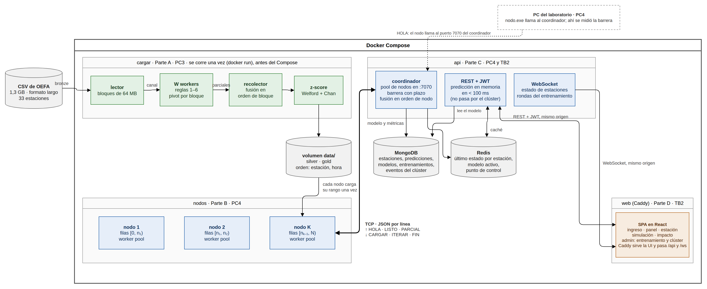
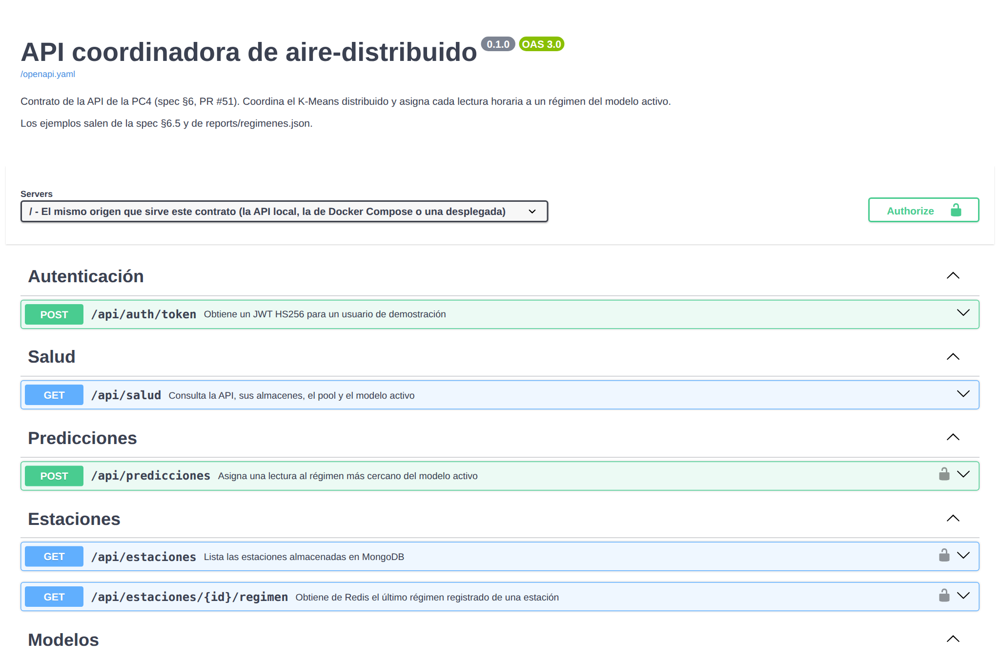
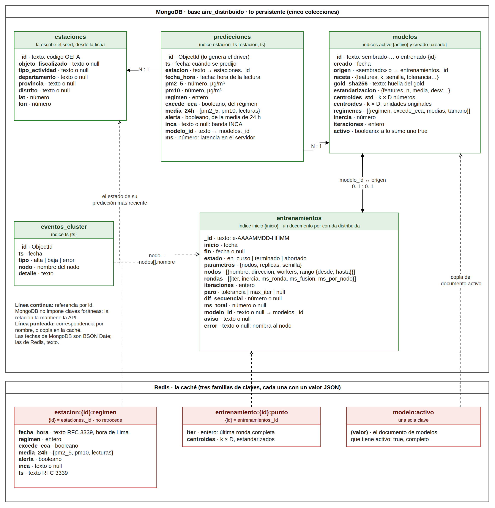
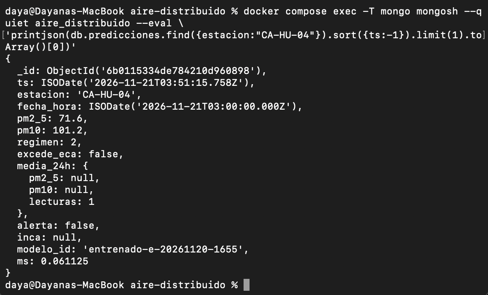
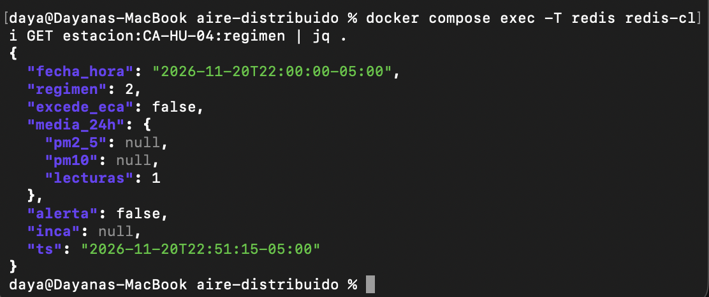
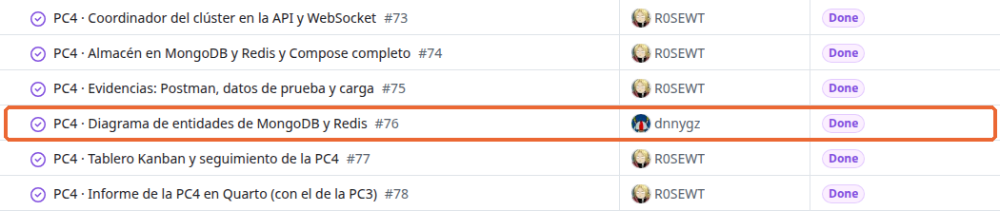
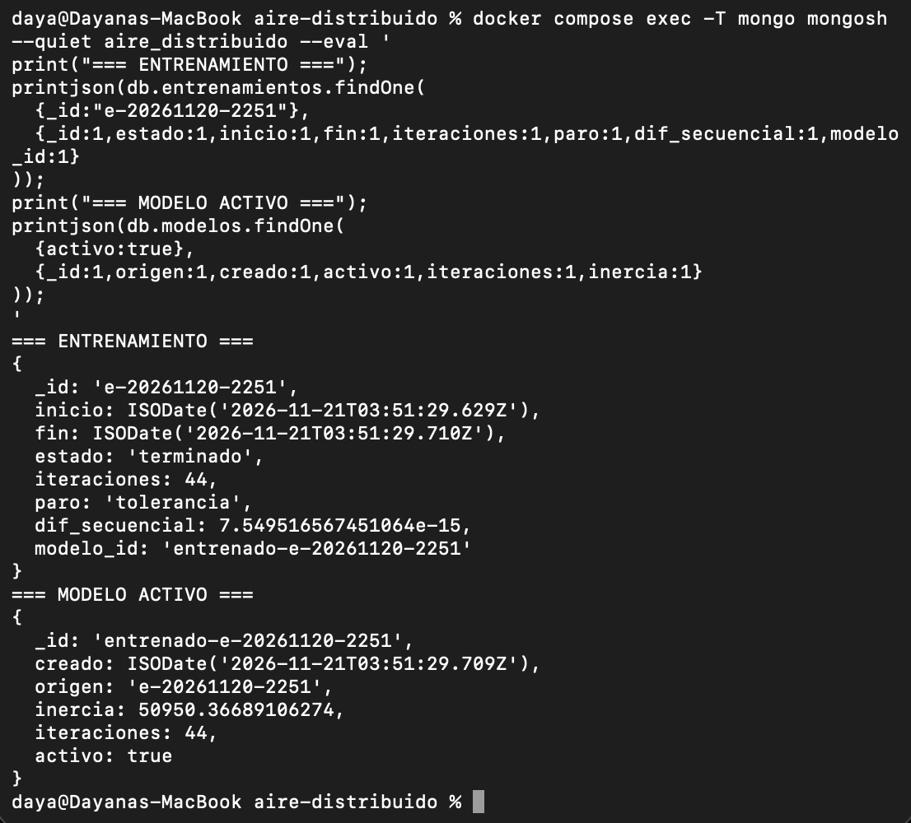
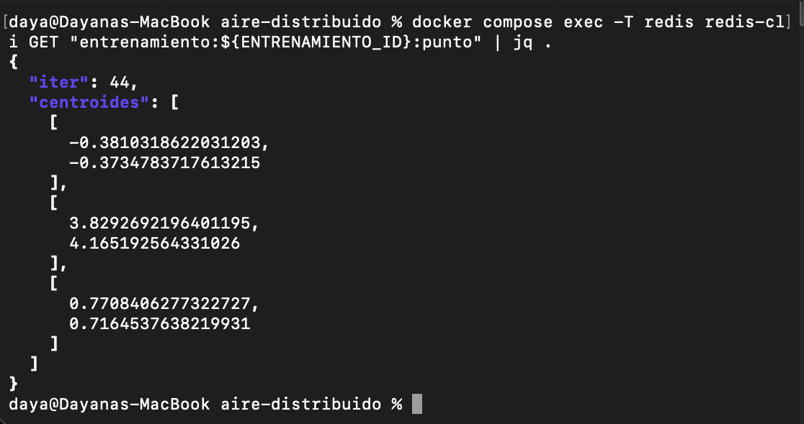

## {.center}

[Rody]{.quien}

[OEFA · calidad del aire · ]{.eyebrow}

::: {.pregunta}
¿En qué estaciones de OEFA y a qué horas el aire entra en el nivel alto de PM2,5/PM10, y **con
cuánta anticipación** eso avisa de un episodio que supera el ECA?
:::

::: {.chips .fragment}
[PC3: el dato y el K-Means en una máquina]{.chip} [PC4: el clúster, la API y las bases]{.chip .on}
[TB2: la interfaz, las alertas y el impacto]{.chip}
:::

::: {.fragment .sub style="font-size: 0.9em; margin-top: 0.8em;"}
Los nodos reciben el gold de la PC3:  horas de
 estaciones con PM2,5 y PM10, sacadas de
 filas del CSV de OEFA.
:::

::: notes
[0:40 · Rody, desde la portada] Buenas. Somos el Equipo 4: Dayana, Julio y yo, Rody. Caso 10,
calidad del aire de OEFA, y esta es nuestra pregunta: en qué estaciones y a qué horas el aire entra
en el nivel alto de material particulado, y con cuánta anticipación eso avisa de un episodio que
supera el ECA.
[clic] En la PC3 limpiamos el CSV y entrenamos el K-Means concurrente en una máquina. La PC4, que
presentamos hoy, lo lleva a un clúster de nodos que se hablan por sockets TCP, detrás de una API
coordinadora con MongoDB y Redis. La interfaz y las alertas son del TB2.
[clic] Lo que reciben los nodos es el gold de la PC3: 65 873 horas de 17 estaciones, sacadas de
casi 2,9 millones de filas.
:::

## Lo que nos observaron en la PC4, y dónde está la respuesta hoy

[Rody]{.quien}

::: {.eval}
| Observación (resumida) | Lo que mostramos ahora | Lámina |
|:--|:--|:-:|
| No se explica el código Go distribuido: `listen`, `dial`, puertos y patrones | `net.Listen` en el 7070 y el 8080, `Accept` en un bucle, el `DialContext` del nodo; la ronda con su `WaitGroup`; los patrones por su nombre | 7, 8 y 9 |
| «Incorrecto»: la analogía «los chunks pasan a ser nodos, el `WaitGroup` una barrera a través de la red y el canal una conexión TCP» | La quitamos. Lo literal: **entre procesos, sockets TCP; dentro de cada proceso, goroutines, canales y `WaitGroup`** | 8 |
| No se explica el código Go de la API ni cómo pasa la petición al clúster | El handler de la predicción, las rutas con sus roles, y los dos caminos: predecir **no** pasa por el clúster; entrenar, sí | 5, 11 y 12 |
| No se incluyen el Dockerfile ni el docker-compose; no se explica el despliegue | Los dos, con el porqué de cada decisión | 17 |
| No se ubica en el Kanban la tarea «Diagrama de entidades de MongoDB y Redis» | La tarjeta #76, marcada en la captura y con su enlace | 20 |
:::

::: notes
[0:50 · Rody] Antes de empezar: en la PC4 nos observaron cinco cosas, y las usamos como guion de
hoy. Uno: no explicamos el código distribuido con lo que se ve en clase, Listen, Dial y puertos;
ahora está el código de los sockets y los patrones. Dos: una analogía del informe era incorrecta,
la de que los chunks pasan a ser nodos; la quitamos y lo decimos literal: entre procesos, sockets;
dentro de cada proceso, goroutines, canales y WaitGroup. Tres: faltaba el código de la API y cómo
llega un pedido al clúster. Cuatro: el Dockerfile y el compose no estaban en el informe. Y cinco, la
tarjeta del diagrama de entidades: es la #76, hoy la mostramos marcada y con su enlace.
:::

## Arquitectura: las partes, en Docker Compose

[Rody]{.quien}

{.figura style="max-height: 440px;"}

::: {.chips}
[api · HTTP 8080]{.chip .on} [api · TCP 7070 para los nodos]{.chip .on} [nodo × K · solo sale]{.chip}
[mongo · 27017]{.chip} [redis · 6379]{.chip} [`--scale nodo=K`]{.chip}
:::

::: notes
[0:40 · Rody] La arquitectura. A la izquierda, lo de la PC3: el cargador concurrente deja el silver
y el gold. Lo de la PC4 es el centro: B, los nodos del K-Means, abajo; C, la API coordinadora,
arriba, con MongoDB y Redis. La SPA de la derecha llega en el TB2: en la PC4 el cliente era Postman.
Los puertos: la API escucha dos sockets, el 8080 para HTTP y el 7070 para los nodos, que es TCP puro.
El 7070 no está en ports: no se publica fuera de la red de Compose, que es donde están los nodos. (En
el laboratorio, el coordinador corrió fuera de Docker y escuchó en la IP de la PC: es la caja de
arriba.) MongoDB en el 27017 y Redis en el 6379. La cantidad de nodos es un parámetro: --scale nodo=K.
(Si el diagrama no se lee, Alt + clic lo amplía; en Linux, Ctrl + clic.)
:::

## El camino de un pedido

[Rody]{.quien}

[Predecir: no pasa por el clúster]{.flujo-t}

::: {.flujo}
::: {.web}
**Cliente**
Postman · el JWT va en `Authorization`
:::

::: {.flecha}
→
:::

::: {.api}
**API · `net/http` :8080**
ruta, JWT y rol (`401` / `403`)
:::

::: {.flecha}
→
:::

::: {.mem}
**En memoria**
modelo (`atomic.Pointer`) y media de 24 h
:::

::: {.flecha}
→
:::

::: {.base}
**Después de responder**
cola → MongoDB y Redis · WebSocket
:::
:::

[Entrenar (admin): sí pasa por el clúster]{.flujo-t}

::: {.flujo}
::: {.web}
**Cliente (admin)**
`POST /api/entrenamientos`
:::

::: {.flecha}
→
:::

::: {.api}
**API**
uno a la vez (si no, `409`) y toma K nodos del pool
:::

::: {.flecha}
→
:::

::: {.nodo}
**Nodos · TCP :7070**
`CARGAR` una vez, `ITERAR` → `PARCIAL` por ronda
:::

::: {.flecha}
→
:::

::: {.api}
**API**
fusiona en orden de nodo; activa el modelo si es el secuencial
:::

::: {.flecha}
→
:::

::: {.base}
**Cada ronda**
WebSocket · MongoDB · Redis
:::
:::

::: notes
[0:40 · Rody] Para que quede claro qué pasa con un pedido, dos caminos.
Arriba, una predicción: el cliente manda una lectura con su token; la API valida el token y el rol,
clasifica la lectura con el modelo que tiene en memoria, actualiza la media de 24 horas de esa
estación, también en memoria, y responde. La predicción NO pasa por el clúster: el modelo ya
entrenado vive en la API. Recién después de responder, la lectura va por una cola a MongoDB y Redis.
Abajo, un entrenamiento, que solo puede lanzar un admin: la API toma K nodos del pool, les manda su
rango una vez y después una ronda por iteración. Fusiona en orden de nodo y, si el modelo coincide
con el secuencial, lo activa. Ese es el trabajo del clúster: entrenar.
:::

## {background-color="#10233B" .center}

[Julio]{.quien}

[1 · Distribución]{.eyebrow}

::: {.pregunta}
Entre máquinas: sockets TCP, un protocolo de mensajes y una barrera con plazo
:::

::: notes
[0:05 · Julio] La distribución: cómo se hablan la API y los nodos.
:::

## Los sockets: la API escucha, el nodo llama

[Julio]{.quien}

:::: {.columns}
::: {.column width="58%"}
::: {.codigo}
[cmd/api/main.go · la API abre dos sockets de escucha: 7070 y 8080]{.archivo}

```go
lnNodos, err := net.Listen("tcp", op.nodosAddr) // ":7070"
ln, err := net.Listen("tcp", op.addr)           // ":8080"
```

[cluster/reunir.go · Accept en un bucle; cada conexión, en su goroutine, espera el HOLA (5 s)]{.archivo}

```go
for {
    conn, err := r.ln.Accept()
    if err != nil { return }
    e := protocolo.NuevoEnlace(conn)
    go r.saludar(e, conn.RemoteAddr().String())
}
```

[cmd/nodo/main.go · el nodo marca a api:7070; el coordinador nunca llama]{.archivo}

```go
marcador := &net.Dialer{Timeout: 3 * time.Second}
return marcador.DialContext(ctx, "tcp", *coordinador)
```
:::
:::

::: {.column width="42%"}
::: {.lista style="font-size: 0.6em;"}
- **Topología en estrella**: la API coordina; los nodos no se hablan entre sí. La fusión es una
  suma de parciales, y solo el coordinador la necesita
- **El nodo llama** (`Dial`): Colab está detrás de NAT, y el firewall de las PC del laboratorio
  bloquea las conexiones entrantes (abrirlas pide administrador); las de salida pasan. Si pierde la
  conexión, vuelve a llamar solo
- **Un mensaje = una línea de JSON** sobre la conexión TCP (`bufio` + `encoding/json` + `\n`),
  con `SetReadDeadline` y `SetWriteDeadline` para los plazos
- En el laboratorio, con  PC como nodos y el coordinador fuera de
  Docker, una ronda de `PING` a todos a la vez, sin cálculo, tarda ** ms**
  de mediana: lo que la barrera paga en red
:::
:::
::::

::: notes
[0:50 · Julio] Aquí están los sockets. La API abre dos con net.Listen: el 7070, TCP puro, para los
nodos, y el 8080 para HTTP. Una goroutine hace Accept en un bucle y cada conexión nueva se atiende
en su propia goroutine, que espera el HOLA del nodo con un plazo de 5 segundos.
El nodo es el que marca, con net.Dialer y DialContext hacia api:7070. Lo hicimos así porque Colab
está detrás de NAT y el firewall de Windows en las PC del laboratorio bloquea las conexiones
entrantes; las de salida pasan sin pedir nada. Y si el nodo pierde la conexión, vuelve a llamar solo.
La topología es una estrella: los nodos no se hablan entre sí, porque la fusión es una suma de
parciales y solo el coordinador la necesita. Cada mensaje es una línea de JSON sobre la conexión,
leída con un bufio.Reader y escrita con un bufio.Writer, con plazos de lectura y escritura del
propio socket. En el laboratorio, con 4 PC, una ronda de PING a todos a la vez, sin cálculo, tarda
medio milisegundo: eso es lo que la barrera paga en red.
:::

## Una ronda: dos niveles, y la fusión en orden de nodo

[Julio]{.quien}

:::: {.columns}
::: {.column width="55%"}
::: {.codigo .chico}
[protocolo/coordinador.go · una goroutine por nodo y un WaitGroup]{.archivo}

```go
var barrera sync.WaitGroup
barrera.Add(len(enlaces))
for i, e := range enlaces {
    go func() {
        defer barrera.Done()
        // ITERAR por su socket; lee el PARCIAL con plazo.
        // Solo escribe su índice: sin Mutex.
        parciales[i], errs[i] = e.ronda(iter, k,
            centroides, limite, plazo)
    }()
}
barrera.Wait()
```

[cluster/lloyd.go · después de la barrera, la misma función que en una máquina]{.archivo}

```go
p := kmeans.Fusionar(ps, k, dim) // en orden de nodo, no de llegada
```
:::
:::

::: {.column width="45%"}
| Mensaje | Sentido |
|:--|:--|
| `HOLA` | nodo → API |
| `CARGAR` / `LISTO` | su rango del gold, una vez |
| `ITERAR` | API → nodo, con los centroides |
| `PARCIAL` | sumas, conteos e inercia |
| `FIN`, `PING`/`PONG`, `ERROR` | cierre, latido y falla |

::: {.lista style="font-size: 0.56em; margin-top: 0.5em;"}
- **Entre procesos**, sockets TCP. **Dentro de cada proceso**, goroutines, canales y `WaitGroup`:
  cada nodo calcula su parcial con su propio worker pool, el de la PC3
- Con 1 nodo, el modelo es el de una máquina **bit a bit**; con hasta
  , en el orden de 10⁻¹⁵ (a lo sumo
   en `cmd/distribuido`), porque agrupar por nodo cambia el
  orden de la suma. La API exige ≤ 
:::
:::
::::

::: notes
[0:50 · Julio] Así es una ronda en el coordinador. Por cada nodo se lanza una goroutine: escribe el
ITERAR en el socket de su nodo y se bloquea leyendo el PARCIAL, con un plazo. Cada goroutine escribe
solo en su índice del arreglo, así que no hace falta Mutex. Un WaitGroup espera a todas: esa es la
barrera. Si un nodo no responde a tiempo, la ronda se aborta con un error que lo nombra.
Después de la barrera, el coordinador llama a Fusionar en orden de nodo: la misma función que suma
los chunks en una sola máquina; como los parciales se agrupan por nodo, el orden de la suma cambia.
Y esto es lo que antes dijimos mal: el chunk no «pasa a ser» un nodo. Son dos niveles: entre
procesos usamos sockets TCP, y dentro de cada proceso, goroutines, canales y WaitGroup. Cada nodo
calcula su parcial con su propio worker pool, el mismo de la PC3.
Resultado: con un nodo, el modelo distribuido es el de una máquina bit a bit; con hasta 4 nodos
difiere en el orden de 10 a la menos 15, que es redondeo, muy por debajo de la tolerancia de 10 a la
menos 9 que la API exige para activar un modelo.
:::

## Los patrones de Go, por su nombre

[Julio]{.quien}

| Patrón | Dónde | Con qué |
|:--|:--|:--|
| Accept loop | pool de nodos (`cluster/reunir.go`) | `net.Listener`, una goroutine por conexión |
| Fan-out / fan-in con plazo | ronda del clúster (`protocolo/coordinador.go`) | una goroutine por conexión TCP; `WaitGroup` |
| Worker pool con barrera | cada nodo (`kmeans/nodo.go`) y el K-Means de la PC3 (`kmeans/concurrente.go`) | canal de chunks; `WaitGroup` |
| Bucle de eventos con `select` | pool de nodos (`cluster/pool.go`) | canal de llegadas, `time.Ticker` del latido |
| Hub de difusión | WebSocket (`api/hub.go`) | canales de alta, baja y difusión |
| Escritura asíncrona por lotes | persistencia (`api/escritor.go`) | una cola con búfer y una goroutine por base |
| Publicación sin lock | modelo activo (`api/servidor.go`) | `atomic.Pointer` |
| Exclusión mutua donde hay estado compartido | ventana de 24 h, pool, hub | `sync.Mutex` y `sync.RWMutex` |
| Pipeline productor–consumidor y semáforo | cargador de la PC3 (`datos/pipeline.go`) | canales `trabajos` y `resultados`; canal con búfer de 2W |

::: notes
[0:30 · Julio] Y los patrones, con el nombre con que los vimos en clase. Del lado distribuido: el
Accept loop, que atiende cada conexión en su goroutine; el fan-out y fan-in con plazo de cada ronda;
el worker pool con barrera dentro de cada nodo; y un bucle de eventos con select en el pool, que
recibe las llegadas y hace el latido con un Ticker. En la API: el hub del WebSocket, la escritura a
las bases por una cola con búfer, el modelo publicado con un atomic.Pointer, y Mutex solo donde hay
estado compartido de verdad: la ventana de 24 horas, el pool y el hub.
:::

## {background-color="#10233B" .center}

[Julio]{.quien}

[2 · La API]{.eyebrow}

::: {.pregunta}
La API coordinadora en Go: `net/http`, JWT, Swagger y menos de 100 ms
:::

::: notes
[0:05 · Julio] La API.
:::

## La API en Go: el handler de una predicción

[Julio]{.quien}

:::: {.columns}
::: {.column width="58%"}
::: {.codigo .chico}
[api/servidor.go · rutas de `net/http`, cada una con los roles que admite]{.archivo}

```go
s.ruta("POST /api/predicciones", cualquiera, s.predecir)
s.ruta("POST /api/entrenamientos", []string{RolAdmin},
    s.iniciarEntrenamiento)
s.ruta("GET /ws", nil, s.seguirEventos) // token en el apretón
```

[api/rutas.go · predecir: nada del camino espera a una base ni al clúster]{.archivo}

```go
m := s.modelo.Load() // atomic.Pointer: sin lock
reg, err := m.Predecir(modelo.Lectura{
    Estacion: l.estacion, PM25: l.pm25, PM10: l.pm10})
media := s.ventanas.Agregar(l.estacion, l.fechaHora,
    l.pm25, l.pm10) // la media de 24 h, en memoria
s.escritor.encolar(almacen.Prediccion{ /* … */ })
s.responder(w, r, http.StatusOK, /* … */)
```

[api/escritor.go · si la cola está llena, se descarta y se cuenta: el pedido no espera]{.archivo}

```go
select {
case c.ch <- p:
    return true
default:
    c.descartadas.Add(1)
    return false
}
```
:::
:::

::: {.column width="42%"}
::: {.lista style="font-size: 0.6em;"}
- `ruta` envuelve cada handler con la verificación del JWT (HS256, `crypto/hmac`) y la medición
  de latencia por ruta
- El modelo se reemplaza con un `Store` atómico al terminar un entrenamiento: las predicciones en
  curso terminan con el anterior
- El WebSocket está escrito sobre `net/http` (RFC 6455, `Hijack`): un hub con canales de alta,
  baja y difusión
- Los drivers de MongoDB y Redis son la única dependencia externa, y solo en `almacen/`
:::
:::
::::

::: notes
[0:50 · Julio] Este es el código de la API. Cada ruta se registra en el mux de net/http con los roles
que admite; la función ruta la envuelve con la verificación del JWT y con la medición de latencia.
Una predicción hace cuatro cosas: lee el modelo de un atomic.Pointer, sin lock; clasifica la lectura
con el centroide más cercano; actualiza la media de 24 horas de la estación, en memoria; y encola la
predicción para guardarla. Responde sin esperar a MongoDB ni a Redis, y sin pasar por el clúster.
La cola es un canal con búfer: si se llena, se descarta y se cuenta, pero el pedido no espera.
El WebSocket también es nuestro, sobre net/http: un hub con canales de alta, baja y difusión. Lo
único que no es biblioteca estándar son los drivers de MongoDB y Redis.
:::

## El contrato: Swagger en `/docs` y las rutas con su rol

[Julio]{.quien}

:::: {.columns}
::: {.column width="50%"}
{.captura style="max-height: 470px;"}
:::

::: {.column width="50%"}
| Ruta | Quién |
|:--|:--|
| `POST /api/auth/token`, `GET /api/salud`, `GET /docs`, `GET /openapi.yaml` | libre |
| `POST /api/predicciones`, `GET /api/estaciones`, `GET /api/estaciones/{id}/regimen`, `GET /api/modelos/activo`, `GET /ws` | usuario o admin |
| `POST /api/entrenamientos`, `GET /api/entrenamientos`, `GET /api/entrenamientos/{id}`, `GET /api/metricas`, `GET /api/cluster/nodos` | admin |

::: {.lista style="font-size: 0.56em; margin-top: 0.5em;"}
- Contrato OpenAPI 3 en `docs/api/openapi.yaml`: la API lo sirve y Swagger UI lo muestra
- Sin token, `401`; con un rol que no alcanza, `403`; un segundo entrenamiento a la vez, `409`
- Postman: la colección de `docs/postman/` con sus pruebas, y el Runner con
   lecturas de prueba
:::
:::
::::

[Las 14 rutas del tag `pc4`. Hoy son : `POST /api/auth/invitado`, `GET /api/regimenes` y `GET /api/cluster/eventos` llegaron con la interfaz del TB2.]{.nota}

::: notes
[0:25 · Julio] El contrato está en OpenAPI y la misma API lo sirve en /docs con Swagger UI, que es lo
que ven aquí. Cada ruta tiene su rol: libres, de usuario y de admin. Sin token responde 401; con un
token de usuario en una ruta de admin, 403; y si piden un segundo entrenamiento mientras corre otro,
409. En Postman está la colección con sus pruebas y el Runner con 78 lecturas de prueba; lo
mostramos en vivo en la demo.
:::

## La API responde en menos de 100 ms, con 64 clientes a la vez

[Julio]{.quien}

::: {.d3 data-grafico="latencia"}
:::

[ pedidos a `POST /api/predicciones` con JWT ( por nivel), medidos del lado del cliente con `cmd/carga`:  sobre el límite y  errores. Mientras tanto, la cola de cada base procesó  predicciones (los pedidos y el calentamiento),  descartadas: MongoDB las insertó todas; Redis se queda con el último régimen de cada estación.]{.nota}

::: notes
[0:30 · Julio] Y la medición. 80 000 pedidos de predicción, con 1, 4, 16 y 64 clientes a la vez. La
escala es logarítmica: con 64 clientes, el 99 % de los pedidos responde en 3,1 milisegundos, más de
30 veces por debajo del límite de 100. Ninguno pasó el límite, ninguno falló, y en esa corrida las
colas no descartaron ninguna predicción: MongoDB las insertó todas, y Redis, que guarda solo el
último régimen de cada estación, las procesó todas.
:::

## {background-color="#10233B" .center}

[Dayana]{.quien}

[3 · Bases de datos]{.eyebrow}

::: {.pregunta}
MongoDB guarda lo que tiene que durar; Redis, lo que se lee rápido
:::

::: notes
[0:05 · Dayana] Las bases de datos.
:::

## MongoDB persiste, Redis es la caché

[Dayana]{.quien}

:::: {.columns}
::: {.column width="62%"}
{.figura style="max-height: 520px; margin-top: 0.4em;"}
:::

::: {.column width="38%"}
::: {.dos .apilado}
::: {}
[MongoDB ·  colecciones]{.t}

`estaciones`, `predicciones`, `modelos`, `entrenamientos` y `eventos_cluster`: lo que tiene que
durar, con  índices.
:::

::: {}
[Redis ·  tipos de clave]{.t}

`estacion:{id}:regimen` (el último de cada estación), `modelo:activo` (arranque en caliente) y
`entrenamiento:{id}:punto` (los centroides de la última ronda; todavía no se reanuda desde ahí).
:::

::: {}
[Cómo escribe la API]{.t}

Una cola con búfer y una goroutine por base, por lotes de hasta :
una base lenta no frena a la otra ni al pedido.
:::
:::
:::
::::

::: notes
[0:40 · Dayana] Dos niveles de almacenamiento, como pide el enunciado. MongoDB guarda lo que tiene
que durar: el catálogo de estaciones, cada predicción, los modelos, el historial de entrenamientos
con sus rondas y las altas y bajas de los nodos.
Redis es la caché: el último régimen de cada estación, que es lo que se consulta más seguido; una
copia del modelo activo, para que la API arranque con el último entrenado; y los centroides de la
última ronda de un entrenamiento, aunque todavía no se reanuda desde ahí.
La API escribe con una goroutine y una cola por base: si una se pone lenta, no frena a la otra ni al
pedido. Este es el diagrama de la tarjeta #76 del tablero.
:::

## Los registros: la misma predicción en las dos bases

[Dayana]{.quien}

:::: {.columns}
::: {.column width="52%"}
{.captura style="max-height: 430px;"}

[MongoDB · `db.predicciones`, la última de CA-HU-04: la lectura, el régimen, la media de 24 h y el modelo que la clasificó]{.nota style="display: block; margin-top: 0.4em;"}
:::

::: {.column width="48%"}
{.captura style="max-height: 300px;"}

[Redis · `GET estacion:CA-HU-04:regimen`: solo el último estado de la estación. El `ts` es el mismo instante que en MongoDB (22:51:15 en Lima, 03:51:15 en UTC)]{.nota style="display: block; margin-top: 0.4em;"}

::: {.lista style="font-size: 0.56em; margin-top: 0.5em;"}
- Las bases y el `seed` corren en el mismo Docker Compose; el `seed` crea las colecciones, los
  índices y el catálogo de  estaciones
:::
:::
::::

[Capturas de la terminal tomadas el 20/11/2026 sobre el Compose del repositorio (`docs/informe/capturas/pc4/`).]{.nota}

::: notes
[0:30 · Dayana] Y los registros reales. A la izquierda, MongoDB: la última predicción de la estación
CA-HU-04, con la lectura, el régimen, la media de 24 horas y el modelo que la clasificó. A la
derecha, Redis: para la misma estación guarda solo el último estado. Es la misma predicción: el
instante en que se escribió coincide; MongoDB lo muestra en UTC y Redis en hora de Lima. Las bases
corren en el mismo Compose, y un seed crea las colecciones, los índices y el catálogo de las 33
estaciones antes de que arranque la API.
:::

## Docker: un Dockerfile y un Compose

[Dayana]{.quien}

:::: {.columns}
::: {.column width="50%"}
::: {.codigo .chico}
[Dockerfile · dos etapas: compilar con Go, ejecutar en distroless (extracto)]{.archivo}

```dockerfile
FROM golang:1.26 AS build
COPY go.mod go.sum ./
RUN go mod download            # su propia capa
COPY . .
RUN CGO_ENABLED=0 go build -trimpath \
    -ldflags="-s -w" -o /out/bin/ ./cmd/...
FROM gcr.io/distroless/static-debian12:nonroot
COPY --from=build /out/bin/ /usr/local/bin/
USER nonroot:nonroot
```
:::

::: {.lista style="font-size: 0.54em; margin-top: 0.4em;"}
- Una sola imagen para la API y los nodos (y el cargador de la PC3): binarios estáticos, sin
  shell, usuario sin privilegios
- El gold no va en la imagen: se monta de solo lectura
:::
:::

::: {.column width="50%"}
::: {.codigo .chico}
[docker-compose.yml · los servicios del clúster (extracto)]{.archivo}

```yaml
api:
  command: ["api", "-addr", ":8080", "-nodos-addr", ":7070", …]
  expose: ["7070"]                  # no está en ports
  ports: ["127.0.0.1:${API_PORT:-8080}:8080"]
  depends_on:
    mongo: {condition: service_healthy}
    redis: {condition: service_healthy}
    seed:  {condition: service_completed_successfully}
  healthcheck:
    test: ["CMD", "api", "-salud"]  # distroless: sin curl
nodo:
  image: aire-distribuido           # la misma imagen
  command: ["nodo", "-coordinador", "api:7070", …]
  # sin ports: solo abre la conexión de salida
```
:::

::: {.chips style="margin-top: 0.4em;"}
[`docker compose up -d --build --scale nodo=3`]{.chip} [``]{.chip}
[``]{.chip} [`seed` con `mongosh`]{.chip}
:::
:::
::::

::: notes
[0:45 · Dayana] El despliegue, que en la PC4 no mostramos. Un Dockerfile de dos etapas: la primera
compila con Go todos los comandos, como binarios estáticos; la segunda los copia a una imagen
distroless, sin shell y con un usuario sin privilegios. Es una sola imagen para la API y los nodos.
En el compose, la API escucha el 8080 y el 7070; el 7070 no está en ports, así que solo lo ven los
nodos de la red de Compose. La API arranca cuando MongoDB y Redis están sanos y el seed terminó, y
su healthcheck es la propia API, porque la imagen no tiene curl. El nodo usa la misma imagen, llama
a api:7070 y no publica ningún puerto. Con --scale nodo=3 se levantan tres nodos.
(Los puertos de Mongo y Redis se publican solo en 127.0.0.1: es un entorno de desarrollo.)
:::

## Evidencias

[Dayana]{.quien}

::: {.eval}
| Qué se probó | Cómo | Resultado |
|:--|:--|:--|
| Condiciones de carrera | `go test -race -short ./...` en cada push y PR (CI) | ninguna detectada en las  funciones que compila el CI; las  de integración piden MongoDB y Redis y corren aparte |
| Distribuido frente a secuencial | `cmd/distribuido` con 1 a  nodos | 1 nodo: bit a bit; hasta : ≤  (tolerancia ) |
| La red del clúster en el laboratorio | `cmd/smoke`,  PC,  rondas de `PING` | p50 de  ms por ronda |
| API en menos de 100 ms | `cmd/carga`,  pedidos, 1 a  clientes | p99 ≤  ms;  sobre el límite |
| La API de punta a punta | Postman y newman,  lecturas de prueba |  casos, de  estaciones |
| Registros en las bases | `mongosh` y `redis-cli` sobre el Compose | la misma predicción en MongoDB y en Redis (lámina 16) |
| El código, sobre sockets reales | `go test -race -run SobreTCP ./protocolo/` | un coordinador y un nodo sobre TCP en `127.0.0.1` |
:::

::: notes
[0:40 · Dayana] Las evidencias, en una tabla. El CI corre las pruebas de Go con el detector de
carreras en cada push y en cada PR: compila 524 funciones de prueba, y el detector no encuentra
ninguna carrera en lo que ejercitan; las 25 de integración piden MongoDB y Redis y se corren aparte.
El distribuido da el mismo modelo que el secuencial: bit a bit con un nodo, y con hasta cuatro, a 10
a la menos 15. En el laboratorio, con 4 PC, una ronda de PING tarda medio milisegundo. La API, menos
de 100 ms con 64 clientes. La colección de Postman, con sus datos de prueba, recorre la API de punta
a punta. Y las pruebas del protocolo corren también sobre TCP real, en la misma máquina.
:::

## Demo en vivo · Docker Compose en la laptop

[Rody conduce]{.quien}

::: {.demo-tabla}
| | Qué se muestra | Narra | |
|:-|:-----------------------------------|:-|-:|
| 1 | `docker compose ps`: `api`, `mongo` y `redis` sanos, tres `nodo` arriba, `seed` terminado | Rody | 0:20 |
| 2 | `docker compose logs nodo`: cada nodo «conectado desde IP:puerto a IP:7070» | Julio | 0:20 |
| 3 | Postman: el token de usuario y `POST /api/predicciones` → `200`, el régimen y los ms | Julio | 0:30 |
| 4 | El mismo token en `POST /api/entrenamientos` → `403`; con el de admin → `202`, y en `logs -f nodo` el `CARGAR` y la primera `ITERAR` | Julio | 0:40 |
| 5 | `mongosh`: la última predicción; `redis-cli GET estacion:…:regimen`: la misma | Dayana | 0:30 |
:::

::: {.planb}
**Plan B si falla Docker:** las capturas de las láminas 12 y 16, y
`go test -race -run SobreTCP -v ./protocolo/`, que corre un coordinador y un nodo sobre TCP real en
`127.0.0.1`.
:::

::: notes
[2:20 · Rody conduce la laptop; cada uno narra su parte] El Compose se levanta antes de la clase con
docker compose up -d --scale nodo=3, y Julio deja corriendo docker compose logs -f --tail 0 nodo en
otra pestaña antes del paso 4: con varios nodos, un --tail corto cortaría el CARGAR. Postman con el
entorno «aire-distribuido - local» y las claves cargadas (que no se vean en pantalla). Si el tiempo
aprieta, la demo se queda con los pasos 3 y 5.
:::

## El proceso: informe, GitHub y Kanban

[Rody]{.quien}

::: {.tres style="margin-top: 0.4em;"}
::: {}
[Git Flow]{.t}

Cada tarea en su rama, que entra a `develop` por PR; la entrega sale de `release/pc4` a `main`, con
el tag `pc4` (21/11/2026).
:::

::: {}
[El informe]{.t}

La estructura a) a j) del enunciado, con el informe de la PC3 y sus correcciones adentro: el
criterio de documentación.
:::

::: {}
[El tablero]{.t}

Una tarjeta por tarea, con su responsable y su estado. Abajo, la tarea que nos observaron.
:::
:::

{.captura style="width: 100%; margin-top: 0.6em;"}

[Proyecto «aire-distribuido · Trabajo Final CC65», filtro `PC4`. La tarjeta #76, en *Done*:
<https://github.com/R0SEWT/aire-distribuido/issues/76>]{.nota}

::: notes
[0:40 · Rody] Por último, el proceso. Trabajamos con Git Flow: cada tarea en su rama, que entra a
develop por pull request; la entrega salió de la rama release/pc4 a main, con el tag pc4. El informe
sigue la estructura del enunciado y lleva dentro el de la PC3 con las correcciones.
Y el tablero: una tarjeta por tarea, con su responsable. Aquí está la #76, el diagrama de entidades
de MongoDB y Redis, a cargo de Dayana, en Done; es el diagrama de la lámina 15. Dejamos el enlace
directo a la tarjeta.
:::

## {background-color="#10233B"}

[Rody]{.quien}

:::: {.columns}
::: {.column width="70%"}
[Lo que nos llevamos de la PC4]{.eyebrow}

::: {.lista style="font-size: 0.78em;"}
- Repartir es fácil. Lo difícil es que el resultado no dependa de cómo se repartió: fusionar
  siempre en el mismo orden. Con 1 nodo, bit a bit; con 4, a 10⁻¹⁵.
- Un sistema rápido es el que no espera: el modelo en memoria y las bases fuera del camino del
  pedido.
- Contarlo con las palabras de clase: `Listen`, `Dial`, puertos y patrones, no con analogías.
:::

[Lo que sigue en el TB2]{.eyebrow style="margin-top: 0.9em; display: block;"}

::: {.lista style="font-size: 0.66em;"}
- La interfaz en React sobre esta API, las alertas por WebSocket y lo que el sistema responde sobre
  el aire
:::
:::

::: {.column width="30%" .centro}
{.qr}

[github.com/R0SEWT/aire-distribuido]{.nota}

[¿Preguntas?]{.pregunta style="display: block; margin-top: 0.6em;"}
:::
::::

::: notes
[0:30 · Rody] Tres cosas que nos llevamos de la PC4. Repartir el trabajo es fácil; lo difícil es que
el resultado no dependa de cómo se repartió, y eso se logra fusionando siempre en el mismo orden: con
un nodo sale bit a bit, y con cuatro, a 10 a la menos 15. Un sistema rápido es el que no espera: el
modelo en memoria y las bases de datos fuera del camino del pedido. Y la lección de la nota:
contarlo con las palabras de clase, no con analogías.
En el TB2, la interfaz sobre esta misma API. Gracias; ¿preguntas?
:::

# Respaldo {.respaldo background-color="#10233B"}

## Los plazos del clúster y qué pasa si un nodo cae {.respaldo}

[Respaldo · cmd/api y cluster/]{.eyebrow}

| Plazo | Valor | Qué protege |
|:--|--:|:--|
| HOLA de una conexión nueva |  s | una conexión que no se presenta no ocupa una goroutine para siempre |
| CARGAR → LISTO |  s | la primera barrera: todos tienen su rango en memoria |
| Ronda ITERAR → PARCIAL |  s | la barrera de cada iteración |
| Latido PING → PONG, cada  s |  s | detectar a un nodo libre que se fue |

::: {.lista style="font-size: 0.6em; margin-top: 0.6em;"}
- Si un nodo cae o no responde a tiempo, la ronda se aborta con un error que lo nombra y **no hay
  modelo**: no reasignamos el rango del nodo caído. Los nodos vuelven a llamar solos y se relanza con
  los que queden
- Un `PARCIAL` que llega tarde de una ronda abortada se reconoce por su número y se descarta
- Los centroides de cada ronda quedan en Redis, pero todavía no se reanuda desde ahí: se relanza
- Un entrenamiento a la vez: un semáforo (canal con búfer de 1); el segundo pedido recibe `409`
:::

## Cuándo conviene repartir {.respaldo}

[Respaldo · reports/smoke_lab_4.json y reports/kmeans_distribuido_local_N.json]{.eyebrow}

::: {.lista style="font-size: 0.68em;"}
- Una ronda de `PING` a  PC del laboratorio, sin cálculo:
   ms de mediana; la ida y vuelta a cada nodo, entre  y
   ms
- Una iteración sobre todo el gold en una sola máquina con  workers:
   ms
- Con  filas, la red cuesta tanto como el cómputo: con esta tabla,
  repartir no acelera. El clúster se justifica cuando cada nodo tiene mucho más que calcular: con
   réplicas del gold (
  filas) llega a los mismos centroides
- La fusión y la actualización, lo que el coordinador hace en serie, tardan
   ms: el costo de la ronda es la red, no la suma
:::

## Dentro de cada nodo: el worker pool de la PC3 {.respaldo}

[Respaldo · kmeans/concurrente.go y kmeans/nodo.go]{.eyebrow}

::: {.d3 data-grafico="pool" data-w="4"}
:::

[Ilustrativo: los tiempos no son mediciones. Cada nodo corre este mismo pool sobre su rango del gold.]{.nota}

## El mismo resultado bit a bit para todo W {.respaldo}

[Respaldo · reports/benchmark_kmeans.json]{.eyebrow}

:::: {.columns}
::: {.column width="64%"}
::: {.d3 data-grafico="speedup" data-series="kmeans_1000,kmeans_10000"}
:::
:::

::: {.column width="36%"}
[]{.cifra .chica}

::: {.sub}
inercia, idéntica bit a bit con  workers y el mismo chunk
:::

::: {.lista style="margin-top: 0.7em;"}
- × con 12 workers, hasta converger en
   iteraciones
- `go test -race` no detecta carreras al actualizar los centroides
:::
:::
::::

## Un entrenamiento en MongoDB y su punto en Redis {.respaldo}

[Respaldo · docs/informe/capturas/pc4/]{.eyebrow}

::: {.apps style="grid-template-columns: 1fr 1fr;"}
::: {}
{.captura style="max-height: 440px;"}

[MongoDB · `entrenamientos` y `modelos`]{.pie}
:::

::: {}
{.captura style="max-height: 440px;"}

[Redis · los centroides de la última ronda de un entrenamiento]{.pie}
:::
:::
